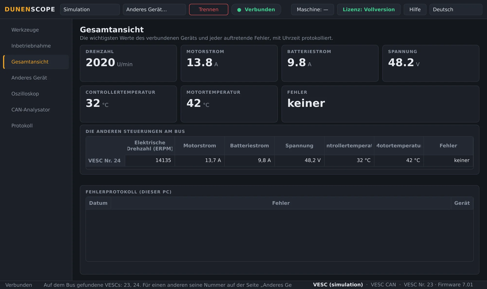
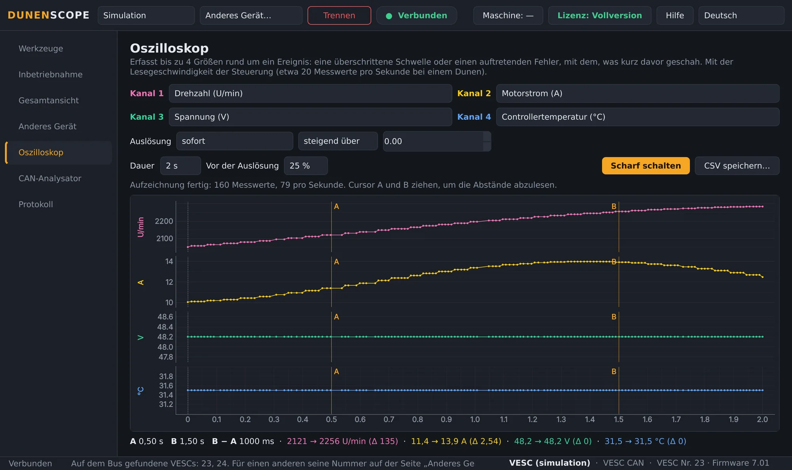
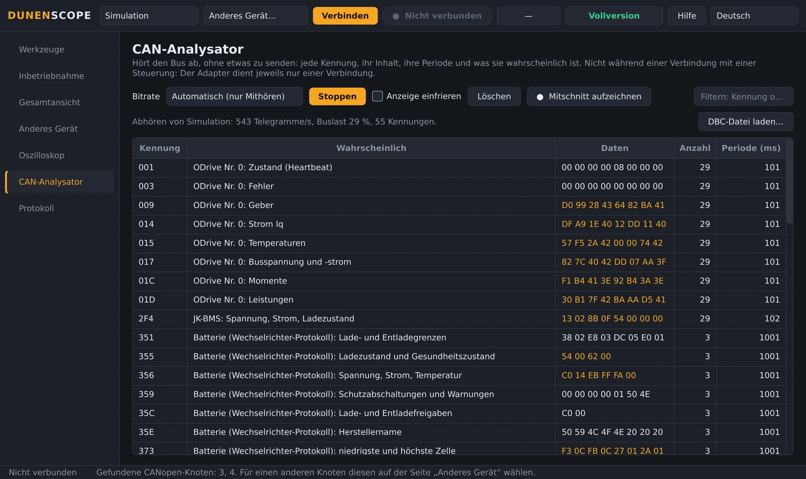
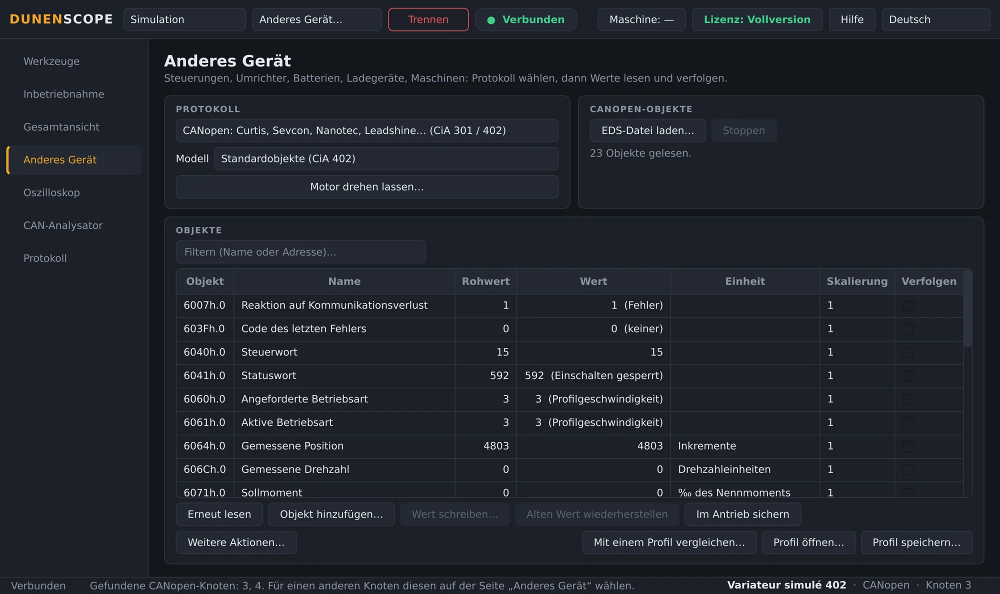
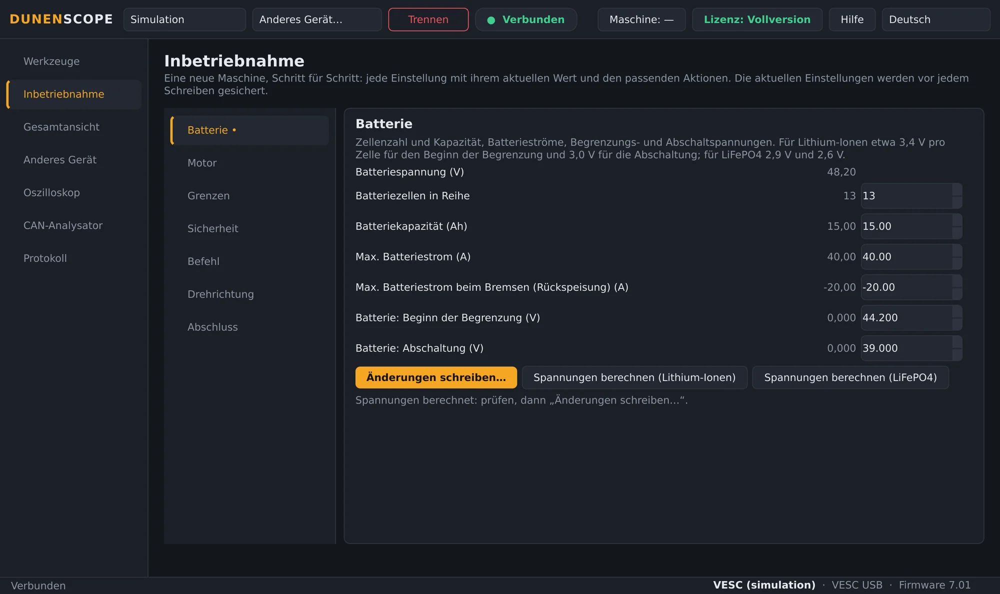
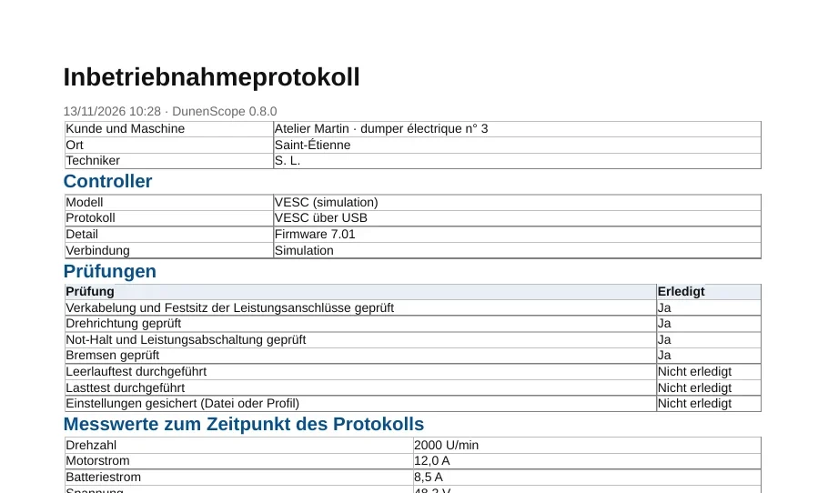
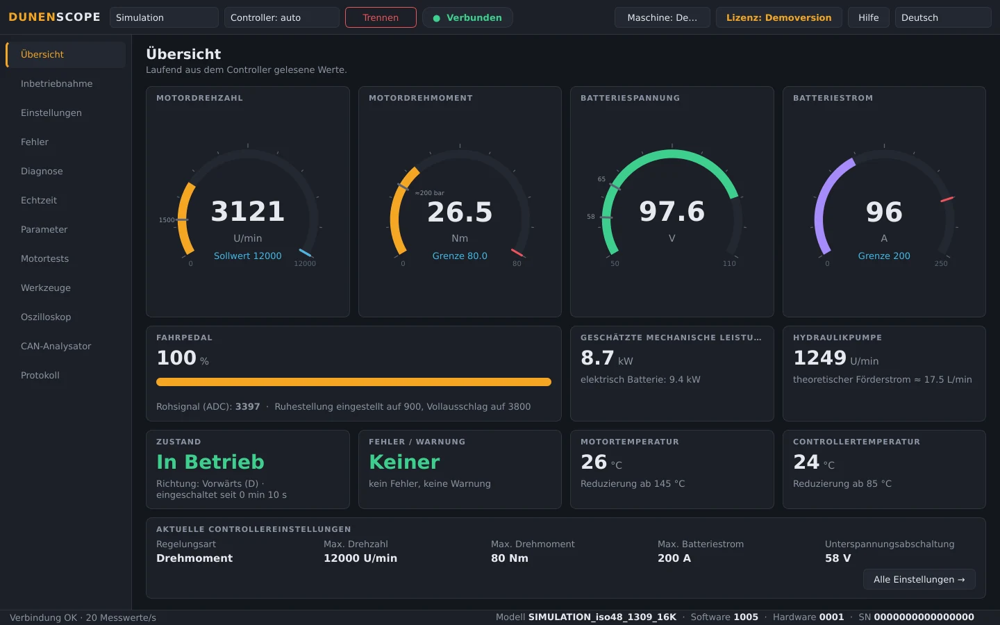
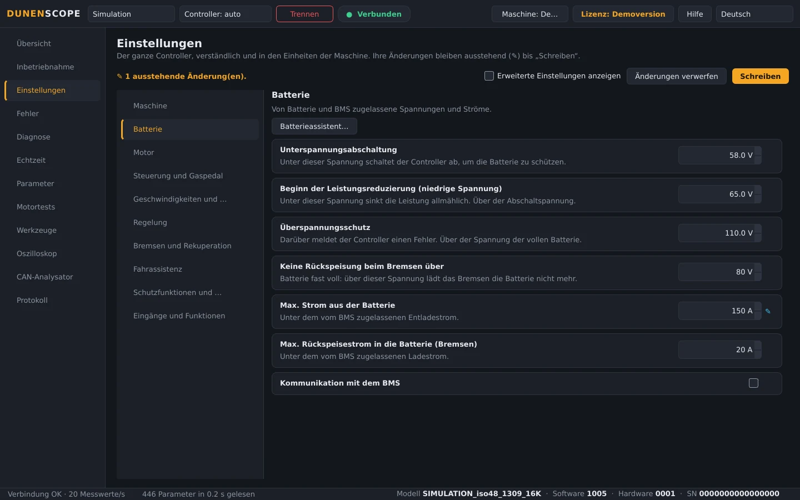

<a href="README.md">English</a> · <a href="README.fr.md">Français</a> · <a href="README.zh.md">中文</a> · <a href="README.es.md">Español</a> · <b>Deutsch</b> · <a href="README.it.md">Italiano</a> · <a href="README.pt.md">Português (BR)</a> · <a href="README.ru.md">Русский</a> · <a href="README.ja.md">日本語</a> · <a href="README.ko.md">한국어</a>

Windows 10 / 11 · 64 Bit · Lesen kostenlos

## Diagnose und Einstellung von Motorcontrollern, Antrieben und Batterien

DunenScope macht aus einem Windows-PC und einem CAN-, USB- oder RS-485-Adapter einen Diagnose- und Einstellplatz: Dunen-Controller, mit VESC® Software kompatible Controller, CANopen®- und Modbus-Antriebe, Kelly, Curtis, Sevcon, BMS und Ladegeräte. Es erklärt jeden Fehler, speichert, was kurz davor geschah, richtet die Maschine Schritt für Schritt ein und erstellt das Inbetriebnahmeprotokoll.

## Das Video (46 s)

 <a href="https://github.com/simonlabrossedu71-tech/DunenScope/raw/main/docs/video/DunenScope_presentation_en.mp4">Ganzes Video mit Ton herunterladen (MP4, 16 MB)</a>

## Was es lesen und einstellen kann

Wählen Sie das Gerät auf der Seite **Anderes Gerät** (oder lassen Sie DunenScope einen Dunen erkennen):

**Motorcontroller**

- **Dunen / ELYX** — 446 Parameter, Einstellung, geführte Inbetriebnahme, Motortests, PI-Einstellung
- **Kompatibel mit VESC® Software** — über USB oder CAN: Einstellung, geführte Inbetriebnahme, Motorerkennung
- **Kelly KLS-D, KAC, KBL / KHB** — über CAN oder serielle Verbindung: Messwerte und Fehler
- **Votol EM, Fardriver, Bafang (M-Motoren), ODrive** — Messwerte und Fehler

**Industrieantriebe**

- **CANopen®-Antriebe CiA 402** — Nanotec, Leadshine…: Objekte aus dem Profil oder der EDS-Datei, Einstellung, Motortest
- **Curtis 1232E bis 1239E, Sevcon Gen4** — CANopen, nur Lesen: Messwerte und Fehler
- **Modbus RTU und TCP** — Schneider ATV320, ASI BAC / Phaserunner, Sabvoton…: Register, Spulen und Eingänge

**Batterien und Ladegeräte**

- **BMS JK, Daly, JBD / Xiaoxiang, Wechselrichter-Protokoll** — Zellen, Temperaturen, Strom, Ladezustand, Alarme
- **Pylontech-Batterien (RS-485), Ladegeräte Elcon / TC** — nur Lesen
- **Victron VE.Direct** — Solarladeregler, Ladegeräte, BMV und SmartShunt: nur Mithören

**Maschinen und CAN-Bus**

- **J1939-Maschinen** — Verbrennungsmotor, aktive Fehler
- **DBC-Datei** — jeder CAN-Bus, der durch eine DBC-Datei beschrieben ist (Orion BMS 2…)

Ihr Gerät fehlt? Senden Sie seine Kommunikationsunterlagen (Protokollhandbuch, EDS, Registerliste, CAN-Trace) über das Formular [Mein Gerät hinzufügen](https://github.com/simonlabrossedu71-tech/DunenScope/issues/new?template=nouveau-controleur.yml).

## Was DunenScope kann

- **Geführte Inbetriebnahme** — eine neue Maschine Schritt für Schritt: Batterie, Motor, Grenzwerte, Sicherheit, Drehrichtung; jede Einstellung mit aktuellem Wert, Grenzen und praktischem Gegenwert.
- **Diagnose, die erklärt** — jeder Fehler jeder Marke mit wahrscheinlicher Ursache und Prüfhinweisen; die Blackbox speichert die 20 Sekunden vor jedem Fehler; mehrere Controller am selben Bus gemeinsam überwacht.
- **Oszilloskop** — vier Kanäle, Trigger auf Schwelle oder beim Auftreten eines Fehlers, Vorlauf vor dem Trigger, Cursor, CSV-Export.
- **CAN-Analysator** — hört den Bus mit, ohne etwas zu senden, und zeigt, was jeder Frame ist (CANopen, VESC-kompatibel, Kelly, Dunen, J1939); Buslast, Aufzeichnung für Excel.
- **Inbetriebnahmeprotokoll** — ein PDF für den Kunden: Controller, Messwerte, alle Einstellungen, abgehakte Prüfungen und Unterschriftsfelder.
- **Übersicht und Kurven** — Drehzahl, Drehmoment, Spannung, Strom, Temperaturen, Zustand und Fehler live; Echtzeitkurven, CSV-Aufzeichnung.
- **Sicherung und sicheres Schreiben** — automatische Sicherung vor jedem Schreiben, Rücklesen, Motor im Stillstand, Rückgängig; Maschine Zeile für Zeile mit einem Profil vergleichen.
- **Online-Bibliothek** — das von anderen geteilte Profil eines Modells öffnen (Namen, Einheiten, Skalierungen) oder Ihr eigenes teilen, immer ohne Werte.
- **Für Dunen-Controller** — alle 446 Parameter mit den Nummern aus DunenConfiger, Einstellungen im Klartext in den Einheiten der Maschine, Einfache Einstellung, „Warum ist es begrenzt?“, Motortests und PI-Einstellung, Bandendetest.
- **Simulation und zehn Sprachen** — alles ohne Hardware ausprobieren, Fehler inklusive; Oberfläche und Fehlererklärungen gibt es in 10 Sprachen.

## Bildschirmfotos

<table>
<tr><td width="50%" align="center"> Gesamtansicht: erklärte Fehler, mehrere Controller am Bus</td><td width="50%" align="center"> Oszilloskop: vier Größen rund um ein Ereignis aufgezeichnet</td></tr>
<tr><td width="50%" align="center"> CAN-Analysator: jeder Frame erkannt</td><td width="50%" align="center"> Anderes Gerät: ein CANopen-Antrieb CiA 402</td></tr>
<tr><td width="50%" align="center"> Geführte Inbetriebnahme eines VESC-kompatiblen Controllers</td><td width="50%" align="center"> Inbetriebnahmeprotokoll als PDF</td></tr>
<tr><td width="50%" align="center"> Übersicht eines Dunen-Controllers</td><td width="50%" align="center"> Einstellungen eines Dunen, in den Einheiten der Maschine</td></tr>
</table>

## Lesen kostenlos, Vollversion zum Einstellen

| Funktion | Demoversion (kostenlos) | Vollversion |
| --- | :---: | :---: |
| Verbinden, alle Einstellungen lesen, Übersicht, Kurven | ✅ | ✅ |
| Diagnose, Fehlerprotokoll und Blackbox, Oszilloskop, CAN-Analysator | ✅ | ✅ |
| Vollständiger Simulationsmodus, Updates | ✅ | ✅ |
| Einstellungen in den Controller schreiben, geführte Inbetriebnahme | — | ✅ |
| Motortests, PI-Einstellung, Pedalkalibrierung | — | ✅ |

**Dauerlizenz 50 €** · **Jahresabonnement 20 €** · **Quartalsabonnement 7 €**. Ein Schlüssel pro PC, in Sekunden über die Schaltfläche **Lizenz** aktiviert. Funktioniert nach der Aktivierung ohne Internet.

**Online kaufen:** [Dauerhaft — 50 €](https://buy.polar.sh/polar_cl_qO94LG8UMUEZitzRuoHexlgbRA5yJC3UlaF5C1Fv4O9) · [Jährlich — 20 €/Jahr](https://buy.polar.sh/polar_cl_St8xQg80RzRuOiugr63Lz4lFQkZ8MM2BkT6Jx1tNVVB) · [Vierteljährlich — 7 €/Quartal](https://buy.polar.sh/polar_cl_vjvXcXdimxbXQ3JzsfKf5UKQlYK8jFWHVp7yw0nHOmJ)

Der Schlüssel kommt per E-Mail: DunenScope → **Lizenz** → Schlüssel einfügen → **Aktivieren**. Abonnements gehen alle 45 Tage einmal online.

## Erste Schritte

1. Laden Sie **DunenScope_Setup** unter [Releases](https://github.com/simonlabrossedu71-tech/DunenScope/releases/latest) herunter und starten Sie es. Zeigt Windows „Der Computer wurde durch Windows geschützt“, klicken Sie auf *Weitere Informationen* → *Trotzdem ausführen*.
2. Schließen Sie den Adapter an das Gerät an und schalten Sie es ein.
3. Ein Dunen wird automatisch gefunden → **Verbinden**. Für eine andere Marke: Seite **Anderes Gerät**, Protokoll wählen → **Verbinden**.
4. Noch keine Hardware? Wählen Sie **Simulation**: Alles wird gezeigt, ohne etwas anzuschließen.

## Benötigte Hardware

- Windows 10 oder 11, 64 Bit.
- Ein CAN-Adapter: PEAK PCAN-USB (empfohlen), Kvaser, IXXAT, Vector, CANable oder candleLight.
- Je nach Gerät: das USB-Kabel eines VESC-kompatiblen Controllers, ein USB-RS485-Adapter (Modbus, BMS, Pylontech) oder ein VE.Direct-USB-Kabel (Victron).

## Handbücher

Vollständige Handbücher (PDF), auch mit der Software installiert:

- [Français (PDF)](docs/manuals/DunenScope_Notice_FR.pdf) · [English (PDF)](docs/manuals/DunenScope_Manual_EN.pdf) · [中文 (PDF)](docs/manuals/DunenScope_Manual_ZH.pdf)

## Updates und Daten

- Jedes Installationsprogramm ist signiert; DunenScope prüft die Signatur vor der Installation eines Updates.
- Neue Versionen werden beim Start kostenlos angeboten; Einstellungen, Profile und Sicherungen bleiben erhalten.
- DunenScope kontaktiert nur den Lizenzdienst, den Update-Server und, wenn Sie sie öffnen, die Online-Bibliothek; Nachrichten über die Schaltfläche Hilfe und Fehlerberichte werden nur mit Ihrer Zustimmung gesendet.

## Lizenz und Sicherheit

Mit der Installation von DunenScope akzeptieren Sie den [Endbenutzer-Lizenzvertrag](docs/licence/EULA_DE.txt). DunenScope kann die Einstellungen eines Controllers ändern und einen Motor drehen lassen: Arbeiten Sie nur an gesicherten Maschinen und mit qualifiziertem Personal. Die mit der Software gelieferten freien Komponenten (Qt, PySide6, python-can, libusb…) behalten ihre eigenen Lizenzen, aufgeführt in THIRD_PARTY_LICENSES.txt im Installationsordner.

DunenScope ist weder mit dem VESC-Projekt verbunden noch von ihm unterstützt. CANopen® ist eine eingetragene Marke von CAN in Automation. Dunen, ELYX, Kelly, Curtis, Sevcon, Victron, Pylontech und die übrigen genannten Marken gehören ihren jeweiligen Inhabern.

Herausgegeben von ORDA Engineering SAS, Saint-Étienne, Frankreich.
