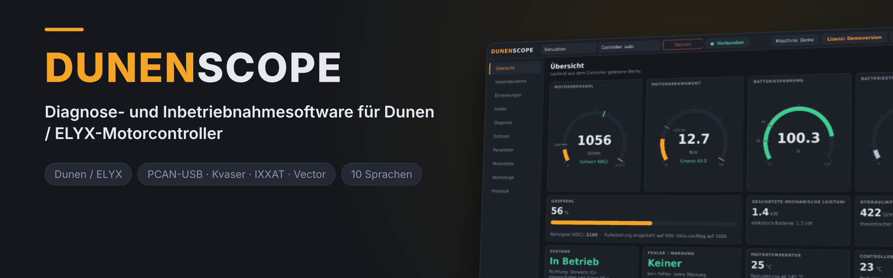
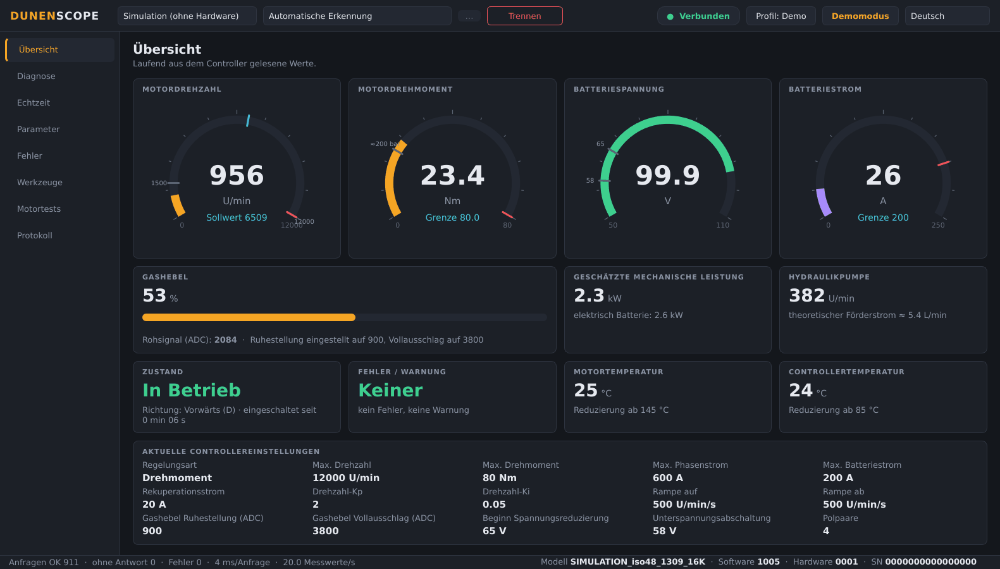
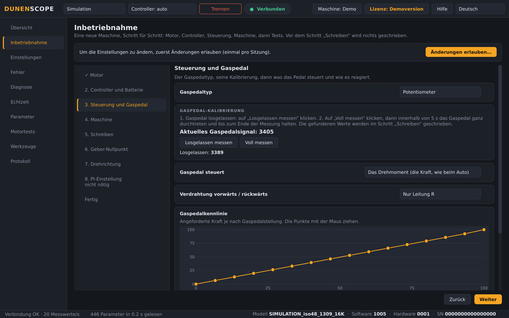
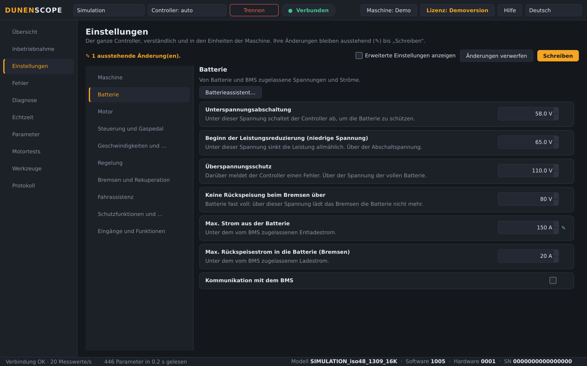
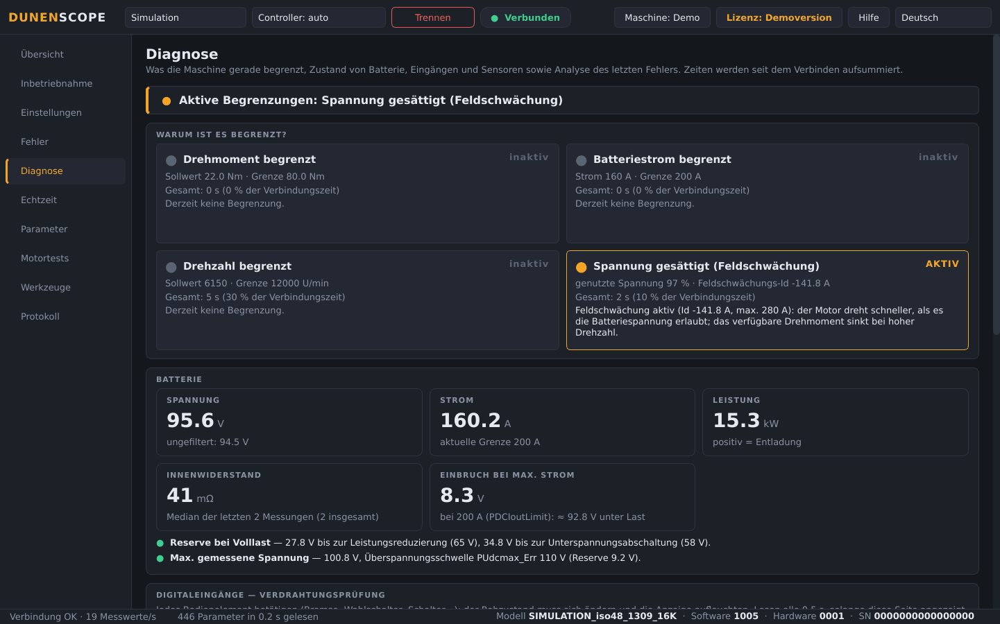
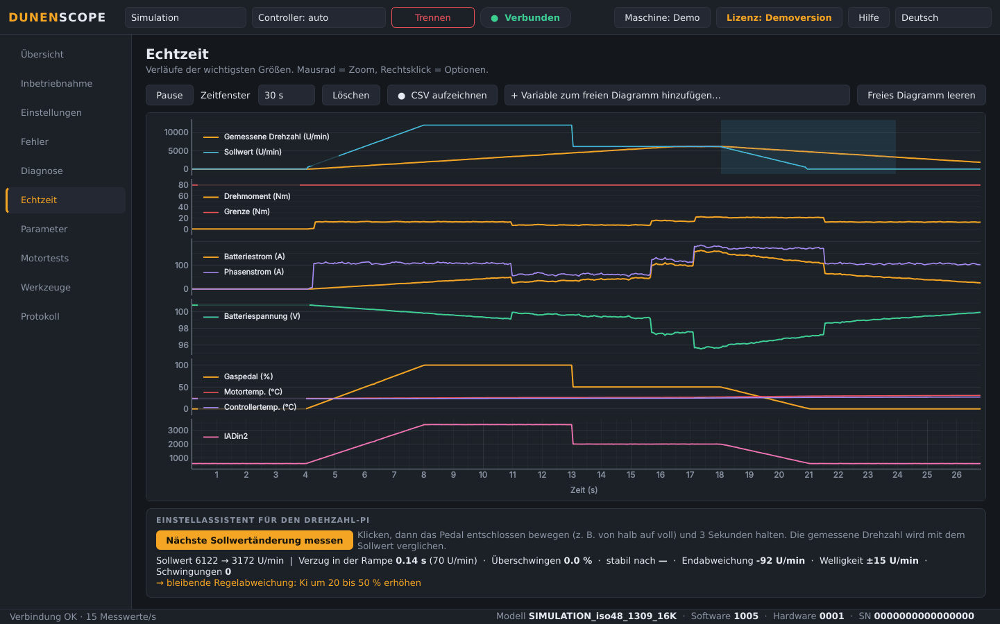
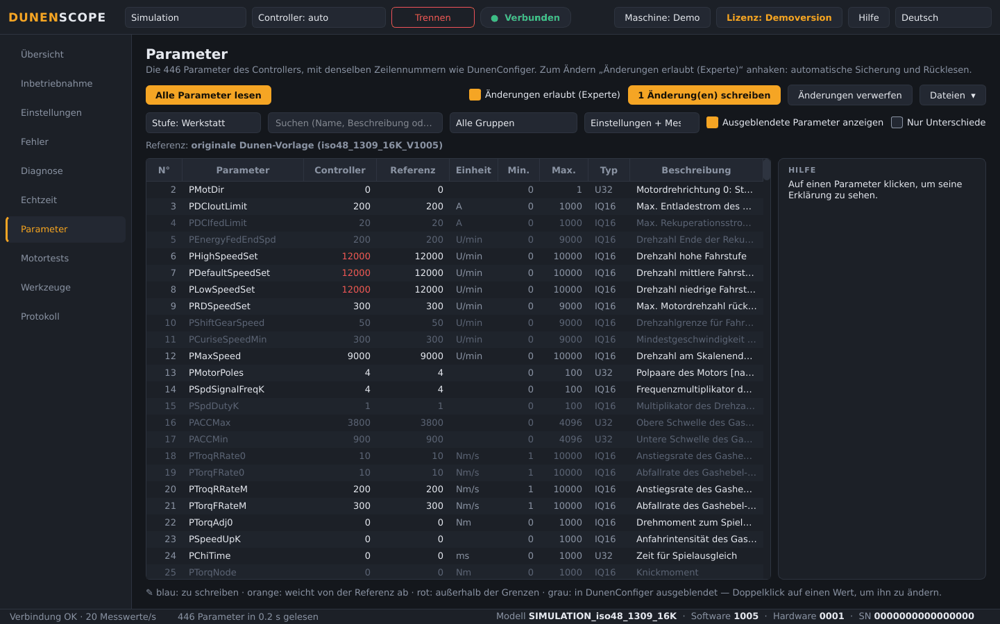
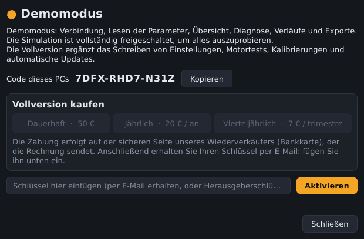

<a href="README.md">English</a> · <a href="README.fr.md">Français</a> · <a href="README.zh.md">中文</a> · <a href="README.es.md">Español</a> · <b>Deutsch</b> · <a href="README.it.md">Italiano</a> · <a href="README.pt.md">Português (BR)</a> · <a href="README.ru.md">Русский</a> · <a href="README.ja.md">日本語</a> · <a href="README.ko.md">한국어</a>

Windows 10 / 11 · 64 Bit · kostenloser Demomodus

## Diagnose- und Inbetriebnahmesoftware für Dunen / ELYX-Motorcontroller

DunenScope macht aus einem Windows-PC und einem CAN-Adapter einen vollständigen Prüfstand für Dunen / ELYX-Controller: sehen, was die Maschine tut, verstehen, was sie begrenzt, sie einstellen und beweisen, dass sie funktioniert — in Minuten und in Ihrer Sprache.

## Was DunenScope kann

- **Inbetriebnahme** — eine neue Maschine Schritt für Schritt, wie bei VESC: Motor, Controller und Batterie, Pedalkalibrierung, Maschine, Schreiben, Geber-Nullpunkt, 5-s-Testdrehung für die Richtung, PI-Einstellung.
- **Einstellungen im Klartext** — der ganze Controller nach Kategorien, in den Einheiten der Maschine (Sekunden, %, km/h, L/min, m/min), mit Pedalkurven, die man mit der Maus zieht.
- **Anstecken und verbinden** — CAN-Adapter, Bitrate und Controller-Adresse werden automatisch gefunden, das Modell wird erkannt.
- **Einfache Einstellung** — ein paar Fragen (Batterie, Drehzahl, Fahrgefühl): die Einstellungen werden berechnet und in der Liste vorbereitet, mit Hilfe zu jedem Parameter und Plausibilitätsprüfung vor dem Schreiben.
- **Andere Controller** — für ein Modell, das DunenScope noch nicht kennt: Protokoll wählen, antwortende Register suchen, benennen, als Kurve anzeigen und ein Modellprofil speichern.
- **Schreiben Sie uns aus der App** — die Schaltfläche Hilfe sendet Ihr Problem, Ihre Idee oder Frage direkt an den Herausgeber; Fehlerberichte nur mit Ihrer Zustimmung.
- **Live-Übersicht** — Drehzahl, Drehmoment, Batteriespannung und -strom, Gashebel, Leistung, Temperaturen, Zustand und Fehler auf einem Bildschirm; Pumpenförderstrom oder Fahrzeuggeschwindigkeit aus Ihrem Maschinenprofil.
- **„Warum ist es begrenzt?“** — zeigt, welche Grenze gerade wirkt (Drehmoment, Batteriestrom, Drehzahl, Spannung) und wie lange; Innenwiderstand und Reserven der Batterie; Verdrahtungsprüfung jedes Eingangs; verbleibende Zeit bis zur thermischen Reduzierung; Analyse des letzten Fehlers.
- **Echtzeit-Verläufe** — sechs synchronisierte Diagramme plus ein freies Diagramm mit 4 beliebigen Variablen, CSV-Aufzeichnung.
- **Alle 446 Parameter** — dieselben Zeilennummern wie DunenConfiger, Suche, Vergleich mit einer Datei, xlsx-Export zum Reimport in DunenConfiger, CSV.
- **Sicheres Schreiben** — automatische vollständige Sicherung vor jedem Schreiben, Rücklesen, gefährliche Parameter gesperrt, Motor muss stehen, Speicherung im Festspeicher wie bei DunenConfiger.
- **Drehzahl-PI-Einstellung** — Messung an der Maschine, schrittweise manuelle Einstellung mit Hinweisen und automatische Einstellung.
- **Motortests** — vorgegebene Drehzahl oder vorgegebenes Drehmoment, automatisches Einlernen des Geberwinkels, Stromregelkreis; STOPP / Esc und automatischer Halt.
- **Werkstattwerkzeuge** — Support-Paket mit einem Klick (.zip), Kalibrierassistent für den Gashebel, Bandendetest mit Bericht und Produktionsprotokoll.
- **Für den Einsatz vor Ort** — 10 Sprachen, Adapter PEAK PCAN-USB, Kvaser, IXXAT, Vector und SLCAN, Anwendungsprofile und ein Simulationsmodus, um alles ohne Hardware auszuprobieren.

## Bildschirmfotos

<table>
<tr><td width="50%" align="center"> Inbetriebnahme: eine neue Maschine Schritt für Schritt</td><td width="50%" align="center"> Einstellungen im Klartext, in den Einheiten der Maschine</td></tr>
<tr><td width="50%" align="center"> Diagnose — was die Maschine begrenzt</td><td width="50%" align="center"> Echtzeit-Verläufe und PI-Einstellassistent</td></tr>
<tr><td width="50%" align="center"> Parameter — vergleichen, schreiben, exportieren</td><td width="50%" align="center"> Lizenzfenster</td></tr>
</table>

## Kostenloser Demomodus oder Vollversion

| Funktion | Demo (kostenlos) | Vollversion |
| --- | :---: | :---: |
| Verbinden, alle Parameter lesen, Übersicht, Verläufe | ✅ | ✅ |
| Diagnose, Fehlerspeicher, Bandendetest, Exporte, Support-Paket | ✅ | ✅ |
| Simulationsmodus mit allen Funktionen | ✅ | ✅ |
| Automatische Updates | ✅ | ✅ |
| Einstellungen in einen echten Controller schreiben | — | ✅ |
| Motortests, PI-Einstellung, Gashebel-Kalibrierung | — | ✅ |

### Vollversion

**Dauerlizenz 50 €** · **Jahresabonnement 20 €** · **Quartalsabonnement 7 €**. Ein Schlüssel pro PC, in Sekunden über die Schaltfläche **Lizenz** (oben rechts) aktiviert. Funktioniert nach der Aktivierung ohne Internet.

**Online kaufen:** [Dauerhaft — 50 €](https://buy.polar.sh/polar_cl_qO94LG8UMUEZitzRuoHexlgbRA5yJC3UlaF5C1Fv4O9) · [Jährlich — 20 €/Jahr](https://buy.polar.sh/polar_cl_St8xQg80RzRuOiugr63Lz4lFQkZ8MM2BkT6Jx1tNVVB) · [Vierteljährlich — 7 €/Quartal](https://buy.polar.sh/polar_cl_vjvXcXdimxbXQ3JzsfKf5UKQlYK8jFWHVp7yw0nHOmJ)

Der Schlüssel kommt per E-Mail: in DunenScope unter **Lizenz** → **Aktivieren** einfügen.

Abos: eine Internetverbindung alle 45 Tage genügt.

## Erste Schritte

1. Laden Sie **DunenScope_Setup** unter [Releases](https://github.com/simonlabrossedu71-tech/DunenScope/releases/latest) herunter und starten Sie es. Zeigt Windows „Der Computer wurde durch Windows geschützt“, klicken Sie auf *Weitere Informationen* → *Trotzdem ausführen*.
2. Wählen Sie Ihre Sprache. Das Installationsprogramm bietet den PEAK-Treiber an, falls er fehlt.
3. Schließen Sie den CAN-Adapter an den Controller an und schalten Sie die Zündung ein.
4. Auf **Verbinden** klicken: DunenScope findet Adapter, Bitrate und Knoten selbst. Noch keine Hardware? **Simulation** wählen.
5. Vollversion: Schaltfläche **Lizenz** → Schlüssel einfügen → **Aktivieren**.

## Voraussetzungen

- Windows 10 oder 11, 64 Bit.
- Ein CAN-Adapter: PEAK PCAN-USB (empfohlen), Kvaser, IXXAT, Vector oder SLCAN (CANable…).
- Ein Dunen / ELYX-Controller mit dem DunenConfiger-Protokoll (Modbus über CAN, standardmäßig 250 kbit/s).

## Ihre Steuerung wird noch nicht unterstützt?

DunenScope lässt sich an jede Motorsteuerung anpassen, die über CAN, CANopen, Modbus (RS-485 oder TCP) oder eine dokumentierte serielle Verbindung kommuniziert. Schicken Sie uns ihre Kommunikationsdateien: Wir nehmen sie in die Software auf.

1. Anfrage stellen: **[Meine Steuerung hinzufügen](https://github.com/simonlabrossedu71-tech/DunenScope/issues/new?template=nouveau-controleur.yml)** (kostenloses GitHub-Konto).
2. Hängen Sie an, was Sie haben – je mehr, desto schneller:
   - das **Handbuch** der Steuerung, vor allem das Kapitel zur Kommunikation (PDF);
   - die **Beschreibung der Kommunikation**: EDS- oder XDD-Datei (CANopen), Modbus-Registertabelle (Adresse, Typ, Skalierung, Einheit, Lesen/Schreiben), DBC-Datei oder Beschreibung der CAN-Telegramme, serielles Protokoll;
   - die **Liste der Fehlercodes** und ihre Bedeutung;
   - wenn möglich: einen Export der Einstellungen aus der Herstellersoftware und einen CAN-Mitschnitt (candump, PCAN-View-Trace) mit stehendem, laufendem Motor und im Fehlerfall.
3. Wir antworten in der Anfrage, in Ihrer Sprache, meist innerhalb einer Woche, und fragen nach, was fehlt. Sobald die Unterstützung fertig ist, kommt sie mit einem DunenScope-Update.

An eine GitHub-Anfrage angehängte Dateien sind öffentlich: Hängen Sie kein Dokument an, das einer Geheimhaltungsvereinbarung unterliegt – erwähnen Sie es einfach in der Anfrage. GitHub akzeptiert nicht jeden Dateityp: Legen Sie .eds-, .xdd-, .dbc- und ähnliche Dateien in eine .zip-Datei.

## Handbücher

Vollständige Handbücher (PDF), auch im Startmenü installiert:

- [English (PDF)](docs/manuals/DunenScope_Manual_EN.pdf) · [Français (PDF)](docs/manuals/DunenScope_Notice_FR.pdf) · [中文 (PDF)](docs/manuals/DunenScope_Manual_ZH.pdf)

## Updates und Sicherheit

- Jedes Installationsprogramm ist signiert; DunenScope prüft die Signatur vor der Installation eines Updates.
- Neue Versionen werden allen Nutzern beim Start kostenlos angeboten; Einstellungen, Profile und Sicherungen bleiben erhalten.
- DunenScope kontaktiert nur den Lizenzdienst und den Download-Server. Keine anderen Daten verlassen Ihren PC.

## Lizenz und Sicherheitshinweise

Mit der Installation von DunenScope akzeptieren Sie den [Endbenutzer-Lizenzvertrag](docs/licence/EULA_DE.txt). DunenScope kann die Einstellungen eines Controllers ändern und einen Motor drehen lassen: Arbeiten Sie nur an gesicherten Maschinen und mit qualifiziertem Personal. Dunen und ELYX sind Marken ihrer jeweiligen Inhaber.
