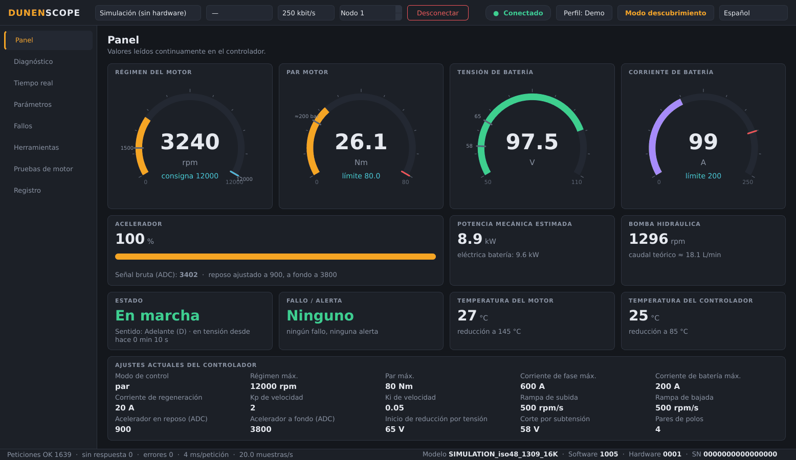
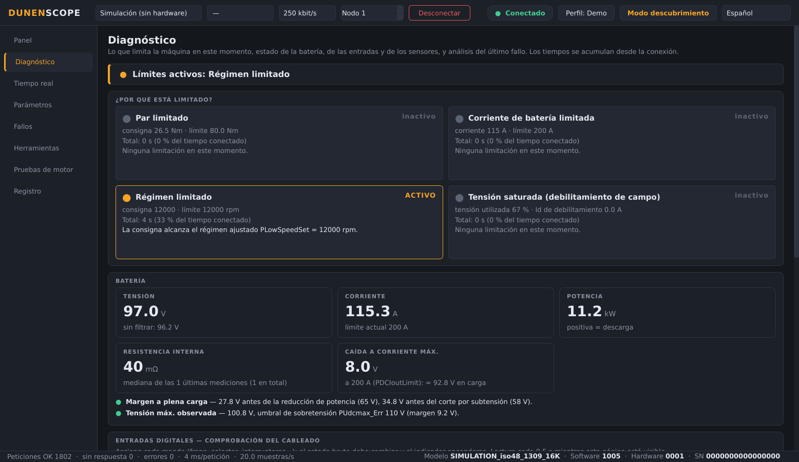
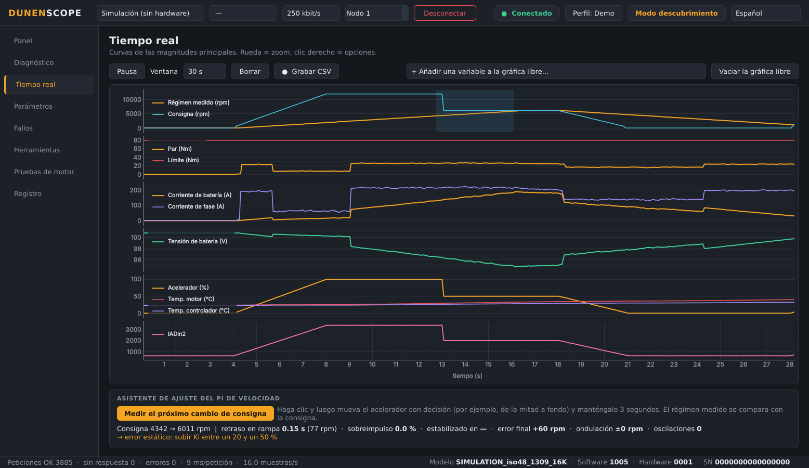
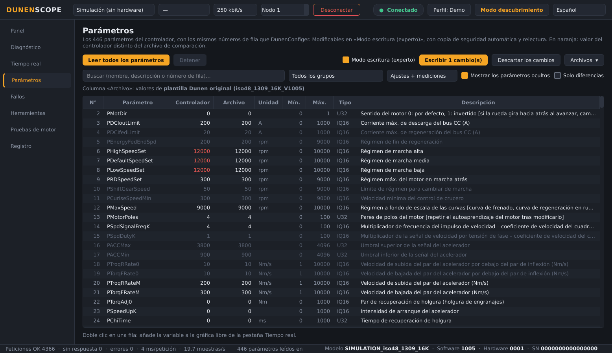
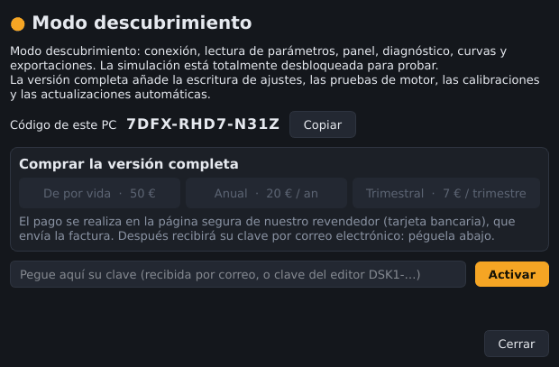

<a href="README.md">English</a> · <a href="README.fr.md">Français</a> · <a href="README.zh.md">中文</a> · <b>Español</b> · <a href="README.de.md">Deutsch</a> · <a href="README.it.md">Italiano</a> · <a href="README.pt.md">Português (BR)</a> · <a href="README.ru.md">Русский</a> · <a href="README.ja.md">日本語</a> · <a href="README.ko.md">한국어</a>

Windows 10 / 11 · 64 bits · modo descubrimiento gratuito

## Software de diagnóstico y puesta en marcha para controladores de motor Dunen / ELYX

DunenScope convierte un PC con Windows y un adaptador CAN en un banco de pruebas completo para controladores Dunen / ELYX: ver lo que hace la máquina, entender qué la limita, ajustarla y demostrar que funciona — en minutos y en su idioma.

## Qué hace DunenScope

- **Panel en directo** — régimen, par, tensión y corriente de batería, acelerador, potencia, temperaturas, estado y fallos en una sola pantalla; caudal de bomba o velocidad del vehículo según su perfil de máquina.
- **«¿Por qué está limitado?»** — muestra qué límite actúa ahora mismo (par, corriente de batería, régimen, tensión) y desde cuándo; resistencia interna y márgenes de la batería; comprobación del cableado de cada entrada; tiempo restante antes de la reducción térmica; análisis del último fallo.
- **Curvas en tiempo real** — seis gráficas sincronizadas y una gráfica libre con 4 variables a elegir, grabación CSV.
- **Los 446 parámetros** — mismos números de fila que DunenConfiger, búsqueda, comparación con un archivo, exportación xlsx reimportable en DunenConfiger, CSV.
- **Escritura segura** — copia de seguridad completa automática antes de cada escritura, relectura, parámetros peligrosos bloqueados, motor parado obligatorio, guardado en memoria permanente como DunenConfiger.
- **Ajuste del PI de velocidad** — medición en la máquina, ajuste manual por escalones con consejos y ajuste automático.
- **Pruebas de motor** — régimen o par impuesto, autoaprendizaje del ángulo del codificador, lazo de corriente; STOP / Esc y parada automática.
- **Herramientas de taller** — paquete de soporte en un clic (.zip), asistente de calibración del acelerador, prueba de fin de línea con informe y registro de producción.
- **Pensado para el terreno** — 10 idiomas, adaptadores PEAK PCAN-USB, Kvaser, IXXAT, Vector y SLCAN, perfiles de aplicación y un modo simulación para probarlo todo sin hardware.

## Capturas de pantalla

<table>
<tr><td width="50%" align="center"> Diagnóstico — qué limita la máquina</td><td width="50%" align="center"> Curvas en tiempo real y asistente de ajuste del PI</td></tr>
<tr><td width="50%" align="center"> Parámetros — comparar, escribir, exportar</td><td width="50%" align="center"> Ventana Licencia</td></tr>
</table>

## Modo descubrimiento gratuito o versión completa

| Función | Descubrimiento (gratis) | Versión completa |
| --- | :---: | :---: |
| Conexión, lectura de todos los parámetros, panel, curvas | ✅ | ✅ |
| Diagnóstico, historial de fallos, prueba de fin de línea, exportaciones, paquete de soporte | ✅ | ✅ |
| Modo simulación con todas las funciones desbloqueadas | ✅ | ✅ |
| Escritura de ajustes en un controlador real | — | ✅ |
| Pruebas de motor, ajuste del PI, calibración del acelerador | — | ✅ |
| Actualizaciones automáticas | — | ✅ |

### Versión completa

**Licencia de por vida 50 €** · **suscripción anual 20 €** · **suscripción trimestral 7 €**. Una clave por PC, activada en segundos desde el botón **Licencia** (arriba a la derecha). Funciona sin internet una vez activada. La compra en línea abrirá pronto.

Suscripciones: basta con conectarse a internet una vez cada 45 días.

## Primeros pasos

1. Descargue **DunenScope_Setup** en [Releases](https://github.com/simonlabrossedu71-tech/DunenScope/releases/latest) y ejecútelo. Si Windows muestra «Windows protegió su PC», haga clic en *Más información* → *Ejecutar de todas formas*.
2. Elija su idioma. El instalador ofrece el controlador PEAK si falta.
3. Conecte el adaptador CAN al controlador y ponga la llave en ON.
4. Elija el adaptador, 250 kbit/s, nodo 1 → **Conectar**. ¿Aún sin hardware? Elija **Simulación**.
5. Versión completa: botón **Licencia** → pegue su clave → **Activar**.

## Requisitos

- Windows 10 u 11, 64 bits.
- Un adaptador CAN: PEAK PCAN-USB (recomendado), Kvaser, IXXAT, Vector o SLCAN (CANable…).
- Un controlador Dunen / ELYX con el protocolo de DunenConfiger (Modbus sobre CAN, 250 kbit/s por defecto).

## Manuales

Manuales completos (PDF), también instalados en el menú Inicio:

- [English (PDF)](docs/manuals/DunenScope_Manual_EN.pdf) · [Français (PDF)](docs/manuals/DunenScope_Notice_FR.pdf) · [中文 (PDF)](docs/manuals/DunenScope_Manual_ZH.pdf)

## Actualizaciones y seguridad

- Cada instalador está firmado; DunenScope comprueba la firma antes de instalar una actualización.
- Las nuevas versiones se proponen al iniciar a los usuarios de la versión completa; se conservan ajustes, perfiles y copias de seguridad.
- DunenScope solo contacta con el servicio de licencias y el servidor de descargas. Ningún otro dato sale de su PC.

## Licencia y precauciones

Al instalar DunenScope acepta el [contrato de licencia de usuario final](docs/licence/EULA_ES.txt). DunenScope puede modificar los ajustes de un controlador y hacer girar un motor: trabaje con la máquina en condiciones seguras y con personal cualificado. Dunen y ELYX son marcas de sus respectivos propietarios.
