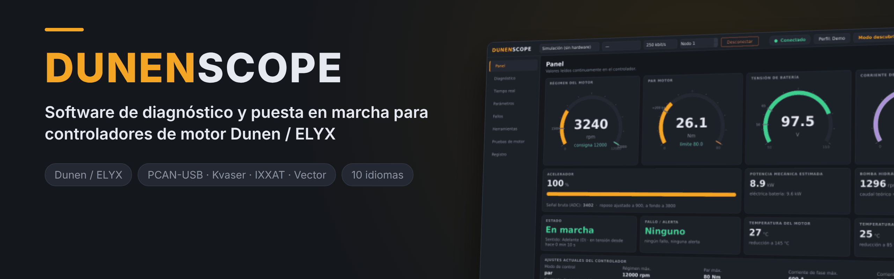
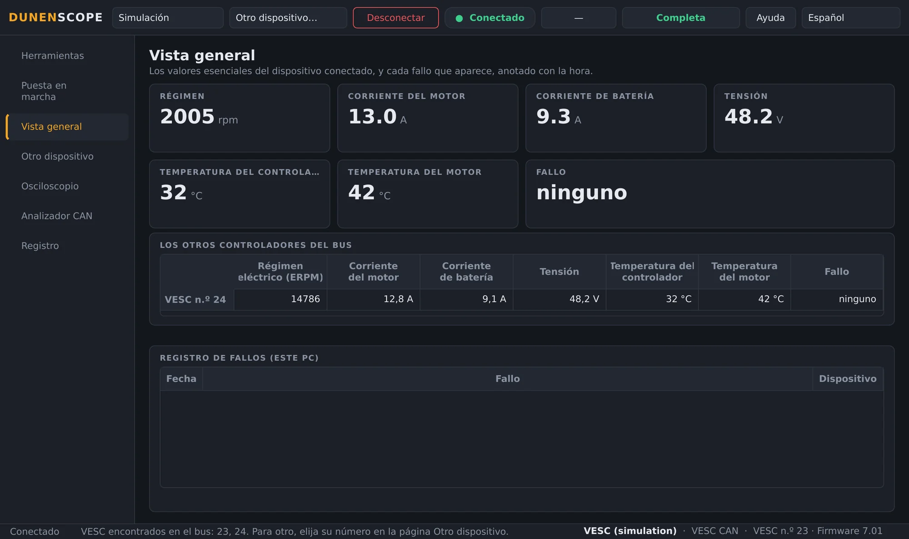
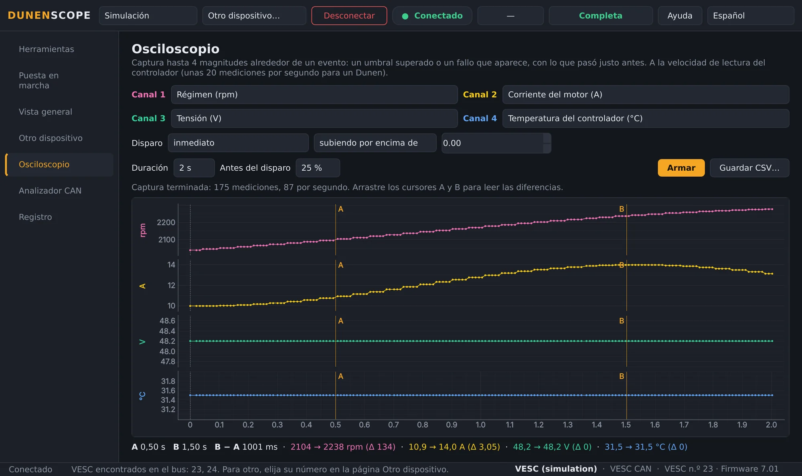
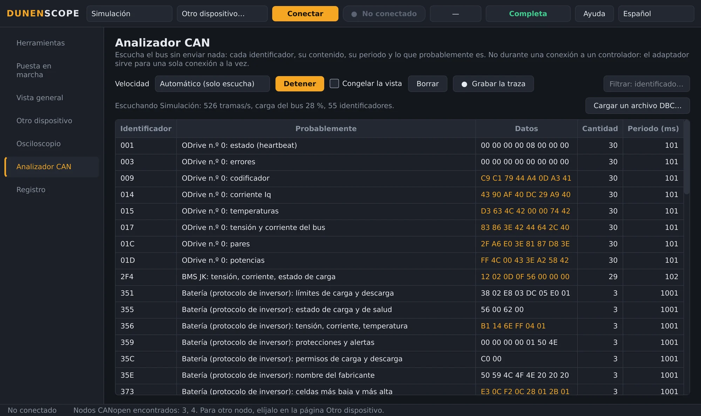
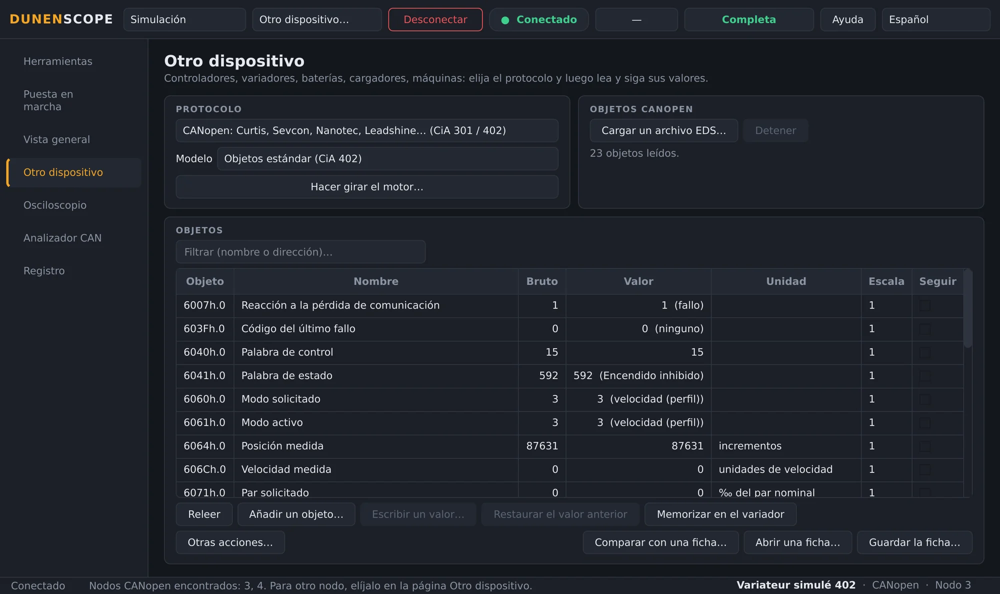
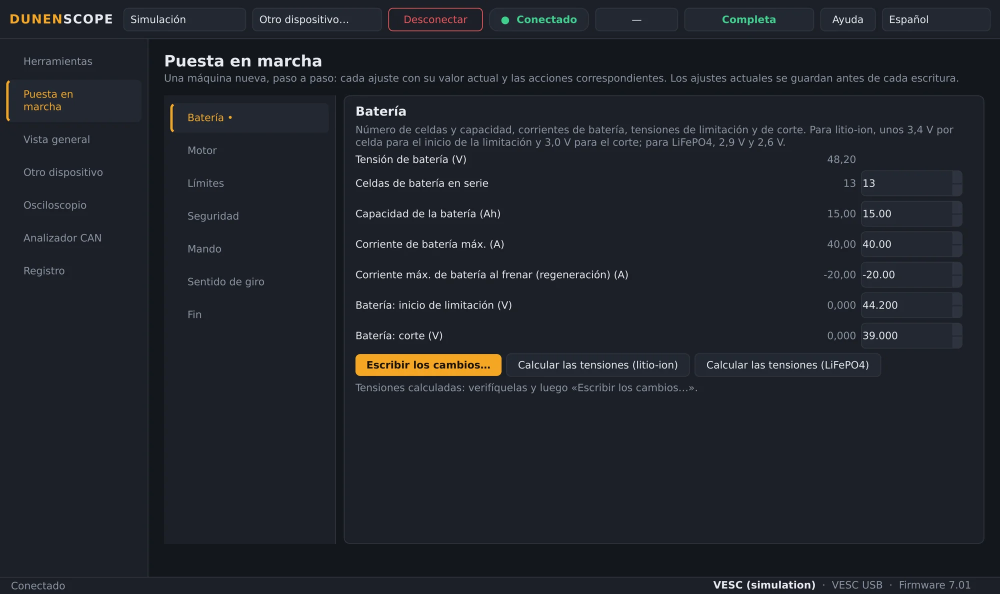
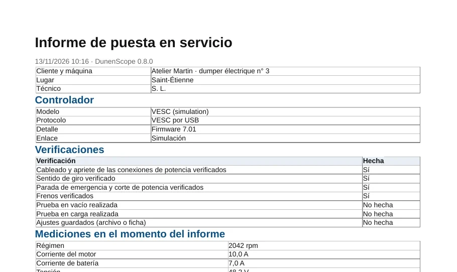
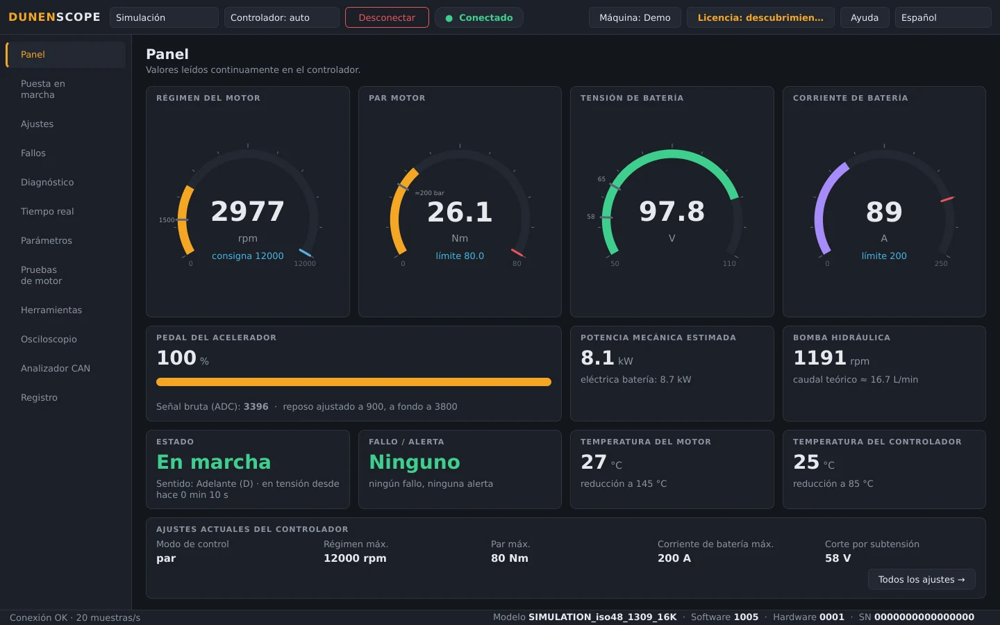
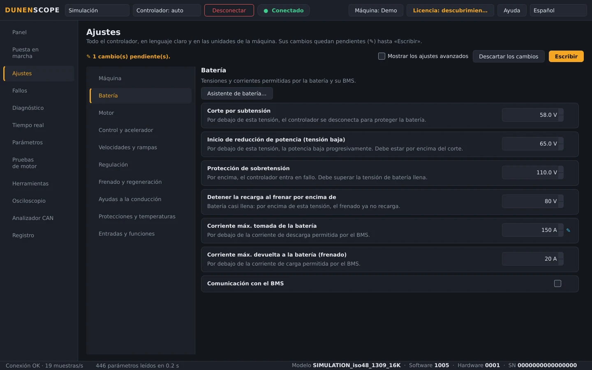

<a href="README.md">English</a> · <a href="README.fr.md">Français</a> · <a href="README.zh.md">中文</a> · <b>Español</b> · <a href="README.de.md">Deutsch</a> · <a href="README.it.md">Italiano</a> · <a href="README.pt.md">Português (BR)</a> · <a href="README.ru.md">Русский</a> · <a href="README.ja.md">日本語</a> · <a href="README.ko.md">한국어</a>

Windows 10 / 11 · 64 bits · lectura gratuita

## Diagnóstico y ajuste de controladores de motor, variadores y baterías

DunenScope convierte un PC con Windows y un adaptador CAN, USB o RS-485 en un banco de diagnóstico y ajuste: controladores Dunen, controladores compatibles con VESC® Software, variadores CANopen® y Modbus, Kelly, Curtis, Sevcon, BMS y cargadores. Explica cada fallo, guarda lo que pasó justo antes, ajusta la máquina paso a paso y genera el informe de puesta en servicio.

> [!TIP]
> **¿Un error? ¿Falta un equipo?** Deje sus archivos aquí: cada solicitud se lee y se atiende automáticamente en el mismo día, con una respuesta en la solicitud, preguntas si falta información y, después, la corrección o el equipo en una próxima actualización.
>
> **[Informar de un error](https://github.com/simonlabrossedu71-tech/DunenScope/issues/new?template=signaler-bug.yml)** · **[Añadir mi dispositivo](https://github.com/simonlabrossedu71-tech/DunenScope/issues/new?template=nouveau-controleur.yml)**

## El vídeo (46 s)

 <a href="https://github.com/simonlabrossedu71-tech/DunenScope/raw/main/docs/video/DunenScope_presentation_en.mp4">Descargar el vídeo completo, con sonido (MP4, 16 MB)</a>

## Qué puede leer y ajustar

Elija el equipo en la página **Otro dispositivo** (o deje que DunenScope reconozca un Dunen):

**Controladores de motor**

- **Dunen / ELYX** — 446 parámetros, ajuste, puesta en marcha guiada, pruebas de motor, ajuste del PI
- **Compatibles con VESC® Software** — por USB o CAN: ajuste, puesta en marcha guiada, detección del motor
- **Kelly KLS-D, KAC, KBL / KHB** — por CAN o enlace serie: mediciones y fallos
- **Votol EM, Fardriver, Bafang (motores M), ODrive** — mediciones y fallos

**Variadores industriales**

- **Variadores CANopen® CiA 402** — Nanotec, Leadshine…: objetos del perfil o del archivo EDS, ajuste, prueba de motor
- **Curtis 1232E a 1239E, Sevcon Gen4** — CANopen, solo lectura: mediciones y fallos
- **Modbus RTU y TCP** — Schneider ATV320, ASI BAC / Phaserunner, Sabvoton…: registros, bobinas y entradas

**Baterías y cargadores**

- **BMS JK, Daly, JBD / Xiaoxiang, protocolo de inversor** — celdas, temperaturas, corriente, carga, alarmas
- **Baterías Pylontech (RS-485), cargadores Elcon / TC** — solo lectura
- **Victron VE.Direct** — reguladores solares, cargadores, BMV y SmartShunt: solo escucha

**Maquinaria y bus CAN**

- **Máquinas J1939** — motor térmico, fallos activos
- **Archivo DBC** — cualquier bus CAN descrito por un archivo DBC (Orion BMS 2…)

¿Su equipo no aparece? Envíe sus archivos de comunicación (manual del protocolo, EDS, lista de registros, traza CAN) mediante el formulario [Añadir mi dispositivo](https://github.com/simonlabrossedu71-tech/DunenScope/issues/new?template=nouveau-controleur.yml).

## Qué hace DunenScope

- **Conexión automática** — un clic en Conectar: un Dunen se conecta al instante; si no, DunenScope escucha los buses CAN sin emitir nada y los puertos serie, y se conecta al equipo encontrado o muestra la lista.
- **Puesta en marcha guiada** — una máquina nueva, paso a paso: batería, motor, límites, seguridad, sentido de giro; cada ajuste con su valor actual, sus límites y su equivalente práctico.
- **Un diagnóstico que explica** — cada fallo, de cada marca, con su causa probable y qué comprobar; la caja negra guarda los 20 segundos anteriores a cada fallo; varios controladores del mismo bus vigilados a la vez.
- **Osciloscopio** — cuatro canales, disparo por umbral o al aparecer un fallo, se conserva lo anterior al disparo, cursores, exportación CSV.
- **Analizador CAN** — escucha el bus sin emitir nada e identifica cada trama (CANopen, compatible VESC, Kelly, Dunen, J1939); carga del bus, traza grabada para Excel.
- **Informe de puesta en servicio** — un PDF para entregar al cliente: el controlador, las mediciones, todos los ajustes, las comprobaciones marcadas y los recuadros de firma.
- **Panel y curvas** — régimen, par, tensión, corriente, temperaturas, estado y fallos en directo; curvas en tiempo real, grabación CSV.
- **Copia de seguridad y escritura segura** — copia automática antes de cada escritura, valor releído, motor parado, deshacer; compare la máquina con una ficha, línea por línea.
- **Biblioteca en línea** — abra la ficha de un modelo compartida por otros (nombres, unidades, escalas) o comparta la suya, siempre sin sus valores.
- **Para los Dunen** — los 446 parámetros con los números de DunenConfiger, ajustes claros en las unidades de la máquina, ajuste fácil, «¿Por qué está limitado?», pruebas de motor y ajuste del PI, prueba de fin de línea.
- **Simulación y diez idiomas** — todo se prueba sin hardware, fallos incluidos; la interfaz y las explicaciones de los fallos existen en 10 idiomas.

## Capturas de pantalla

<table>
<tr><td width="50%" align="center"> Vista general: fallos explicados, varios controladores del bus</td><td width="50%" align="center"> Osciloscopio: cuatro magnitudes capturadas alrededor de un evento</td></tr>
<tr><td width="50%" align="center"> Analizador CAN: cada trama identificada</td><td width="50%" align="center"> Otro dispositivo: un variador CANopen CiA 402</td></tr>
<tr><td width="50%" align="center"> Puesta en marcha guiada de un controlador compatible VESC</td><td width="50%" align="center"> Informe de puesta en servicio en PDF</td></tr>
<tr><td width="50%" align="center"> Panel de un Dunen</td><td width="50%" align="center"> Ajustes de un Dunen, en las unidades de la máquina</td></tr>
</table>

## Lectura gratuita, versión completa para ajustar

| Función | Descubrimiento (gratis) | Versión completa |
| --- | :---: | :---: |
| Conexión, lectura de todos los ajustes, panel, curvas | ✅ | ✅ |
| Diagnóstico, registro y caja negra de fallos, osciloscopio, analizador CAN | ✅ | ✅ |
| Modo Simulación completo, actualizaciones | ✅ | ✅ |
| Escritura de los ajustes en el controlador, puesta en marcha guiada | — | ✅ |
| Pruebas de motor, ajuste del PI, calibración del pedal | — | ✅ |

**Licencia de por vida 50 €** · **suscripción anual 20 €** · **suscripción trimestral 7 €**. Una clave por PC, activada en segundos desde el botón **Licencia**. Funciona sin internet una vez activada.

**Comprar en línea:** [De por vida — 50 €](https://buy.polar.sh/polar_cl_qO94LG8UMUEZitzRuoHexlgbRA5yJC3UlaF5C1Fv4O9) · [Anual — 20 €/año](https://buy.polar.sh/polar_cl_St8xQg80RzRuOiugr63Lz4lFQkZ8MM2BkT6Jx1tNVVB) · [Trimestral — 7 €/trimestre](https://buy.polar.sh/polar_cl_vjvXcXdimxbXQ3JzsfKf5UKQlYK8jFWHVp7yw0nHOmJ)

La clave llega por correo: DunenScope → **Licencia** → pegue la clave → **Activar**. Las suscripciones se conectan una vez cada 45 días.

## Primeros pasos

1. Descargue **DunenScope_Setup** en [Releases](https://github.com/simonlabrossedu71-tech/DunenScope/releases/latest) y ejecútelo. Si Windows muestra «Windows protegió su PC», haga clic en *Más información* → *Ejecutar de todas formas*.
2. Conecte el adaptador al equipo y enciéndalo.
3. Deje **Controlador: auto** y haga clic en **Conectar**: DunenScope encuentra lo que está conectado y se conecta. También puede elegir el protocolo en la página **Otro dispositivo**.
4. ¿Aún sin hardware? Elija **Simulación**: todo se muestra sin conectar nada.

## Material necesario

- Windows 10 u 11, 64 bits.
- Un adaptador CAN: PEAK PCAN-USB (recomendado), Kvaser, IXXAT, Vector, CANable o candleLight.
- Según el equipo: el cable USB de un controlador compatible VESC, un adaptador USB-RS485 (Modbus, BMS, Pylontech) o un cable VE.Direct-USB (Victron).

## Manuales

Manuales completos (PDF), también instalados con el programa:

- [Français (PDF)](docs/manuals/DunenScope_Notice_FR.pdf) · [English (PDF)](docs/manuals/DunenScope_Manual_EN.pdf) · [中文 (PDF)](docs/manuals/DunenScope_Manual_ZH.pdf)

## Actualizaciones y datos

- Cada instalador está firmado; DunenScope comprueba la firma antes de instalar una actualización.
- Las nuevas versiones se ofrecen al iniciar, gratis; se conservan ajustes, fichas y copias de seguridad.
- DunenScope solo contacta con el servicio de licencias, el servidor de actualizaciones y, si la abre, la biblioteca en línea; los mensajes del botón Ayuda y los informes de error solo se envían con su permiso.

## Licencia y seguridad

Al instalar DunenScope, acepta el [contrato de licencia de usuario final](docs/licence/EULA_ES.txt). DunenScope puede modificar los ajustes de un controlador y hacer girar un motor: trabaje con la máquina en condiciones seguras y con personal cualificado. Los componentes libres incluidos con el programa (Qt, PySide6, python-can, libusb…) conservan sus licencias, enumeradas en THIRD_PARTY_LICENSES.txt de la carpeta de instalación.

DunenScope no está afiliado al proyecto VESC ni cuenta con su aprobación. CANopen® es una marca registrada de CAN in Automation. Dunen, ELYX, Kelly, Curtis, Sevcon, Victron, Pylontech y las demás marcas citadas pertenecen a sus propietarios.

Publicado por ORDA Engineering SAS, Saint-Étienne, Francia.
