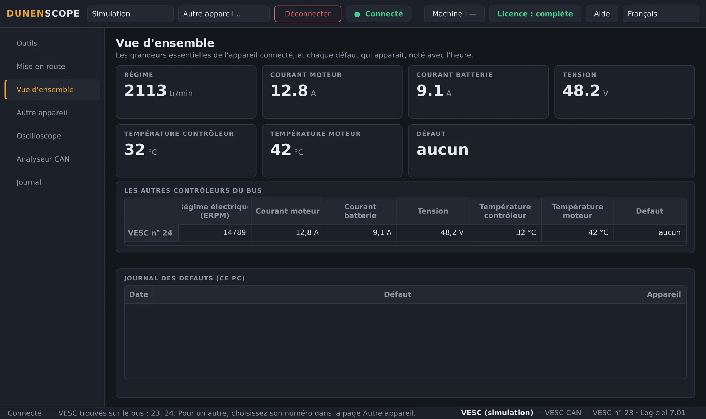
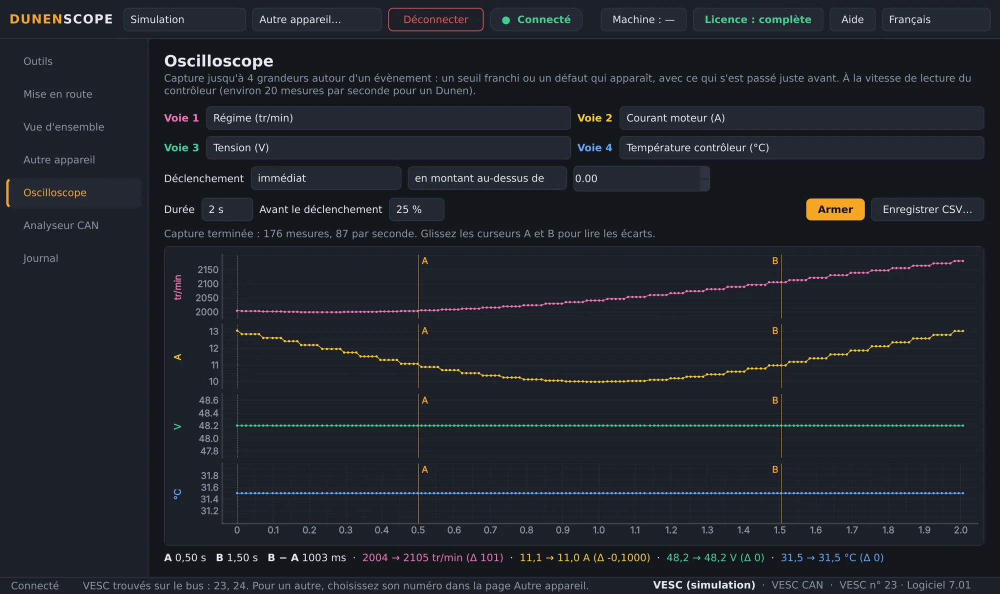
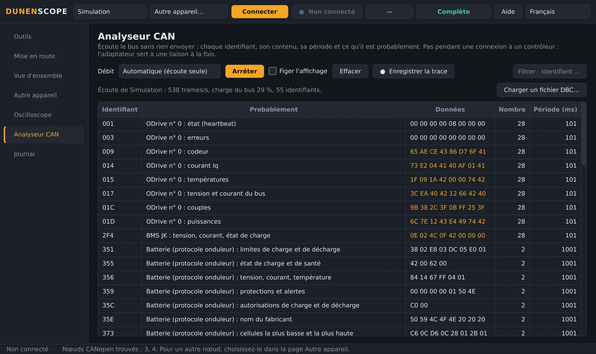
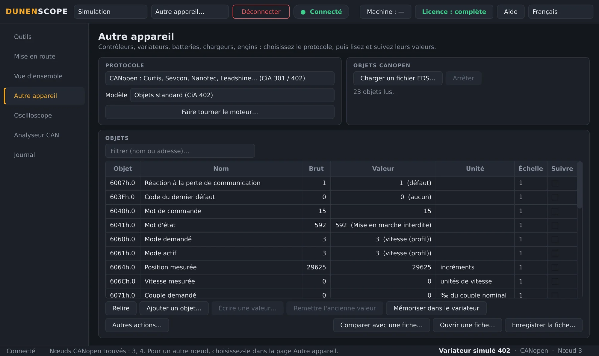
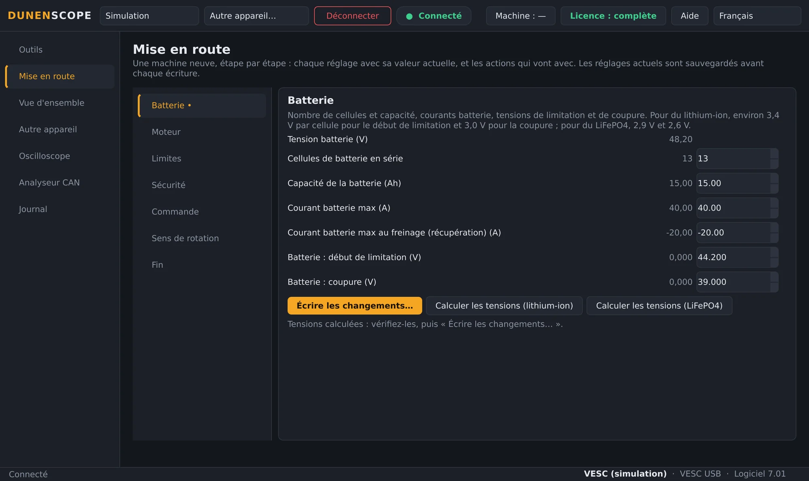
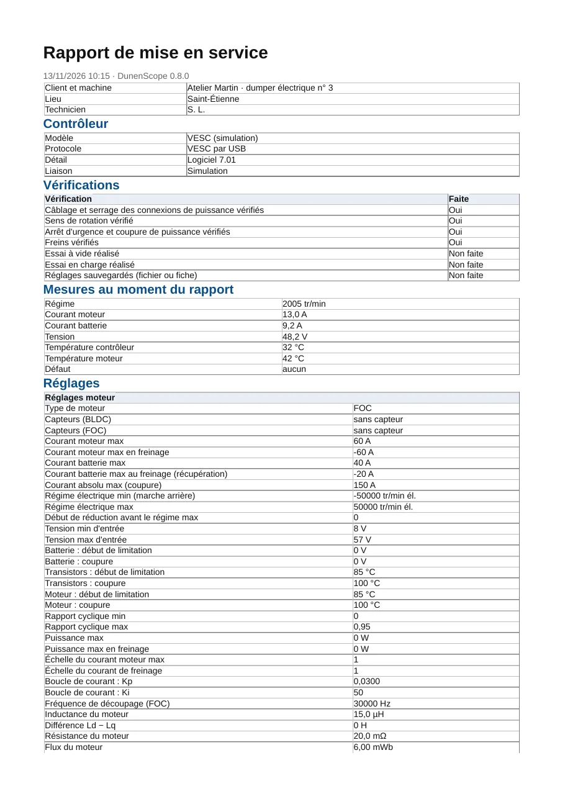
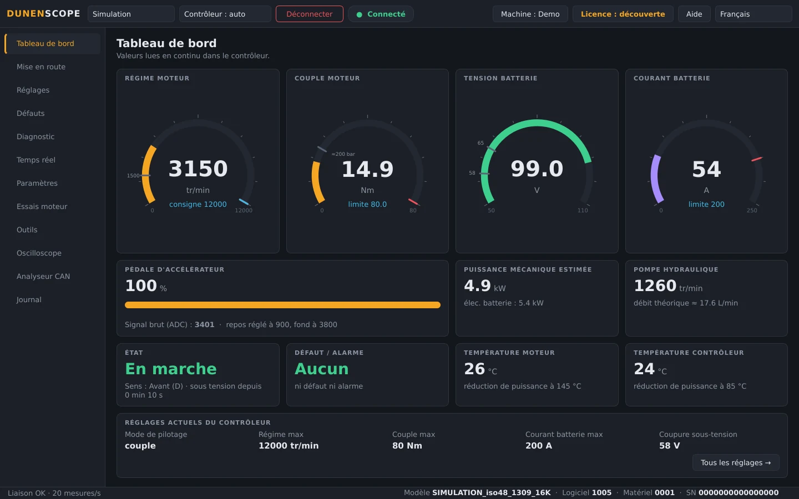
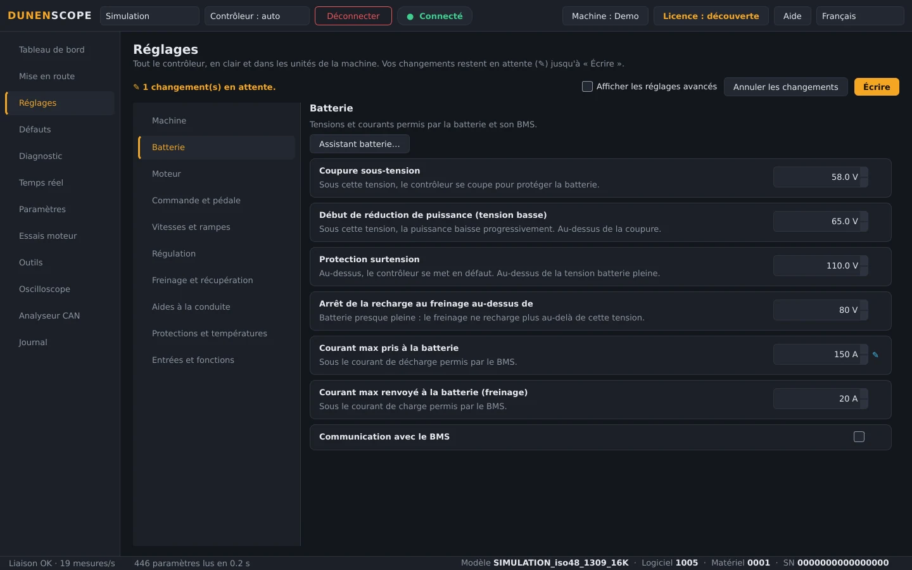

<a href="README.md">English</a> · <b>Français</b> · <a href="README.zh.md">中文</a> · <a href="README.es.md">Español</a> · <a href="README.de.md">Deutsch</a> · <a href="README.it.md">Italiano</a> · <a href="README.pt.md">Português (BR)</a> · <a href="README.ru.md">Русский</a> · <a href="README.ja.md">日本語</a> · <a href="README.ko.md">한국어</a>

Windows 10 / 11 · 64 bits · lecture gratuite

## Diagnostic et réglage de contrôleurs moteur, variateurs et batteries

DunenScope fait d'un PC Windows et d'un adaptateur CAN, USB ou RS-485 un banc de diagnostic et de réglage : contrôleurs Dunen, contrôleurs compatibles avec VESC® Software, variateurs CANopen® et Modbus, Kelly, Curtis, Sevcon, BMS et chargeurs. Il explique chaque défaut, garde ce qui s'est passé juste avant, règle la machine pas à pas et sort le rapport de mise en service.

> [!TIP]
> **Un bug ? Un appareil qui manque ?** Déposez vos fichiers ici : chaque demande est lue et prise en charge automatiquement dans l'heure, avec une réponse sur la demande, des questions s'il manque une information, puis la correction ou l'appareil dans une prochaine mise à jour.
>
> **[Signaler un bug](https://github.com/simonlabrossedu71-tech/DunenScope/issues/new?template=signaler-bug.yml)** · **[Ajouter mon appareil](https://github.com/simonlabrossedu71-tech/DunenScope/issues/new?template=nouveau-controleur.yml)**

## La vidéo (46 s)

 <a href="https://github.com/simonlabrossedu71-tech/DunenScope/raw/main/docs/video/DunenScope_presentation_fr.mp4">Télécharger la vidéo complète, avec le son (MP4, 16 Mo)</a>

## Ce qu'il sait lire et régler

Choisissez l'appareil dans la page **Autre appareil** (ou laissez DunenScope reconnaître un Dunen) :

**Contrôleurs moteur**

- **Dunen / ELYX** — 446 paramètres, réglage, mise en route guidée, essais moteur, réglage du PI
- **Compatibles avec VESC® Software** — par USB ou par CAN : réglage, mise en route guidée, détection du moteur
- **Kelly KLS-D, KAC, KBL / KHB** — par CAN ou liaison série : mesures et défauts
- **Votol EM, Fardriver, Bafang (moteurs M), ODrive** — mesures et défauts

**Variateurs industriels**

- **Variateurs CANopen® CiA 402** — Nanotec, Leadshine… : objets du profil ou du fichier EDS, réglage, essai moteur
- **Curtis 1232E à 1239E, Sevcon Gen4** — CANopen, lecture seule : mesures et défauts
- **Modbus RTU et TCP** — Schneider ATV320, ASI BAC / Phaserunner, Sabvoton… : registres, bobines et entrées

**Batteries et chargeurs**

- **BMS JK, Daly, JBD / Xiaoxiang, protocole onduleur** — cellules, températures, courant, charge, alarmes
- **Batteries Pylontech (RS-485), chargeurs Elcon / TC** — lecture seule
- **Victron VE.Direct** — régulateurs solaires, chargeurs, BMV et SmartShunt : écoute seule

**Engins et bus CAN**

- **Engins J1939** — moteur thermique, défauts actifs
- **Fichier DBC** — tout bus CAN décrit par un fichier DBC (Orion BMS 2…)

Votre appareil n'y est pas ? Envoyez ses fichiers de communication (manuel du protocole, EDS, liste de registres, trace CAN) par le formulaire [Ajouter mon appareil](https://github.com/simonlabrossedu71-tech/DunenScope/issues/new?template=nouveau-controleur.yml).

## Ce que fait DunenScope

- **Mise en route guidée** — une machine neuve, étape par étape : batterie, moteur, limites, sécurité, sens de rotation ; chaque réglage avec sa valeur actuelle, ses bornes et son équivalent utile.
- **Un diagnostic qui explique** — chaque défaut, de chaque marque, avec sa cause probable et ce qu'il faut vérifier ; la boîte noire garde les 20 secondes avant chaque défaut ; plusieurs contrôleurs du même bus surveillés ensemble.
- **Oscilloscope** — quatre voies, déclenchement sur un seuil ou sur l'apparition d'un défaut, part gardée avant le déclenchement, curseurs, export CSV.
- **Analyseur CAN** — il écoute le bus sans rien émettre et dit ce qu'est chaque trame (CANopen, compatible VESC, Kelly, Dunen, J1939) ; charge du bus, trace enregistrée pour Excel.
- **Rapport de mise en service** — un PDF à remettre au client : le contrôleur, les mesures, tous les réglages, les vérifications cochées et les cadres de signature.
- **Tableau de bord et courbes** — régime, couple, tension, courant, températures, état et défauts en direct ; courbes en temps réel, enregistrement CSV.
- **Sauvegarde et écriture sûre** — sauvegarde automatique avant chaque écriture, valeur relue, moteur à l'arrêt, retour arrière ; comparez la machine à une fiche, ligne par ligne.
- **Bibliothèque en ligne** — ouvrez la fiche d'un modèle partagée par d'autres (noms, unités, échelles) ou partagez la vôtre, toujours sans ses valeurs.
- **Pour les Dunen** — les 446 paramètres avec les numéros de DunenConfiger, réglages en clair dans les unités de la machine, réglage facile, « pourquoi ça plafonne ? », essais moteur et réglage du PI, contrôle de fin de ligne.
- **Simulation et dix langues** — tout s'essaie sans matériel, défauts compris ; l'interface et les explications des défauts existent en 10 langues.

## Captures d'écran

<table>
<tr><td width="50%" align="center"> Vue d'ensemble : défauts expliqués, plusieurs contrôleurs du bus</td><td width="50%" align="center"> Oscilloscope : quatre grandeurs capturées autour d'un évènement</td></tr>
<tr><td width="50%" align="center"> Analyseur CAN : chaque trame identifiée</td><td width="50%" align="center"> Autre appareil : un variateur CANopen CiA 402</td></tr>
<tr><td width="50%" align="center"> Mise en route guidée d'un contrôleur compatible VESC</td><td width="50%" align="center"> Rapport de mise en service en PDF</td></tr>
<tr><td width="50%" align="center"> Tableau de bord d'un Dunen</td><td width="50%" align="center"> Réglages d'un Dunen, dans les unités de la machine</td></tr>
</table>

## Lecture gratuite, version complète pour régler

| Fonction | Découverte (gratuit) | Version complète |
| --- | :---: | :---: |
| Connexion, lecture de tous les réglages, tableau de bord, courbes | ✅ | ✅ |
| Diagnostic, journal et boîte noire des défauts, oscilloscope, analyseur CAN | ✅ | ✅ |
| Mode Simulation complet, mises à jour | ✅ | ✅ |
| Écriture des réglages dans le contrôleur, mise en route guidée | — | ✅ |
| Essais moteur, réglage du PI, calibrage de la pédale | — | ✅ |

**Licence à vie 50 €** · **abonnement annuel 20 €** · **abonnement trimestriel 7 €**. Une clé par PC, activée en quelques secondes depuis le bouton **Licence**. Fonctionne sans internet une fois activée.

**Acheter en ligne :** [À vie — 50 €](https://buy.polar.sh/polar_cl_qO94LG8UMUEZitzRuoHexlgbRA5yJC3UlaF5C1Fv4O9) · [Annuel — 20 €/an](https://buy.polar.sh/polar_cl_St8xQg80RzRuOiugr63Lz4lFQkZ8MM2BkT6Jx1tNVVB) · [Trimestriel — 7 €/trimestre](https://buy.polar.sh/polar_cl_vjvXcXdimxbXQ3JzsfKf5UKQlYK8jFWHVp7yw0nHOmJ)

La clé arrive par e-mail : DunenScope → **Licence** → collez la clé → **Activer**. Les abonnements se connectent une fois tous les 45 jours.

## Démarrer

1. Téléchargez **DunenScope_Setup** dans [Releases](https://github.com/simonlabrossedu71-tech/DunenScope/releases/latest) et lancez-le. Si Windows affiche « Windows a protégé votre ordinateur », cliquez sur *Informations complémentaires* → *Exécuter quand même*.
2. Branchez l'adaptateur sur l'appareil et mettez-le sous tension.
3. Un Dunen est trouvé tout seul → **Connecter**. Pour une autre marque : page **Autre appareil**, choisissez le protocole → **Connecter**.
4. Pas encore de matériel ? Choisissez **Simulation** : tout se montre sans rien brancher.

## Matériel nécessaire

- Windows 10 ou 11, 64 bits.
- Un adaptateur CAN : PEAK PCAN-USB (conseillé), Kvaser, IXXAT, Vector, CANable ou candleLight.
- Selon l'appareil : le câble USB d'un contrôleur compatible VESC, un adaptateur USB-RS485 (Modbus, BMS, Pylontech) ou un câble VE.Direct-USB (Victron).

## Notices

Notices complètes (PDF), aussi installées avec le logiciel :

- [Français (PDF)](docs/manuals/DunenScope_Notice_FR.pdf) · [English (PDF)](docs/manuals/DunenScope_Manual_EN.pdf) · [中文 (PDF)](docs/manuals/DunenScope_Manual_ZH.pdf)

## Mises à jour et données

- Chaque installateur est signé ; DunenScope vérifie la signature avant d'installer une mise à jour.
- Les nouvelles versions sont proposées au démarrage, gratuitement ; réglages, fiches et sauvegardes sont conservés.
- DunenScope ne contacte que le service de licence, le serveur des mises à jour et, si vous l'ouvrez, la bibliothèque en ligne ; les messages du bouton Aide et les rapports d'erreur ne partent qu'avec votre accord.

## Licence et sécurité

En installant DunenScope, vous acceptez le [contrat de licence utilisateur](docs/licence/EULA_FR.txt). DunenScope peut modifier les réglages d'un contrôleur et faire tourner un moteur : travaillez machine en sécurité et avec du personnel qualifié. Les composants libres livrés avec le logiciel (Qt, PySide6, python-can, libusb…) gardent leurs licences, listées dans THIRD_PARTY_LICENSES.txt du dossier d'installation.

DunenScope n'est ni affilié au projet VESC, ni approuvé par lui. CANopen® est une marque déposée de CAN in Automation. Dunen, ELYX, Kelly, Curtis, Sevcon, Victron, Pylontech et les autres marques citées appartiennent à leurs propriétaires.

Édité par ORDA Engineering SAS, Saint-Étienne, France.
