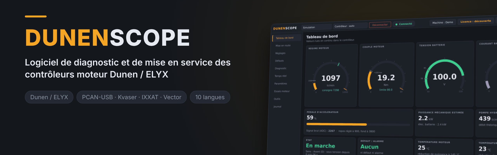
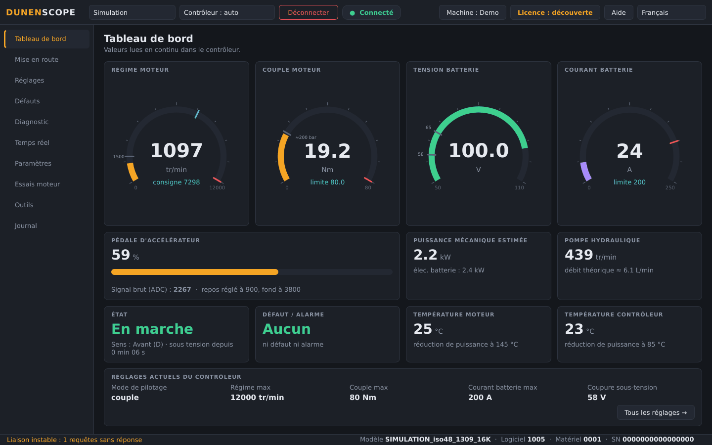
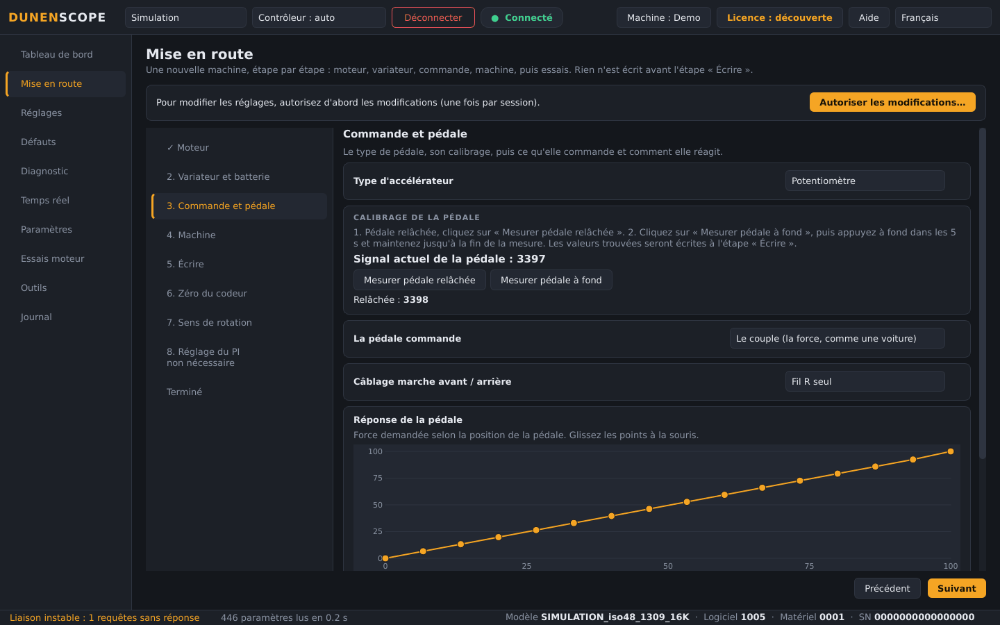
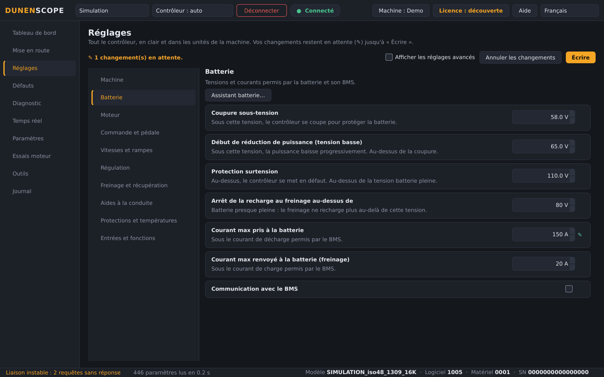
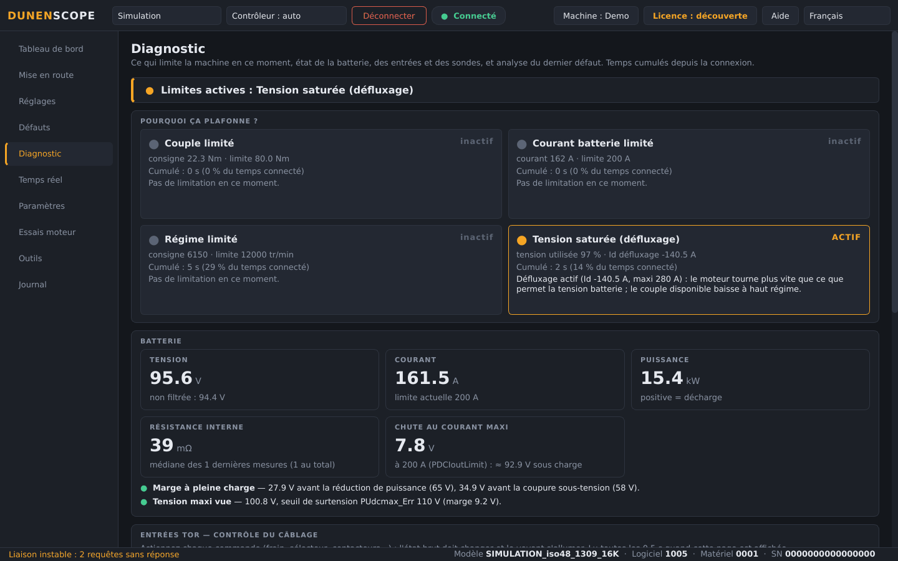
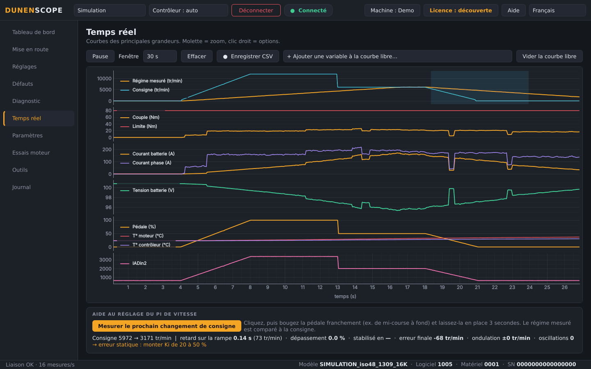
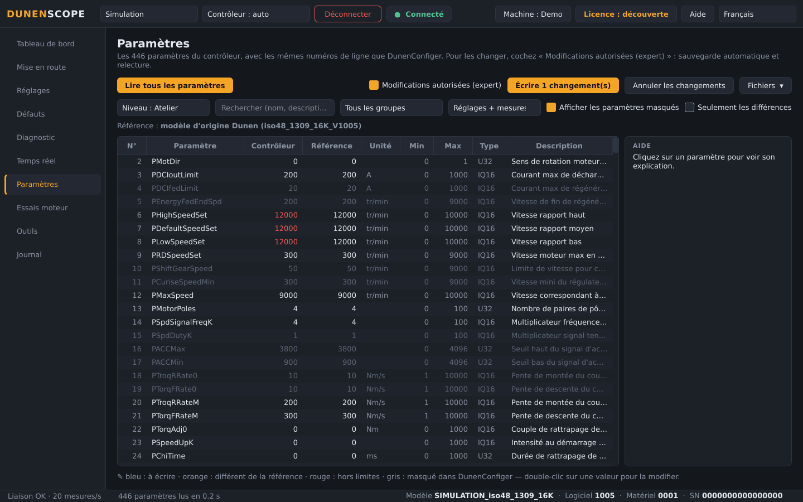
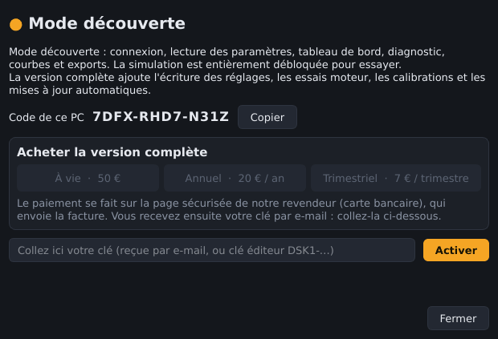

<a href="README.md">English</a> · <b>Français</b> · <a href="README.zh.md">中文</a> · <a href="README.es.md">Español</a> · <a href="README.de.md">Deutsch</a> · <a href="README.it.md">Italiano</a> · <a href="README.pt.md">Português (BR)</a> · <a href="README.ru.md">Русский</a> · <a href="README.ja.md">日本語</a> · <a href="README.ko.md">한국어</a>

Windows 10 / 11 · 64 bits · mode découverte gratuit

## Logiciel de diagnostic et de mise en service des contrôleurs moteur Dunen / ELYX

DunenScope transforme un PC Windows et un adaptateur CAN en banc de test complet pour les contrôleurs Dunen / ELYX : voir ce que fait la machine, comprendre ce qui la limite, la régler et prouver qu'elle fonctionne — en quelques minutes, dans votre langue.

## Ce que fait DunenScope

- **Mise en route** — une nouvelle machine étape par étape, comme sur VESC : moteur, variateur et batterie, calibrage de la pédale, machine, écriture, zéro du codeur, rotation d'essai de 5 s pour le sens, réglage du PI.
- **Réglages en clair** — tout le contrôleur par catégories, dans les unités de la machine (secondes, %, km/h, L/min, m/min), avec des courbes de pédale à glisser à la souris.
- **Branchez, connectez** — l'adaptateur CAN, le débit et l'adresse du contrôleur sont trouvés tout seuls, et le modèle est reconnu.
- **Réglage facile** — quelques questions (batterie, régime, conduite) : les réglages sont calculés et préparés dans la liste, avec une aide sur chaque paramètre et un contrôle de cohérence avant écriture.
- **Autres contrôleurs** — pour un modèle que DunenScope ne connaît pas encore : choisir le protocole, trouver les registres qui répondent, les nommer, les suivre en courbe et enregistrer une fiche de modèle.
- **Écrivez-nous depuis l'appli** — le bouton Aide envoie votre problème, idée ou question directement à l'éditeur ; les rapports d'erreur ne partent qu'avec votre accord.
- **Tableau de bord en direct** — régime, couple, tension et courant batterie, pédale, puissance, températures, état et défauts sur un seul écran ; débit de pompe ou vitesse du véhicule selon votre profil de machine.
- **« Pourquoi ça plafonne ? »** — montre quelle limite agit en ce moment (couple, courant batterie, régime, tension) et depuis combien de temps ; résistance interne et marges de la batterie ; contrôle du câblage de chaque entrée ; temps restant avant réduction thermique ; analyse du dernier défaut.
- **Courbes en temps réel** — six graphes synchronisés et une courbe libre de 4 variables au choix, enregistrement CSV.
- **Les 446 paramètres** — mêmes numéros de ligne que DunenConfiger, recherche, comparaison avec un fichier, export xlsx réimportable dans DunenConfiger, CSV.
- **Écriture sécurisée** — sauvegarde complète automatique avant chaque écriture, relecture, paramètres dangereux bloqués, moteur à l'arrêt obligatoire, enregistrement en mémoire permanente comme DunenConfiger.
- **Réglage du PI de vitesse** — mesure sur la machine, réglage manuel par échelons avec conseils, et réglage automatique.
- **Essais moteur** — régime ou couple imposé, auto-apprentissage de l'angle du codeur, boucle de courant ; STOP / Échap et arrêt automatique.
- **Outils d'atelier** — dossier support en un clic (.zip), assistant de calibration de la pédale, contrôle de fin de ligne avec rapport et journal de production.
- **Pensé pour le terrain** — 10 langues, adaptateurs PEAK PCAN-USB, Kvaser, IXXAT, Vector et SLCAN, profils d'application, et un mode simulation pour tout essayer sans matériel.

## Captures d'écran

<table>
<tr><td width="50%" align="center"> Mise en route : une nouvelle machine étape par étape</td><td width="50%" align="center"> Réglages en clair, dans les unités de la machine</td></tr>
<tr><td width="50%" align="center"> Diagnostic — ce qui limite la machine</td><td width="50%" align="center"> Courbes en temps réel et aide au réglage du PI</td></tr>
<tr><td width="50%" align="center"> Paramètres — comparer, écrire, exporter</td><td width="50%" align="center"> Fenêtre Licence</td></tr>
</table>

## Mode découverte gratuit ou version complète

| Fonction | Découverte (gratuit) | Version complète |
| --- | :---: | :---: |
| Connexion, lecture de tous les paramètres, tableau de bord, courbes | ✅ | ✅ |
| Diagnostic, historique des défauts, contrôle de fin de ligne, exports, dossier support | ✅ | ✅ |
| Mode simulation avec toutes les fonctions débloquées | ✅ | ✅ |
| Mises à jour automatiques | ✅ | ✅ |
| Écriture des réglages dans un vrai contrôleur | — | ✅ |
| Essais moteur, réglage du PI, calibration du levier | — | ✅ |

### Version complète

**Licence à vie 50 €** · **abonnement annuel 20 €** · **abonnement trimestriel 7 €**. Une clé par PC, activée en quelques secondes depuis le bouton **Licence** (en haut à droite). Fonctionne sans internet une fois activée.

**Acheter en ligne :** [À vie — 50 €](https://buy.polar.sh/polar_cl_qO94LG8UMUEZitzRuoHexlgbRA5yJC3UlaF5C1Fv4O9) · [Annuel — 20 €/an](https://buy.polar.sh/polar_cl_St8xQg80RzRuOiugr63Lz4lFQkZ8MM2BkT6Jx1tNVVB) · [Trimestriel — 7 €/trimestre](https://buy.polar.sh/polar_cl_vjvXcXdimxbXQ3JzsfKf5UKQlYK8jFWHVp7yw0nHOmJ)

La clé arrive par e-mail : collez-la dans DunenScope → **Licence** → **Activer**.

Abonnements : une connexion à internet tous les 45 jours suffit.

## Démarrer

1. Téléchargez **DunenScope_Setup** dans [Releases](https://github.com/simonlabrossedu71-tech/DunenScope/releases/latest) et lancez-le. Si Windows affiche « Windows a protégé votre ordinateur », cliquez sur *Informations complémentaires* → *Exécuter quand même*.
2. Choisissez votre langue. L'installeur propose le pilote PEAK s'il manque.
3. Branchez l'adaptateur CAN sur le contrôleur et mettez la clé sur ON.
4. Cliquez sur **Connecter** : DunenScope trouve tout seul l'adaptateur, le débit et le nœud. Pas encore de matériel ? Choisissez **Simulation**.
5. Version complète : bouton **Licence** → collez votre clé → **Activer**.

## Configuration requise

- Windows 10 ou 11, 64 bits.
- Un adaptateur CAN : PEAK PCAN-USB (conseillé), Kvaser, IXXAT, Vector ou SLCAN (CANable…).
- Un contrôleur Dunen / ELYX utilisant le protocole de DunenConfiger (Modbus sur CAN, 250 kbit/s par défaut).

## Notices

Notices complètes (PDF), aussi installées dans le menu Démarrer :

- [English (PDF)](docs/manuals/DunenScope_Manual_EN.pdf) · [Français (PDF)](docs/manuals/DunenScope_Notice_FR.pdf) · [中文 (PDF)](docs/manuals/DunenScope_Manual_ZH.pdf)

## Mises à jour et sécurité

- Chaque installateur est signé ; DunenScope vérifie la signature avant d'installer une mise à jour.
- Les nouvelles versions sont proposées au démarrage à tous les utilisateurs, gratuitement ; réglages, profils et sauvegardes sont conservés.
- DunenScope ne contacte que le service de licence et le serveur de téléchargement. Aucune autre donnée ne quitte votre PC.

## Licence et précautions d'emploi

En installant DunenScope, vous acceptez le [contrat de licence utilisateur](docs/licence/EULA_FR.txt). DunenScope peut modifier les réglages d'un contrôleur et faire tourner un moteur : travaillez machine en sécurité et avec du personnel qualifié. Dunen et ELYX sont des marques de leurs propriétaires respectifs.
