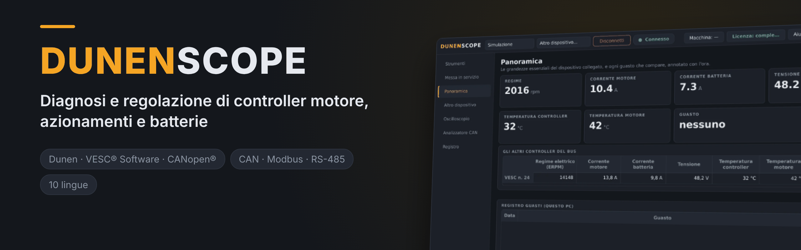
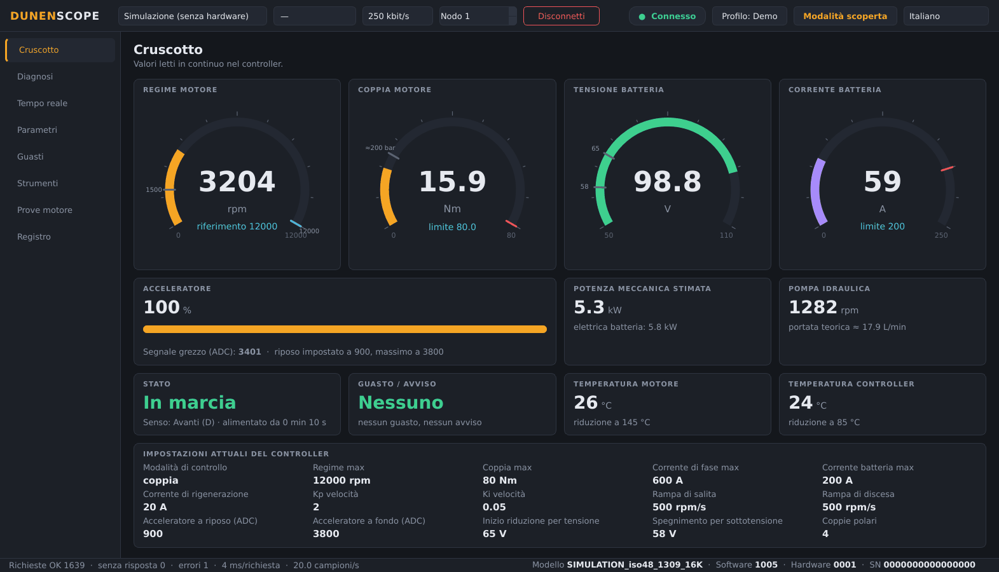
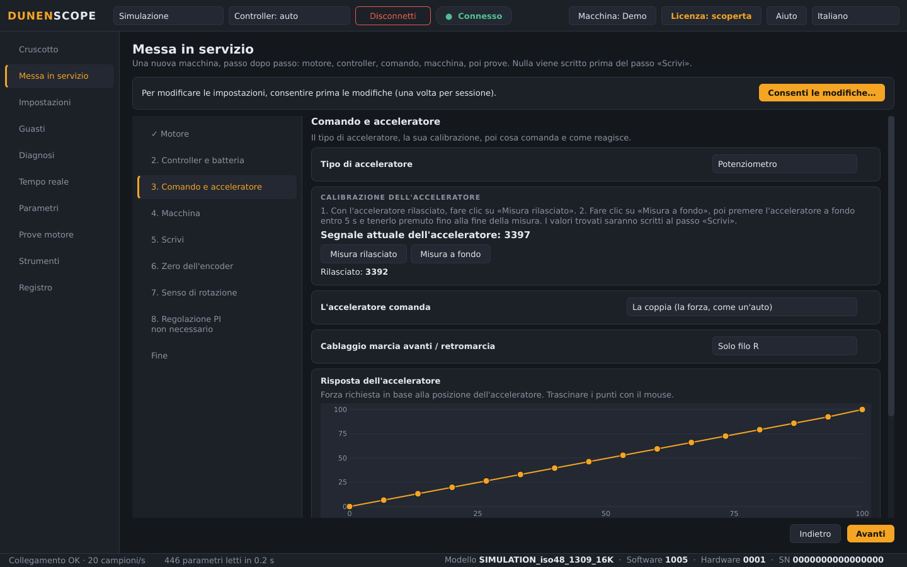
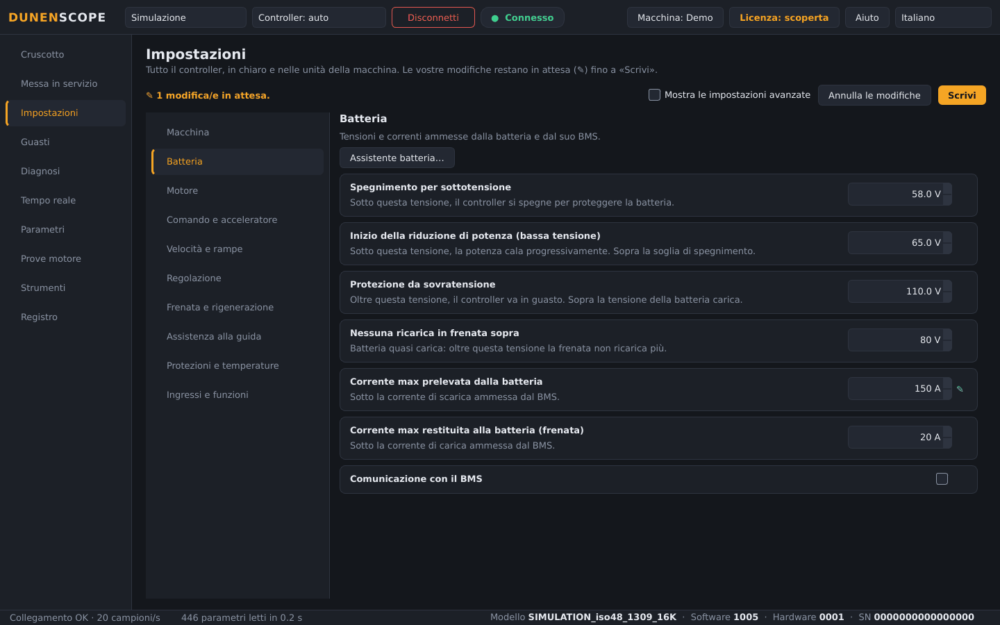
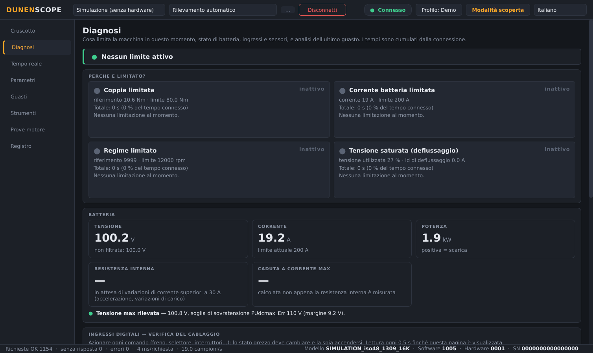
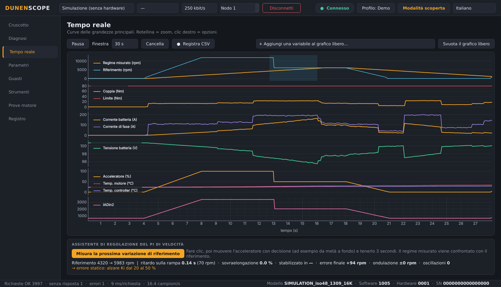
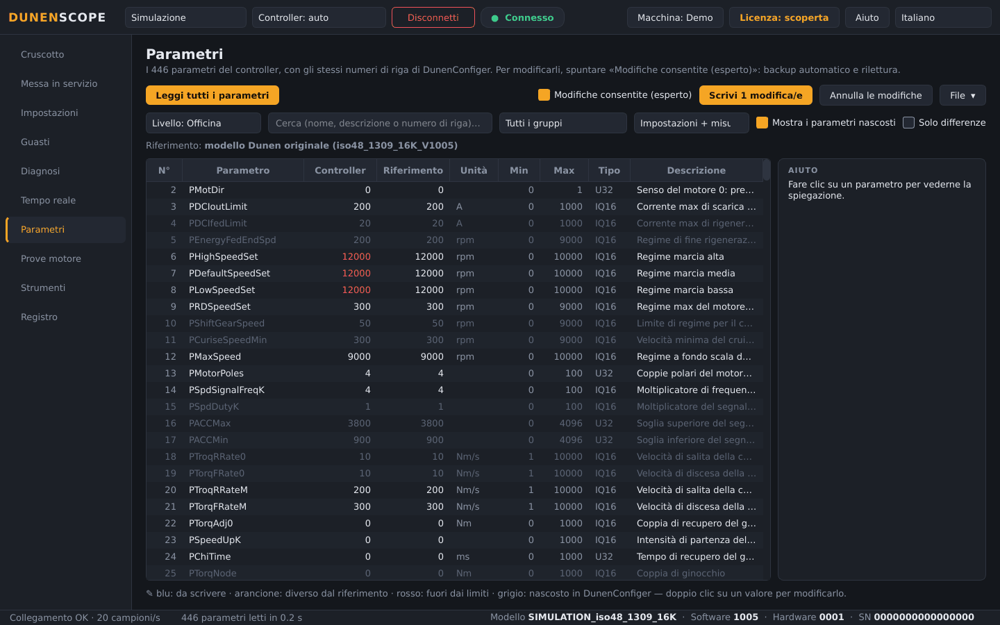
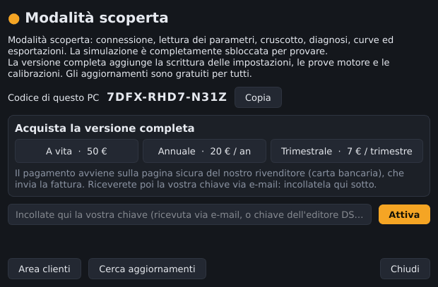

<a href="README.md">English</a> · <a href="README.fr.md">Français</a> · <a href="README.zh.md">中文</a> · <a href="README.es.md">Español</a> · <a href="README.de.md">Deutsch</a> · <b>Italiano</b> · <a href="README.pt.md">Português (BR)</a> · <a href="README.ru.md">Русский</a> · <a href="README.ja.md">日本語</a> · <a href="README.ko.md">한국어</a>

Windows 10 / 11 · 64 bit · modalità scoperta gratuita

## Software di diagnosi e messa in servizio per controller motore Dunen / ELYX

DunenScope trasforma un PC Windows e un adattatore CAN in un banco di prova completo per i controller Dunen / ELYX: vedere cosa fa la macchina, capire cosa la limita, regolarla e dimostrare che funziona — in pochi minuti e nella vostra lingua.

## Cosa fa DunenScope

- **Messa in servizio** — una nuova macchina passo passo, come su VESC: motore, controller e batteria, calibrazione del pedale, macchina, scrittura, zero dell'encoder, rotazione di prova di 5 s per il senso, regolazione del PI.
- **Impostazioni in chiaro** — tutto il controller per categorie, nelle unità della macchina (secondi, %, km/h, L/min, m/min), con curve del pedale da trascinare con il mouse.
- **Collega e connetti** — adattatore CAN, velocità e indirizzo del controller vengono trovati da soli, e il modello viene riconosciuto.
- **Configurazione facile** — poche domande (batteria, regime, guida): le impostazioni vengono calcolate e preparate nell'elenco, con aiuto su ogni parametro e controllo di coerenza prima della scrittura.
- **Altri controller** — per un modello che DunenScope non conosce ancora: scegliere il protocollo, cercare i registri che rispondono, nominarli, seguirli in grafico e salvare una scheda modello.
- **Scriveteci dall'app** — il pulsante Aiuto invia il vostro problema, idea o domanda direttamente all'editore; i rapporti di errore partono solo con il vostro consenso.
- **Cruscotto in tempo reale** — regime, coppia, tensione e corrente batteria, acceleratore, potenza, temperature, stato e guasti in un'unica schermata; portata della pompa o velocità del veicolo secondo il profilo macchina.
- **«Perché è limitato?»** — mostra quale limite agisce in questo momento (coppia, corrente batteria, regime, tensione) e da quanto tempo; resistenza interna e margini della batteria; verifica del cablaggio di ogni ingresso; tempo restante prima della riduzione termica; analisi dell'ultimo guasto.
- **Curve in tempo reale** — sei grafici sincronizzati più un grafico libero con 4 variabili a scelta, registrazione CSV.
- **Tutti i 446 parametri** — stessi numeri di riga di DunenConfiger, ricerca, confronto con un file, esportazione xlsx reimportabile in DunenConfiger, CSV.
- **Scrittura sicura** — salvataggio completo automatico prima di ogni scrittura, rilettura, parametri pericolosi bloccati, motore fermo obbligatorio, salvataggio in memoria permanente come DunenConfiger.
- **Regolazione PI di velocità** — misura sulla macchina, regolazione manuale a gradini con consigli e regolazione automatica.
- **Prove motore** — regime o coppia imposti, autoapprendimento dell'angolo dell'encoder, anello di corrente; STOP / Esc e arresto automatico.
- **Strumenti d'officina** — pacchetto di assistenza in un clic (.zip), assistente di calibrazione dell'acceleratore, collaudo di fine linea con rapporto e registro di produzione.
- **Pensato per il campo** — 10 lingue, adattatori PEAK PCAN-USB, Kvaser, IXXAT, Vector e SLCAN, profili di applicazione e una modalità simulazione per provare tutto senza hardware.

## Schermate

<table>
<tr><td width="50%" align="center"> Messa in servizio: una nuova macchina passo passo</td><td width="50%" align="center"> Impostazioni in chiaro, nelle unità della macchina</td></tr>
<tr><td width="50%" align="center"> Diagnosi — cosa limita la macchina</td><td width="50%" align="center"> Curve in tempo reale e assistente di regolazione PI</td></tr>
<tr><td width="50%" align="center"> Parametri — confrontare, scrivere, esportare</td><td width="50%" align="center"> Finestra Licenza</td></tr>
</table>

## Modalità scoperta gratuita o versione completa

| Funzione | Scoperta (gratis) | Versione completa |
| --- | :---: | :---: |
| Connessione, lettura di tutti i parametri, cruscotto, curve | ✅ | ✅ |
| Diagnosi, storico dei guasti, collaudo di fine linea, esportazioni, pacchetto di assistenza | ✅ | ✅ |
| Modalità simulazione con tutte le funzioni sbloccate | ✅ | ✅ |
| Aggiornamenti automatici | ✅ | ✅ |
| Scrittura delle impostazioni in un controller reale | — | ✅ |
| Prove motore, regolazione PI, calibrazione dell'acceleratore | — | ✅ |

### Versione completa

**Licenza a vita 50 €** · **abbonamento annuale 20 €** · **abbonamento trimestrale 7 €**. Una chiave per PC, attivata in pochi secondi dal pulsante **Licenza** (in alto a destra). Funziona senza internet una volta attivata.

**Acquista online:** [A vita — 50 €](https://buy.polar.sh/polar_cl_qO94LG8UMUEZitzRuoHexlgbRA5yJC3UlaF5C1Fv4O9) · [Annuale — 20 €/anno](https://buy.polar.sh/polar_cl_St8xQg80RzRuOiugr63Lz4lFQkZ8MM2BkT6Jx1tNVVB) · [Trimestrale — 7 €/trimestre](https://buy.polar.sh/polar_cl_vjvXcXdimxbXQ3JzsfKf5UKQlYK8jFWHVp7yw0nHOmJ)

La chiave arriva per e-mail: incollala in DunenScope → **Licenza** → **Attiva**.

Abbonamenti: basta una connessione a internet ogni 45 giorni.

## Per iniziare

1. Scaricate **DunenScope_Setup** da [Releases](https://github.com/simonlabrossedu71-tech/DunenScope/releases/latest) e avviatelo. Se Windows mostra «PC protetto da Windows», fate clic su *Ulteriori informazioni* → *Esegui comunque*.
2. Scegliete la lingua. Il programma di installazione propone il driver PEAK se manca.
3. Collegate l'adattatore CAN al controller e inserite la chiave.
4. Fare clic su **Connetti**: DunenScope trova da solo adattatore, velocità e nodo. Ancora senza hardware? Scegliere **Simulazione**.
5. Versione completa: pulsante **Licenza** → incollate la chiave → **Attiva**.

## Requisiti

- Windows 10 o 11, 64 bit.
- Un adattatore CAN: PEAK PCAN-USB (consigliato), Kvaser, IXXAT, Vector o SLCAN (CANable…).
- Un controller Dunen / ELYX con il protocollo di DunenConfiger (Modbus su CAN, 250 kbit/s predefinito).

## Il vostro controller non è ancora supportato?

DunenScope può adattarsi a qualsiasi controller motore che comunica via CAN, CANopen, Modbus (RS-485 o TCP) o tramite un collegamento seriale documentato. Inviateci i suoi file di comunicazione: lo aggiungiamo al software.

1. Aprite una richiesta: **[Aggiungi il mio controller](https://github.com/simonlabrossedu71-tech/DunenScope/issues/new?template=nouveau-controleur.yml)** (account GitHub gratuito).
2. Allegate ciò che avete: più materiale inviate, più si fa in fretta:
   - il **manuale** del controller, soprattutto il capitolo sulla comunicazione (PDF);
   - la **descrizione della comunicazione**: file EDS o XDD (CANopen), tabella dei registri Modbus (indirizzo, tipo, scala, unità, lettura/scrittura), file DBC o descrizione dei frame CAN, protocollo seriale;
   - l'**elenco dei codici di guasto** e il loro significato;
   - se possibile: un'esportazione delle impostazioni dal software del costruttore e una cattura CAN (candump, traccia PCAN-View) con il motore fermo, in marcia e in guasto.
3. Rispondiamo nella richiesta, nella vostra lingua, di solito entro una settimana, e chiediamo ciò che manca. Quando il supporto è pronto, arriva con un aggiornamento di DunenScope.

I file allegati a una richiesta GitHub sono pubblici: non allegate documenti coperti da un accordo di riservatezza, segnalatelo semplicemente nella richiesta. GitHub non accetta tutti i tipi di file: mettete i file .eds, .xdd, .dbc e simili in uno .zip.

## Manuali

Manuali completi (PDF), installati anche nel menu Start:

- [English (PDF)](docs/manuals/DunenScope_Manual_EN.pdf) · [Français (PDF)](docs/manuals/DunenScope_Notice_FR.pdf) · [中文 (PDF)](docs/manuals/DunenScope_Manual_ZH.pdf)

## Aggiornamenti e sicurezza

- Ogni programma di installazione è firmato; DunenScope verifica la firma prima di installare un aggiornamento.
- Le nuove versioni vengono proposte all'avvio a tutti gli utenti, gratuitamente; impostazioni, profili e salvataggi vengono mantenuti.
- DunenScope contatta solo il servizio licenze e il server di download. Nessun altro dato lascia il vostro PC.

## Licenza e avvertenze

Installando DunenScope accettate il [contratto di licenza per l'utente finale](docs/licence/EULA_IT.txt). DunenScope può modificare le impostazioni di un controller e far girare un motore: lavorate con la macchina in sicurezza e con personale qualificato. Dunen ed ELYX sono marchi dei rispettivi proprietari.
