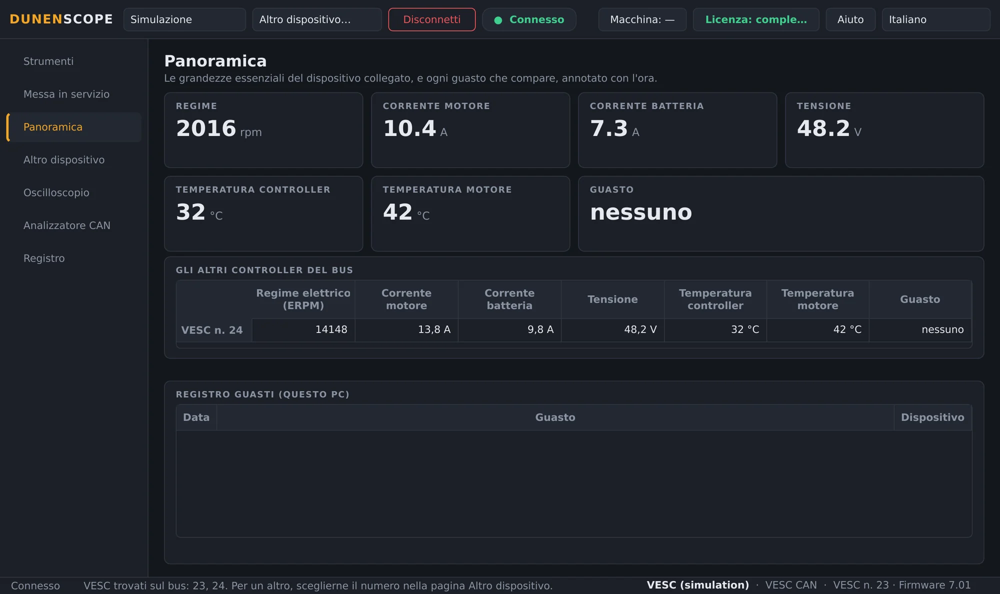
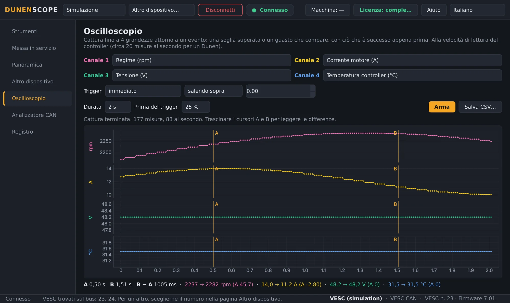
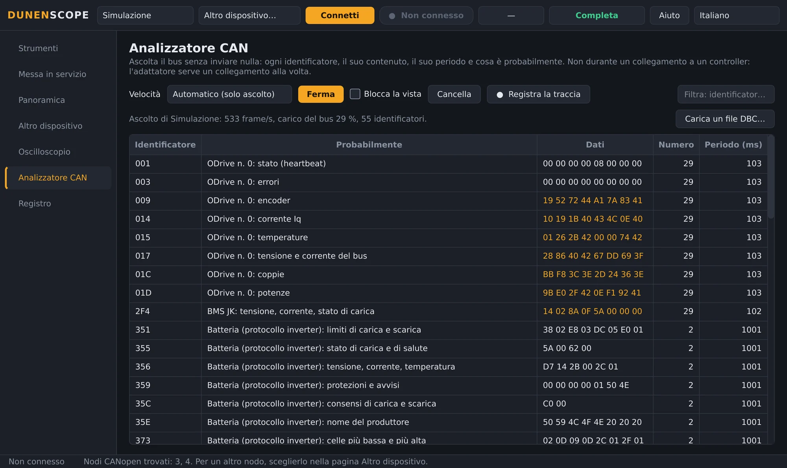
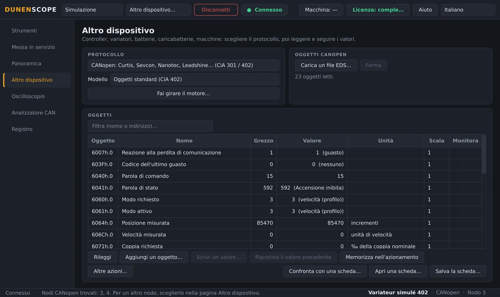
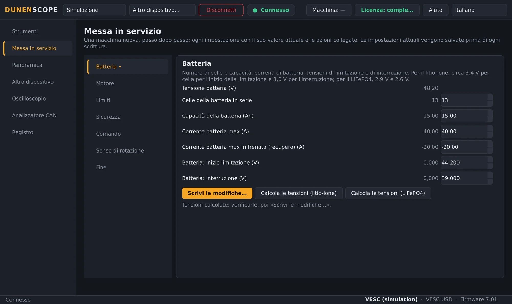
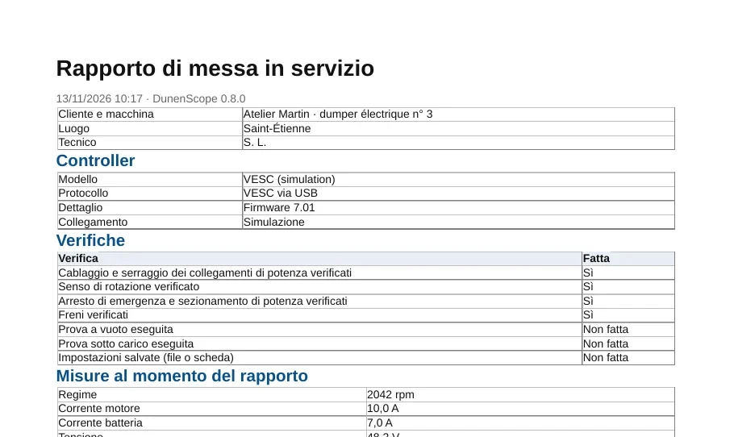
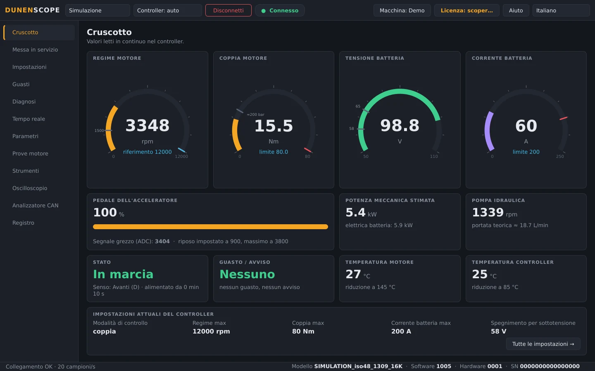
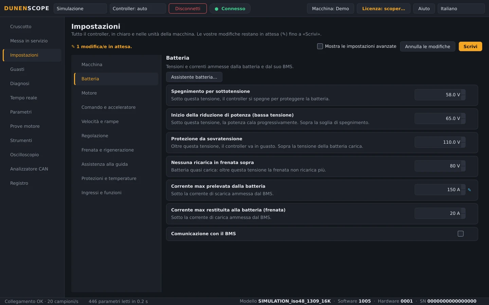

<a href="README.md">English</a> · <a href="README.fr.md">Français</a> · <a href="README.zh.md">中文</a> · <a href="README.es.md">Español</a> · <a href="README.de.md">Deutsch</a> · <b>Italiano</b> · <a href="README.pt.md">Português (BR)</a> · <a href="README.ru.md">Русский</a> · <a href="README.ja.md">日本語</a> · <a href="README.ko.md">한국어</a>

Windows 10 / 11 · 64 bit · lettura gratuita

## Diagnosi e regolazione di controller motore, azionamenti e batterie

DunenScope trasforma un PC Windows e un adattatore CAN, USB o RS-485 in un banco di diagnosi e regolazione: controller Dunen, controller compatibili con VESC® Software, azionamenti CANopen® e Modbus, Kelly, Curtis, Sevcon, BMS e caricabatterie. Spiega ogni guasto, conserva ciò che è successo subito prima, regola la macchina passo passo e produce il rapporto di messa in servizio.

> [!TIP]
> **Un bug? Manca un dispositivo?** Caricate qui i vostri file: ogni richiesta viene letta e presa in carico automaticamente in giornata, con una risposta sulla richiesta, domande se manca qualche informazione e poi la correzione o il dispositivo in un prossimo aggiornamento.
>
> **[Segnala un bug](https://github.com/simonlabrossedu71-tech/DunenScope/issues/new?template=signaler-bug.yml)** · **[Aggiungi il mio dispositivo](https://github.com/simonlabrossedu71-tech/DunenScope/issues/new?template=nouveau-controleur.yml)**

## Il video (46 s)

 <a href="https://github.com/simonlabrossedu71-tech/DunenScope/raw/main/docs/video/DunenScope_presentation_en.mp4">Scarica il video completo, con audio (MP4, 16 MB)</a>

## Cosa sa leggere e regolare

Scegliete l'apparecchio nella pagina **Altro dispositivo** (oppure lasciate che DunenScope riconosca un Dunen):

**Controller motore**

- **Dunen / ELYX** — 446 parametri, regolazione, messa in servizio guidata, prove motore, regolazione PI
- **Compatibili con VESC® Software** — via USB o CAN: regolazione, messa in servizio guidata, rilevamento del motore
- **Kelly KLS-D, KAC, KBL / KHB** — via CAN o collegamento seriale: misure e guasti
- **Votol EM, Fardriver, Bafang (motori M), ODrive** — misure e guasti

**Azionamenti industriali**

- **Azionamenti CANopen® CiA 402** — Nanotec, Leadshine…: oggetti del profilo o del file EDS, regolazione, prova motore
- **Curtis da 1232E a 1239E, Sevcon Gen4** — CANopen, sola lettura: misure e guasti
- **Modbus RTU e TCP** — Schneider ATV320, ASI BAC / Phaserunner, Sabvoton…: registri, bobine e ingressi

**Batterie e caricabatterie**

- **BMS JK, Daly, JBD / Xiaoxiang, protocollo inverter** — celle, temperature, corrente, carica, allarmi
- **Batterie Pylontech (RS-485), caricabatterie Elcon / TC** — sola lettura
- **Victron VE.Direct** — regolatori solari, caricabatterie, BMV e SmartShunt: solo ascolto

**Macchine e bus CAN**

- **Macchine J1939** — motore termico, guasti attivi
- **File DBC** — qualsiasi bus CAN descritto da un file DBC (Orion BMS 2…)

Il vostro apparecchio non c'è? Inviate i suoi file di comunicazione (manuale del protocollo, EDS, elenco dei registri, traccia CAN) con il modulo [Aggiungi il mio dispositivo](https://github.com/simonlabrossedu71-tech/DunenScope/issues/new?template=nouveau-controleur.yml).

## Cosa fa DunenScope

- **Connessione automatica** — un clic su Connetti: un Dunen si connette subito; altrimenti DunenScope ascolta i bus CAN senza emettere nulla e le porte seriali, poi si connette al dispositivo trovato o mostra l'elenco.
- **Messa in servizio guidata** — una macchina nuova, passo passo: batteria, motore, limiti, sicurezza, senso di rotazione; ogni impostazione con il valore attuale, i limiti e il suo equivalente pratico.
- **Una diagnosi che spiega** — ogni guasto, di ogni marca, con la causa probabile e cosa verificare; la scatola nera conserva i 20 secondi prima di ogni guasto; più controller dello stesso bus sorvegliati insieme.
- **Oscilloscopio** — quattro canali, trigger su soglia o alla comparsa di un guasto, pre-trigger conservato, cursori, esportazione CSV.
- **Analizzatore CAN** — ascolta il bus senza trasmettere nulla e dice cos'è ogni frame (CANopen, compatibile VESC, Kelly, Dunen, J1939); carico del bus, traccia registrata per Excel.
- **Rapporto di messa in servizio** — un PDF da consegnare al cliente: il controller, le misure, tutte le impostazioni, le verifiche spuntate e gli spazi per la firma.
- **Cruscotto e curve** — regime, coppia, tensione, corrente, temperature, stato e guasti in diretta; curve in tempo reale, registrazione CSV.
- **Salvataggio e scrittura sicura** — salvataggio automatico prima di ogni scrittura, valore riletto, motore fermo, annullamento; confrontate la macchina con una scheda, riga per riga.
- **Biblioteca online** — aprite la scheda di un modello condivisa da altri (nomi, unità, scale) o condividete la vostra, sempre senza i suoi valori.
- **Per i Dunen** — i 446 parametri con i numeri di DunenConfiger, impostazioni in chiaro nelle unità della macchina, configurazione facile, «Perché è limitato?», prove motore e regolazione PI, collaudo di fine linea.
- **Simulazione e dieci lingue** — si prova tutto senza hardware, guasti compresi; l'interfaccia e le spiegazioni dei guasti esistono in 10 lingue.

## Schermate

<table>
<tr><td width="50%" align="center"> Panoramica: guasti spiegati, più controller del bus</td><td width="50%" align="center"> Oscilloscopio: quattro grandezze catturate attorno a un evento</td></tr>
<tr><td width="50%" align="center"> Analizzatore CAN: ogni frame identificato</td><td width="50%" align="center"> Altro dispositivo: un azionamento CANopen CiA 402</td></tr>
<tr><td width="50%" align="center"> Messa in servizio guidata di un controller compatibile VESC</td><td width="50%" align="center"> Rapporto di messa in servizio in PDF</td></tr>
<tr><td width="50%" align="center"> Cruscotto di un Dunen</td><td width="50%" align="center"> Impostazioni di un Dunen, nelle unità della macchina</td></tr>
</table>

## Lettura gratuita, versione completa per regolare

| Funzione | Scoperta (gratis) | Versione completa |
| --- | :---: | :---: |
| Connessione, lettura di tutte le impostazioni, cruscotto, curve | ✅ | ✅ |
| Diagnosi, registro e scatola nera dei guasti, oscilloscopio, analizzatore CAN | ✅ | ✅ |
| Modalità Simulazione completa, aggiornamenti | ✅ | ✅ |
| Scrittura delle impostazioni nel controller, messa in servizio guidata | — | ✅ |
| Prove motore, regolazione PI, calibrazione del pedale | — | ✅ |

**Licenza a vita 50 €** · **abbonamento annuale 20 €** · **abbonamento trimestrale 7 €**. Una chiave per PC, attivata in pochi secondi dal pulsante **Licenza**. Funziona senza internet una volta attivata.

**Acquista online:** [A vita — 50 €](https://buy.polar.sh/polar_cl_qO94LG8UMUEZitzRuoHexlgbRA5yJC3UlaF5C1Fv4O9) · [Annuale — 20 €/anno](https://buy.polar.sh/polar_cl_St8xQg80RzRuOiugr63Lz4lFQkZ8MM2BkT6Jx1tNVVB) · [Trimestrale — 7 €/trimestre](https://buy.polar.sh/polar_cl_vjvXcXdimxbXQ3JzsfKf5UKQlYK8jFWHVp7yw0nHOmJ)

La chiave arriva per e-mail: DunenScope → **Licenza** → incollate la chiave → **Attiva**. Gli abbonamenti si collegano una volta ogni 45 giorni.

## Per iniziare

1. Scaricate **DunenScope_Setup** da [Releases](https://github.com/simonlabrossedu71-tech/DunenScope/releases/latest) e avviatelo. Se Windows mostra «PC protetto da Windows», fate clic su *Ulteriori informazioni* → *Esegui comunque*.
2. Collegate l'adattatore all'apparecchio e alimentatelo.
3. Lasciate **Controller: auto** e fate clic su **Connetti**: DunenScope trova ciò che è collegato e vi si connette. Potete anche scegliere il protocollo nella pagina **Altro dispositivo**.
4. Ancora senza hardware? Scegliete **Simulazione**: tutto si vede senza collegare nulla.

## Materiale necessario

- Windows 10 o 11, 64 bit.
- Un adattatore CAN: PEAK PCAN-USB (consigliato), Kvaser, IXXAT, Vector, CANable o candleLight.
- A seconda dell'apparecchio: il cavo USB di un controller compatibile VESC, un adattatore USB-RS485 (Modbus, BMS, Pylontech) o un cavo VE.Direct-USB (Victron).

## Manuali

Manuali completi (PDF), installati anche con il software:

- [Français (PDF)](docs/manuals/DunenScope_Notice_FR.pdf) · [English (PDF)](docs/manuals/DunenScope_Manual_EN.pdf) · [中文 (PDF)](docs/manuals/DunenScope_Manual_ZH.pdf)

## Aggiornamenti e dati

- Ogni programma di installazione è firmato; DunenScope verifica la firma prima di installare un aggiornamento.
- Le nuove versioni vengono proposte all'avvio, gratuitamente; impostazioni, schede e salvataggi vengono mantenuti.
- DunenScope contatta solo il servizio licenze, il server degli aggiornamenti e, se la aprite, la biblioteca online; i messaggi del pulsante Aiuto e i rapporti di errore partono solo con il vostro consenso.

## Licenza e sicurezza

Installando DunenScope accettate il [contratto di licenza per l'utente finale](docs/licence/EULA_IT.txt). DunenScope può modificare le impostazioni di un controller e far girare un motore: lavorate con la macchina in sicurezza e con personale qualificato. I componenti liberi forniti con il software (Qt, PySide6, python-can, libusb…) mantengono le proprie licenze, elencate in THIRD_PARTY_LICENSES.txt nella cartella di installazione.

DunenScope non è affiliato al progetto VESC né approvato da esso. CANopen® è un marchio registrato di CAN in Automation. Dunen, ELYX, Kelly, Curtis, Sevcon, Victron, Pylontech e gli altri marchi citati appartengono ai rispettivi proprietari.

Pubblicato da ORDA Engineering SAS, Saint-Étienne, Francia.
