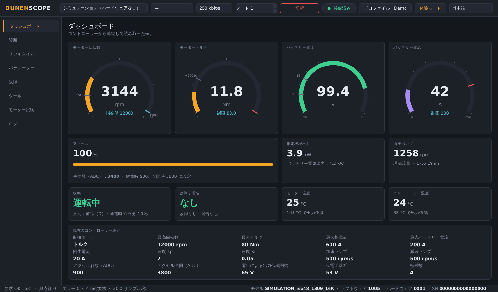
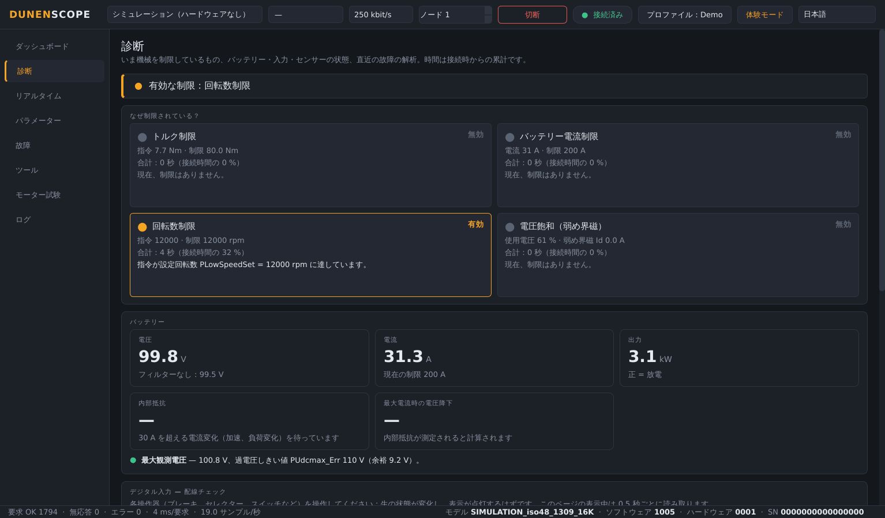
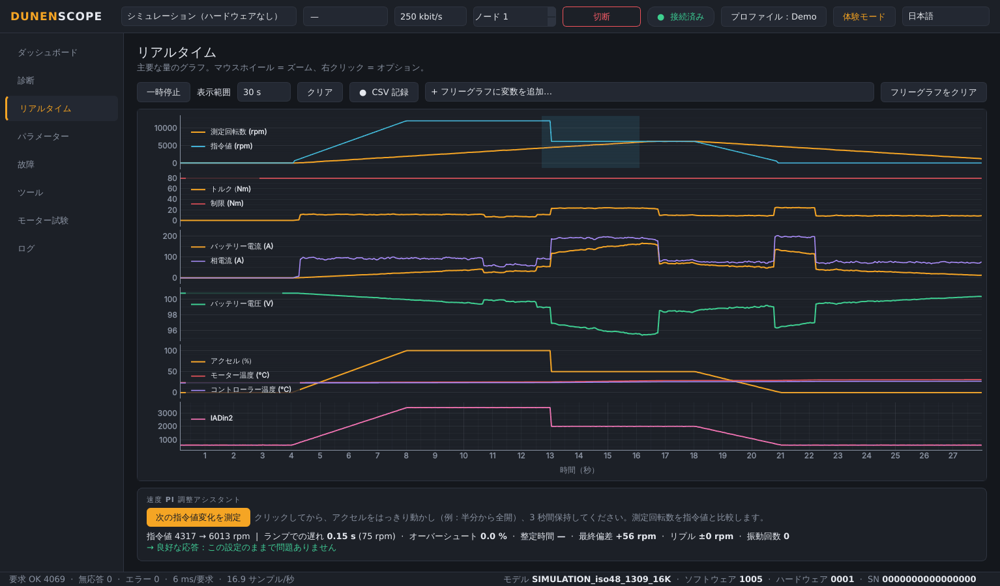
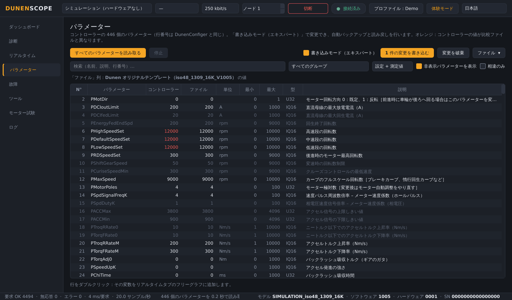
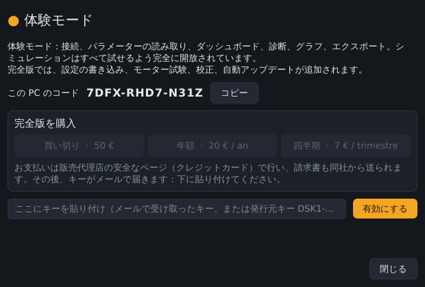

<a href="README.md">English</a> · <a href="README.fr.md">Français</a> · <a href="README.zh.md">中文</a> · <a href="README.es.md">Español</a> · <a href="README.de.md">Deutsch</a> · <a href="README.it.md">Italiano</a> · <a href="README.pt.md">Português (BR)</a> · <a href="README.ru.md">Русский</a> · <b>日本語</b> · <a href="README.ko.md">한국어</a>

Windows 10 / 11 · 64 ビット · 無料の体験モード

## Dunen / ELYX モーターコントローラー用の診断・立ち上げソフトウェア

DunenScope は、Windows PC と CAN アダプターを Dunen / ELYX コントローラーの本格的なテストベンチに変えます。機械の動きを見て、何が制限しているかを理解し、調整し、正しく動くことを確認する——それを数分で、しかも母国語で。

## DunenScope でできること

- **リアルタイムのダッシュボード** — 回転数、トルク、バッテリー電圧と電流、アクセル、出力、温度、状態、故障を 1 画面に表示。機械プロファイルに応じてポンプ流量や車速も表示します。
- **「なぜ制限されている？」** — いま働いている制限（トルク、バッテリー電流、回転数、電圧）とその継続時間を表示。バッテリーの内部抵抗と余裕、各入力の配線チェック、熱による出力低減までの残り時間、直近の故障の解析。
- **リアルタイムグラフ** — 6 つの同期グラフと、任意の 4 変数を選べるフリーグラフ。CSV 記録。
- **446 個すべてのパラメーター** — DunenConfiger と同じ行番号、検索、ファイルとの比較、DunenConfiger に再インポートできる xlsx と CSV へのエクスポート。
- **安全な書き込み** — 書き込みのたびに自動で完全バックアップ、読み戻し確認、危険なパラメーターはロック、モーター停止が必須、DunenConfiger と同様に不揮発メモリーへ保存。
- **速度 PI 調整** — 機械での測定、アドバイス付きのステップごとの手動調整、そして自動調整。
- **モーター試験** — 回転数またはトルクの指定、エンコーダー角度の自動学習、電流ループ。STOP / Esc と自動停止。
- **作業場向けツール** — ワンクリックのサポートパッケージ（.zip）、アクセル校正アシスタント、レポートと生産記録付きの出荷検査。
- **現場のために** — 10 言語、PEAK PCAN-USB・Kvaser・IXXAT・Vector・SLCAN アダプター、用途プロファイル、ハードウェアなしですべてを試せるシミュレーションモード。

## スクリーンショット

<table>
<tr><td width="50%" align="center"> 診断——機械を制限しているもの</td><td width="50%" align="center"> リアルタイムグラフと PI 調整アシスタント</td></tr>
<tr><td width="50%" align="center"> パラメーター——比較・書き込み・エクスポート</td><td width="50%" align="center"> ライセンス画面</td></tr>
</table>

## 無料の体験モードか完全版か

| 機能 | 体験版（無料） | 完全版 |
| --- | :---: | :---: |
| 接続、全パラメーターの読み取り、ダッシュボード、グラフ | ✅ | ✅ |
| 診断、故障履歴、出荷検査、エクスポート、サポートパッケージ | ✅ | ✅ |
| すべての機能を開放したシミュレーションモード | ✅ | ✅ |
| 実際のコントローラーへの設定の書き込み | — | ✅ |
| モーター試験、PI 調整、アクセル校正 | — | ✅ |
| 自動アップデート | — | ✅ |

### 完全版

**買い切りライセンス 50 €** · **年額サブスクリプション 20 €** · **四半期サブスクリプション 7 €**。1 つのキーで PC 1 台。右上の **ライセンス** ボタンから数秒で有効化できます。有効化後はインターネットなしで使用できます。オンライン販売はまもなく開始します。

サブスクリプションは 45 日に 1 回のオンライン確認で十分です。

## はじめに

1. [Releases](https://github.com/simonlabrossedu71-tech/DunenScope/releases/latest) から **DunenScope_Setup** をダウンロードして実行します。「Windows によって PC が保護されました」と表示された場合は、*詳細情報* → *実行* をクリックします。
2. 言語を選びます。PEAK ドライバーがない場合はインストーラーが案内します。
3. CAN アダプターをコントローラーに接続し、キーを ON にします。
4. アダプター、250 kbit/s、ノード 1 を選択 → **接続**。まだハードウェアがない場合は **シミュレーション** を選びます。
5. 完全版：**ライセンス** ボタン → キーを貼り付け → **有効にする**。

## 動作環境

- Windows 10 または 11、64 ビット。
- CAN アダプター：PEAK PCAN-USB（推奨）、Kvaser、IXXAT、Vector、SLCAN（CANable…）。
- DunenConfiger のプロトコル（CAN 上の Modbus、既定 250 kbit/s）を使う Dunen / ELYX コントローラー。

## マニュアル

完全なマニュアル（PDF）。スタートメニューにもインストールされます：

- [English (PDF)](docs/manuals/DunenScope_Manual_EN.pdf) · [Français (PDF)](docs/manuals/DunenScope_Notice_FR.pdf) · [中文 (PDF)](docs/manuals/DunenScope_Manual_ZH.pdf)

## アップデートとセキュリティ

- すべてのインストーラーは署名されており、DunenScope はアップデートをインストールする前に署名を確認します。
- 完全版のユーザーには起動時に新しいバージョンが案内されます。設定、プロファイル、バックアップは保持されます。
- DunenScope が通信するのはライセンスサービスとダウンロードサーバーだけです。その他のデータが PC の外に出ることはありません。

## ライセンスと安全上の注意

DunenScope をインストールすると、[エンドユーザー使用許諾契約](docs/licence/EULA_JA.txt)に同意したものとみなされます。DunenScope はコントローラーの設定を変更し、モーターを回転させることができます。機械を安全な状態にし、有資格者が作業してください。Dunen および ELYX は各所有者の商標です。
