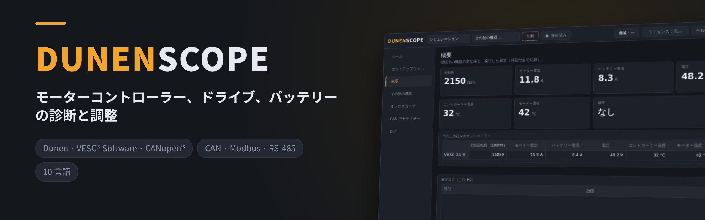
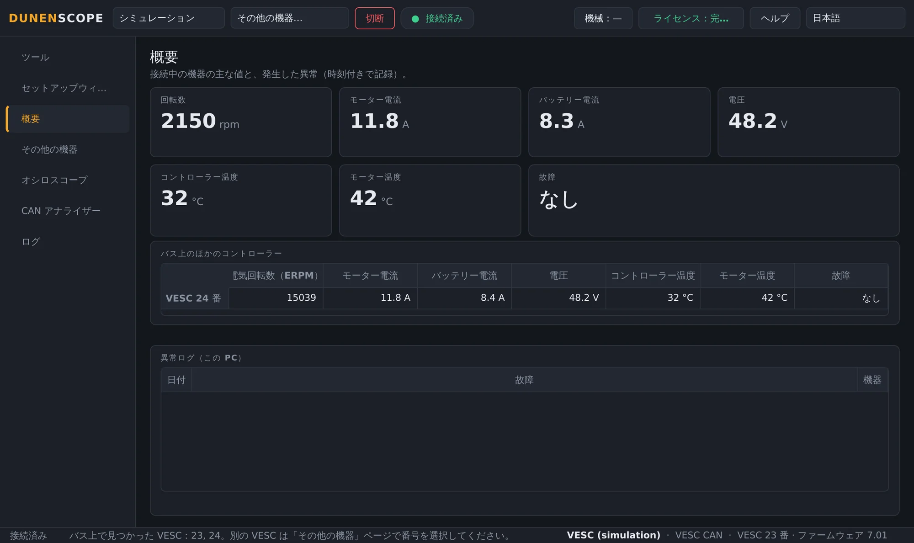
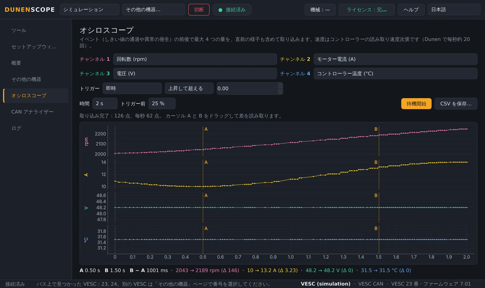
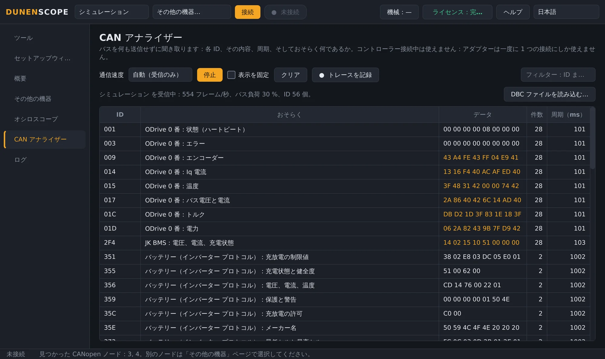
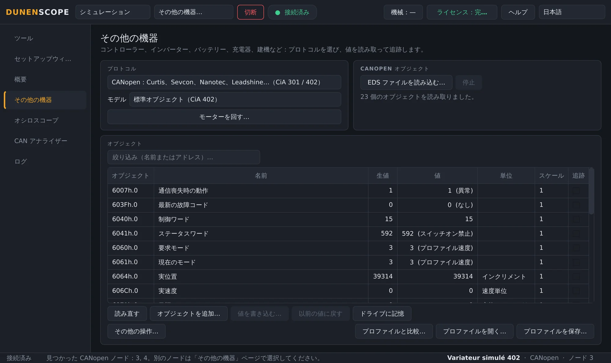
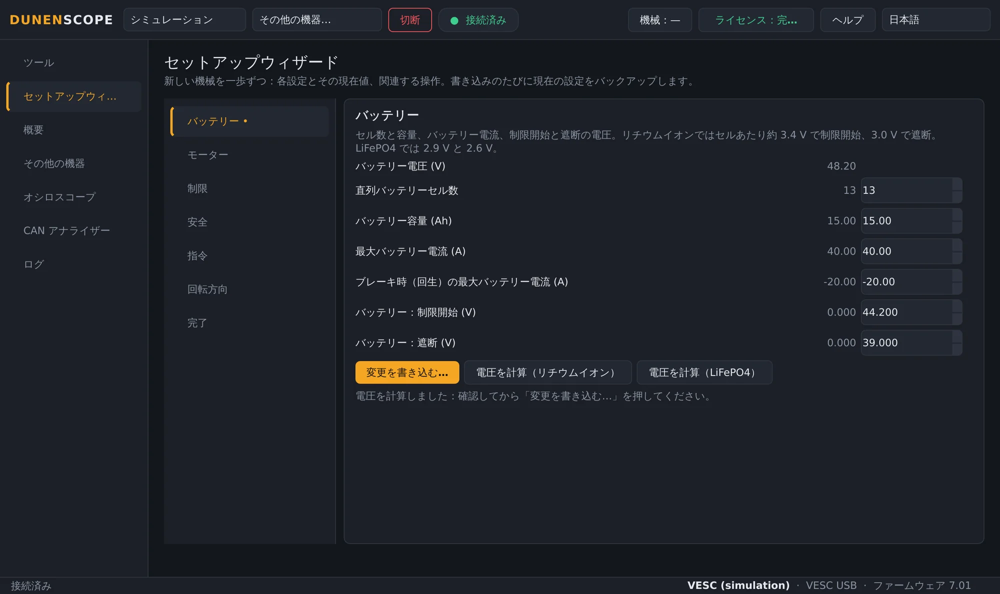
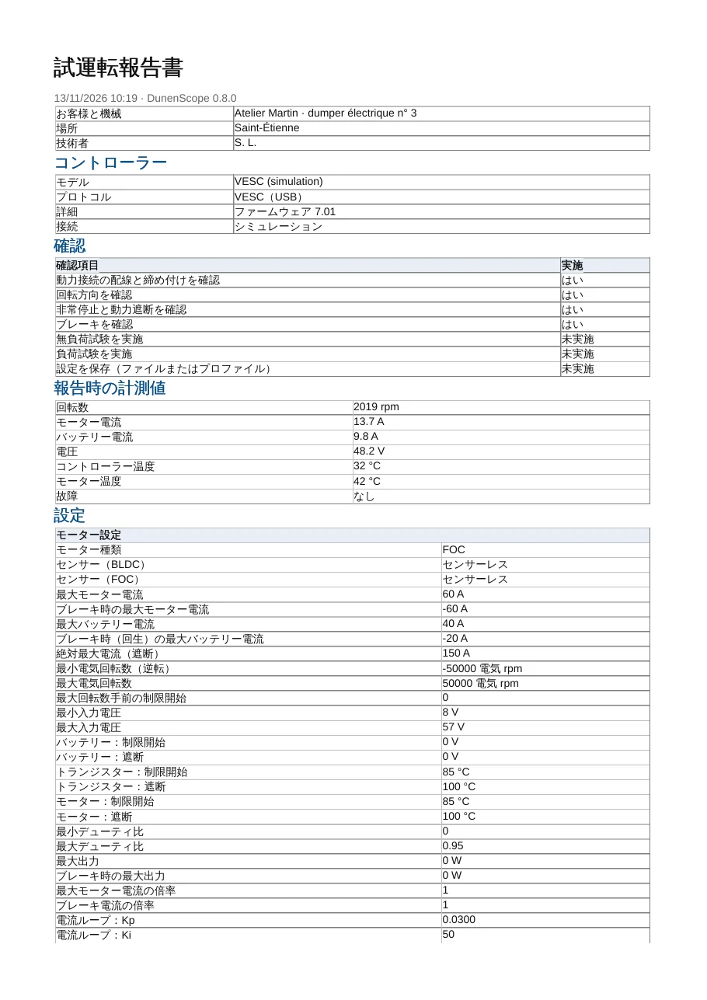
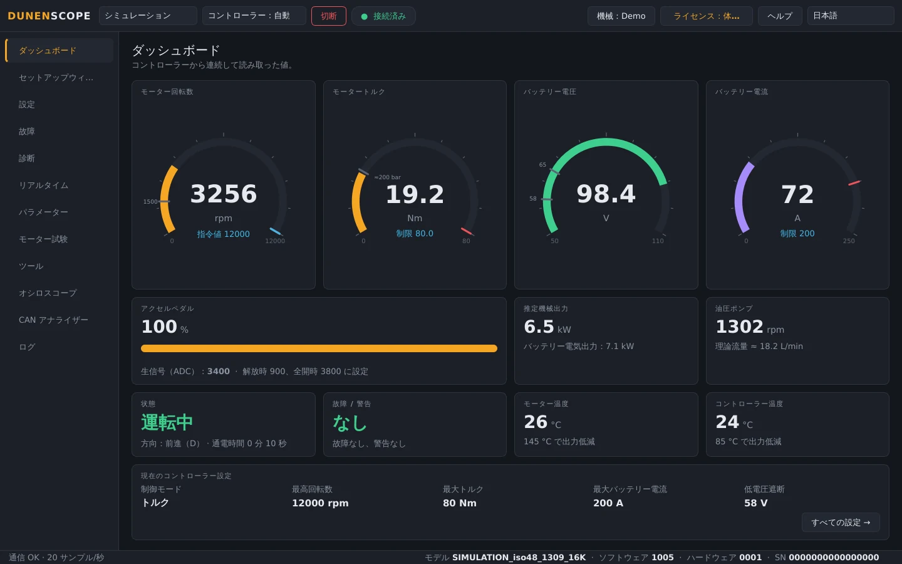
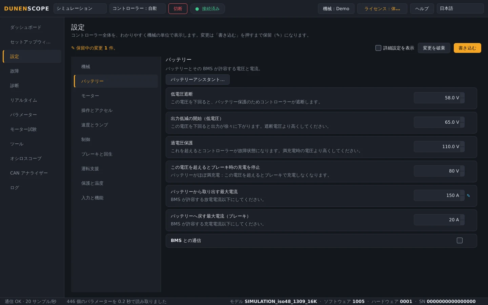

<a href="README.md">English</a> · <a href="README.fr.md">Français</a> · <a href="README.zh.md">中文</a> · <a href="README.es.md">Español</a> · <a href="README.de.md">Deutsch</a> · <a href="README.it.md">Italiano</a> · <a href="README.pt.md">Português (BR)</a> · <a href="README.ru.md">Русский</a> · <b>日本語</b> · <a href="README.ko.md">한국어</a>

Windows 10 / 11 · 64 ビット · 読み取りは無料

## モーターコントローラー、ドライブ、バッテリーの診断と調整

DunenScope は、Windows PC と CAN・USB・RS-485 アダプターを診断・調整ベンチに変えます。対象は Dunen コントローラー、VESC® Software 互換のコントローラー、CANopen® および Modbus ドライブ、Kelly、Curtis、Sevcon、BMS、充電器。すべての故障を説明し、その直前に起きたことを記録し、機械をステップごとに設定して、試運転報告書を作成します。

> [!TIP]
> **不具合がありますか？ 機器が足りませんか？** ここにファイルをお送りください。すべての依頼は 1 時間以内に自動で読み取られ、対応が始まります。依頼への回答、情報が足りない場合の質問、そして今後のアップデートでの修正または機器の追加まで行います。
>
> **[不具合を報告](https://github.com/simonlabrossedu71-tech/DunenScope/issues/new?template=signaler-bug.yml)** · **[機器を追加](https://github.com/simonlabrossedu71-tech/DunenScope/issues/new?template=nouveau-controleur.yml)**

## 動画（46 秒）

 <a href="https://github.com/simonlabrossedu71-tech/DunenScope/raw/main/docs/video/DunenScope_presentation_en.mp4">音声付きの完全版動画をダウンロード（MP4、16 MB）</a>

## 読み取り・調整できる機器

**その他の機器** ページで機器を選びます（Dunen なら DunenScope が自動で認識します）：

**モーターコントローラー**

- **Dunen / ELYX** — 446 個のパラメーター、調整、セットアップウィザード、モーター試験、PI 調整
- **VESC® Software 互換** — USB または CAN 経由：調整、セットアップウィザード、モーター検出
- **Kelly KLS-D、KAC、KBL / KHB** — CAN またはシリアル通信経由：計測値と故障
- **Votol EM、Fardriver、Bafang（M シリーズモーター）、ODrive** — 計測値と故障

**産業用ドライブ**

- **CANopen® CiA 402 ドライブ** — Nanotec、Leadshine…：プロファイルまたは EDS ファイルのオブジェクト、調整、モーター試験
- **Curtis 1232E～1239E、Sevcon Gen4** — CANopen、読み取り専用：計測値と故障
- **Modbus RTU および TCP** — Schneider ATV320、ASI BAC / Phaserunner、Sabvoton…：レジスター、コイル、入力

**バッテリーと充電器**

- **JK、Daly、JBD / Xiaoxiang の BMS、インバーター プロトコル** — セル、温度、電流、充電状態、アラーム
- **Pylontech バッテリー（RS-485）、Elcon / TC 充電器** — 読み取り専用
- **Victron VE.Direct** — ソーラー充電コントローラー、充電器、BMV、SmartShunt：受信のみ

**建機・農機と CAN バス**

- **J1939 車両** — エンジン、アクティブな故障
- **DBC ファイル** — DBC ファイルで記述された任意の CAN バス（Orion BMS 2…）

お使いの機器が見当たりませんか？ 通信資料（プロトコルマニュアル、EDS、レジスター一覧、CAN トレース）を [機器を追加](https://github.com/simonlabrossedu71-tech/DunenScope/issues/new?template=nouveau-controleur.yml) フォームからお送りください。

## DunenScope でできること

- **セットアップウィザード** — 新しい機械をステップごとに設定：バッテリー、モーター、制限値、安全、回転方向。各設定に現在値、範囲、わかりやすい換算値を表示します。
- **説明してくれる診断** — あらゆるメーカーのすべての故障について、考えられる原因と確認すべき点を表示。ブラックボックスが各故障の直前 20 秒を記録。同じバス上の複数のコントローラーを同時に監視。
- **オシロスコープ** — 4 チャンネル、しきい値または故障発生でトリガー、トリガー前のデータも保持、カーソル、CSV エクスポート。
- **CAN アナライザー** — 何も送信せずにバスを受信し、各フレームの内容（CANopen、VESC 互換、Kelly、Dunen、J1939）を表示。バス負荷、Excel 用のトレース記録。
- **試運転報告書** — お客様に渡せる PDF：コントローラー、計測値、全設定、チェック済みの確認項目、署名欄。
- **ダッシュボードとグラフ** — 回転数、トルク、電圧、電流、温度、状態、故障をリアルタイム表示。リアルタイムグラフ、CSV 記録。
- **バックアップと安全な書き込み** — 書き込みのたびに自動バックアップ、読み戻し確認、モーター停止が条件、元に戻す機能。機械とプロファイルを 1 行ずつ比較。
- **オンラインライブラリー** — 他のユーザーが共有したモデルのプロファイル（名前、単位、スケール）を開いたり、自分のプロファイルを共有したりできます。値は常に含まれません。
- **Dunen 向け** — DunenConfiger と同じ番号で 446 個すべてのパラメーター、機械の単位でわかりやすく表示される設定、かんたん設定、「なぜ制限されている？」、モーター試験と PI 調整、出荷検査。
- **シミュレーションと 10 言語** — 故障を含め、すべてをハードウェアなしで試せます。画面と故障の説明は 10 言語に対応。

## スクリーンショット

<table>
<tr><td width="50%" align="center"> 概要：故障の説明、バス上の複数のコントローラー</td><td width="50%" align="center"> オシロスコープ：イベント前後に記録した 4 つの量</td></tr>
<tr><td width="50%" align="center"> CAN アナライザー：すべてのフレームを識別</td><td width="50%" align="center"> その他の機器：CANopen CiA 402 ドライブ</td></tr>
<tr><td width="50%" align="center"> VESC 互換コントローラーのセットアップウィザード</td><td width="50%" align="center"> PDF の試運転報告書</td></tr>
<tr><td width="50%" align="center"> Dunen のダッシュボード</td><td width="50%" align="center"> Dunen の設定（機械の単位で表示）</td></tr>
</table>

## 読み取りは無料、調整には完全版

| 機能 | 体験版（無料） | 完全版 |
| --- | :---: | :---: |
| 接続、全設定の読み取り、ダッシュボード、グラフ | ✅ | ✅ |
| 診断、故障ログとブラックボックス、オシロスコープ、CAN アナライザー | ✅ | ✅ |
| すべて使えるシミュレーションモード、アップデート | ✅ | ✅ |
| コントローラーへの設定の書き込み、セットアップウィザード | — | ✅ |
| モーター試験、PI 調整、ペダルのキャリブレーション | — | ✅ |

**買い切りライセンス 50 €** · **年額サブスクリプション 20 €** · **四半期サブスクリプション 7 €**。1 つのキーで PC 1 台。**ライセンス** ボタンから数秒で有効化できます。有効化後はインターネットなしで使えます。

**オンラインで購入：** [買い切り — 50 €](https://buy.polar.sh/polar_cl_qO94LG8UMUEZitzRuoHexlgbRA5yJC3UlaF5C1Fv4O9) · [年額 — 20 €/年](https://buy.polar.sh/polar_cl_St8xQg80RzRuOiugr63Lz4lFQkZ8MM2BkT6Jx1tNVVB) · [四半期 — 7 €/四半期](https://buy.polar.sh/polar_cl_vjvXcXdimxbXQ3JzsfKf5UKQlYK8jFWHVp7yw0nHOmJ)

キーはメールで届きます：DunenScope → **ライセンス** → キーを貼り付け → **有効にする**。サブスクリプションは 45 日に 1 回オンラインで確認します。

## はじめに

1. [Releases](https://github.com/simonlabrossedu71-tech/DunenScope/releases/latest) から **DunenScope_Setup** をダウンロードして実行します。「Windows によって PC が保護されました」と表示された場合は、*詳細情報* → *実行* をクリックします。
2. アダプターを機器に接続し、電源を入れます。
3. Dunen は自動で見つかります → **接続**。他のメーカーの場合：**その他の機器** ページでプロトコルを選択 → **接続**。
4. まだハードウェアがない場合は **シミュレーション** を選びます：何も接続せずにすべてを確認できます。

## 必要な機材

- Windows 10 または 11、64 ビット。
- CAN アダプター：PEAK PCAN-USB（推奨）、Kvaser、IXXAT、Vector、CANable、candleLight。
- 機器に応じて：VESC 互換コントローラーの USB ケーブル、USB-RS485 アダプター（Modbus、BMS、Pylontech）、または VE.Direct-USB ケーブル（Victron）。

## マニュアル

完全なマニュアル（PDF）。ソフトウェアと一緒にインストールされます：

- [Français (PDF)](docs/manuals/DunenScope_Notice_FR.pdf) · [English (PDF)](docs/manuals/DunenScope_Manual_EN.pdf) · [中文 (PDF)](docs/manuals/DunenScope_Manual_ZH.pdf)

## アップデートとデータ

- すべてのインストーラーは署名されており、DunenScope はアップデートをインストールする前に署名を確認します。
- 新しいバージョンは起動時に無料で案内されます。設定、プロファイル、バックアップは保持されます。
- DunenScope が通信するのは、ライセンスサービス、アップデートサーバー、そして開いた場合のオンラインライブラリーだけです。ヘルプ ボタンからのメッセージとエラーレポートは、同意した場合にのみ送信されます。

## ライセンスと安全

DunenScope をインストールすると、[エンドユーザー使用許諾契約](docs/licence/EULA_JA.txt)に同意したものとみなされます。DunenScope はコントローラーの設定を変更し、モーターを回転させることができます。機械を安全な状態にし、有資格者が作業してください。ソフトウェアに同梱されたオープンソースコンポーネント（Qt、PySide6、python-can、libusb…）はそれぞれのライセンスに従います。一覧はインストールフォルダーの THIRD_PARTY_LICENSES.txt にあります。

DunenScope は VESC プロジェクトとは提携しておらず、その承認も受けていません。CANopen® は CAN in Automation の登録商標です。Dunen、ELYX、Kelly、Curtis、Sevcon、Victron、Pylontech、その他記載のブランドは各所有者に帰属します。

発行：ORDA Engineering SAS（フランス、サン＝テティエンヌ）。
