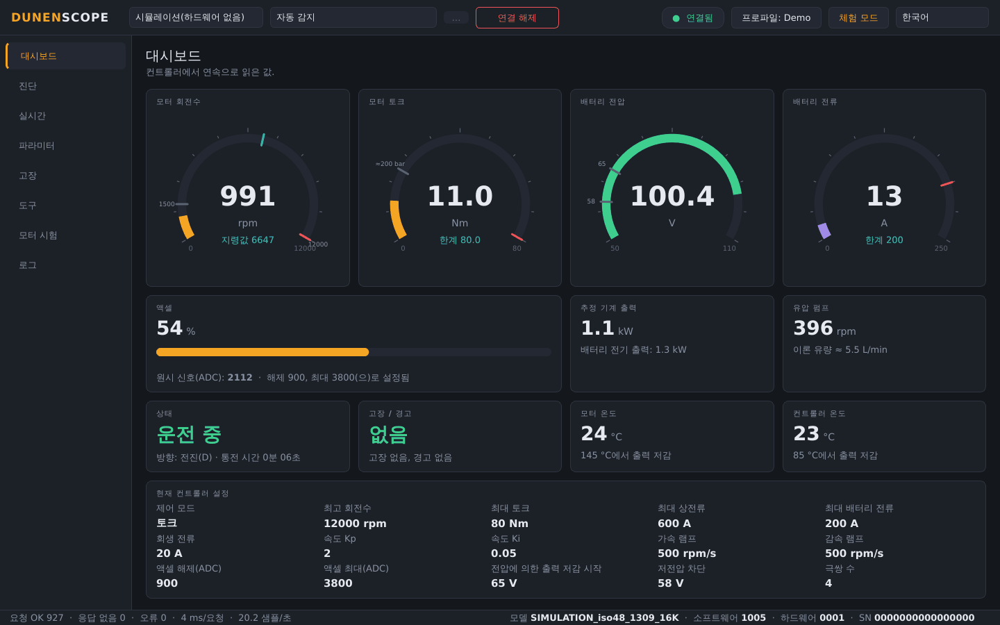
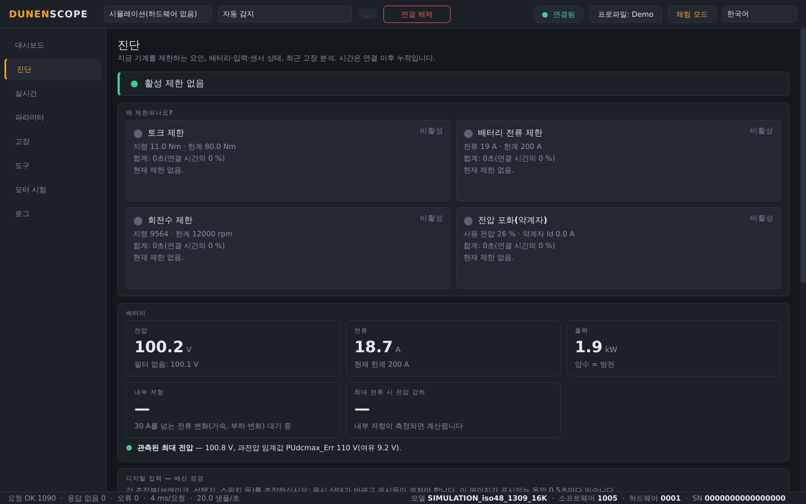
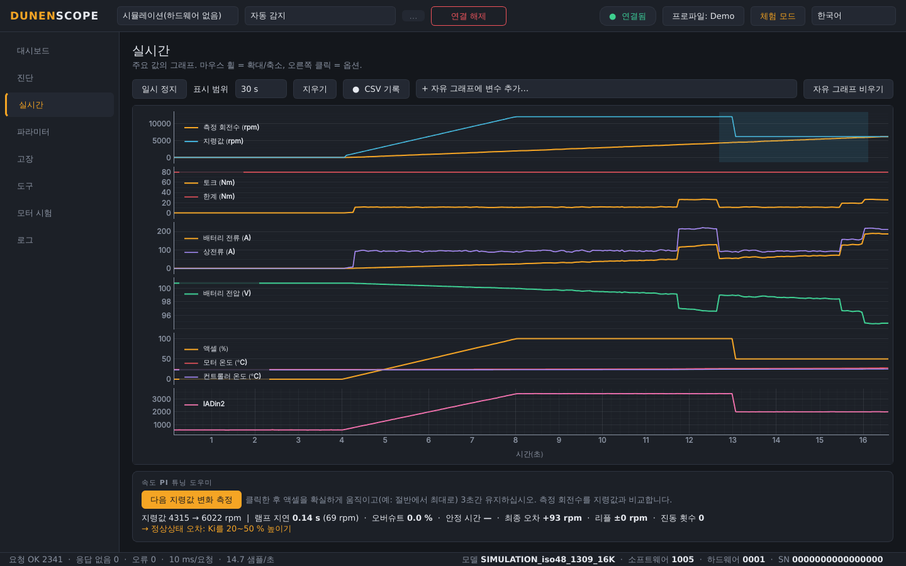
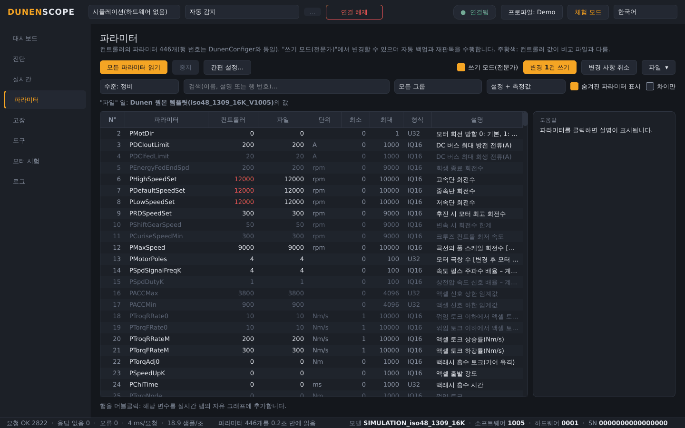
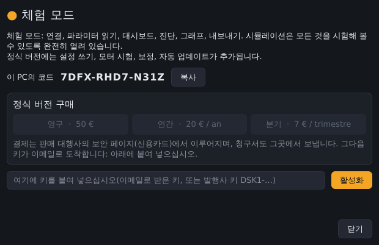

<a href="README.md">English</a> · <a href="README.fr.md">Français</a> · <a href="README.zh.md">中文</a> · <a href="README.es.md">Español</a> · <a href="README.de.md">Deutsch</a> · <a href="README.it.md">Italiano</a> · <a href="README.pt.md">Português (BR)</a> · <a href="README.ru.md">Русский</a> · <a href="README.ja.md">日本語</a> · <b>한국어</b>

Windows 10 / 11 · 64비트 · 무료 체험 모드

## Dunen / ELYX 모터 컨트롤러용 진단 및 시운전 소프트웨어

DunenScope는 Windows PC와 CAN 어댑터를 Dunen / ELYX 컨트롤러를 위한 완전한 테스트 벤치로 바꿔 줍니다. 기계가 무엇을 하는지 보고, 무엇이 제한하는지 이해하고, 조정하고, 제대로 작동함을 확인하세요——몇 분 만에, 여러분의 언어로.

## DunenScope로 할 수 있는 일

- **연결만 하면 끝** — CAN 어댑터, 통신 속도, 컨트롤러 주소를 자동으로 찾고 모델을 인식합니다.
- **간편 설정** — 몇 가지 질문(배터리, 회전수, 주행 느낌)에 답하면 설정값을 계산해 목록에 준비합니다. 모든 파라미터 도움말과 쓰기 전 일관성 검사 포함.
- **기타 컨트롤러** — DunenScope가 아직 모르는 모델도: 프로토콜을 선택하고, 응답하는 레지스터를 찾아 이름을 붙이고, 그래프로 보고, 모델 프로파일을 저장합니다.
- **앱에서 바로 문의** — 도움말 버튼으로 문제, 아이디어, 질문을 개발사에 바로 보낼 수 있으며, 오류 보고서는 동의한 경우에만 전송됩니다.
- **실시간 대시보드** — 회전수, 토크, 배터리 전압과 전류, 액셀, 출력, 온도, 상태, 고장을 한 화면에 표시하고, 기계 프로파일에 따라 펌프 유량이나 차량 속도도 보여 줍니다.
- **"왜 제한되나요?"** — 지금 작동 중인 제한(토크, 배터리 전류, 회전수, 전압)과 지속 시간을 표시합니다. 배터리 내부 저항과 여유, 각 입력의 배선 점검, 열 저감까지 남은 시간, 최근 고장 분석.
- **실시간 그래프** — 동기화된 그래프 6개와 원하는 변수 4개를 고르는 자유 그래프, CSV 기록.
- **446개 파라미터 전체** — DunenConfiger와 같은 행 번호, 검색, 파일과 비교, DunenConfiger로 다시 가져올 수 있는 xlsx 및 CSV 내보내기.
- **안전한 쓰기** — 쓰기 전마다 자동 전체 백업, 재판독 확인, 위험한 파라미터 잠금, 모터 정지 필수, DunenConfiger처럼 비휘발성 메모리에 저장.
- **속도 PI 튜닝** — 기계에서의 측정, 조언이 포함된 단계별 수동 튜닝, 자동 튜닝.
- **모터 시험** — 회전수 또는 토크 지정, 엔코더 각도 자동 학습, 전류 루프. STOP / Esc 및 자동 정지.
- **작업장 도구** — 원클릭 지원 패키지(.zip), 액셀 보정 도우미, 보고서와 생산 기록이 포함된 출하 검사.
- **현장을 위한 설계** — 10개 언어, PEAK PCAN-USB·Kvaser·IXXAT·Vector·SLCAN 어댑터, 용도 프로파일, 하드웨어 없이 모든 기능을 시험할 수 있는 시뮬레이션 모드.

## 스크린샷

<table>
<tr><td width="50%" align="center"> 진단——기계를 제한하는 요인</td><td width="50%" align="center"> 실시간 그래프와 PI 튜닝 도우미</td></tr>
<tr><td width="50%" align="center"> 파라미터——비교, 쓰기, 내보내기</td><td width="50%" align="center"> 라이선스 창</td></tr>
</table>

## 무료 체험 모드 또는 정식 버전

| 기능 | 체험(무료) | 정식 버전 |
| --- | :---: | :---: |
| 연결, 모든 파라미터 읽기, 대시보드, 그래프 | ✅ | ✅ |
| 진단, 고장 이력, 출하 검사, 내보내기, 지원 패키지 | ✅ | ✅ |
| 모든 기능이 열린 시뮬레이션 모드 | ✅ | ✅ |
| 자동 업데이트 | ✅ | ✅ |
| 실제 컨트롤러에 설정 쓰기 | — | ✅ |
| 모터 시험, PI 튜닝, 액셀 보정 | — | ✅ |

### 정식 버전

**영구 라이선스 50 €** · **연간 구독 20 €** · **분기 구독 7 €**. 키 하나당 PC 한 대이며, 오른쪽 위 **라이선스** 버튼에서 몇 초 만에 활성화됩니다. 활성화 후에는 인터넷 없이 작동합니다.

**온라인 구매:** [영구 — 50 €](https://buy.polar.sh/polar_cl_qO94LG8UMUEZitzRuoHexlgbRA5yJC3UlaF5C1Fv4O9) · [연간 — 20 €/년](https://buy.polar.sh/polar_cl_St8xQg80RzRuOiugr63Lz4lFQkZ8MM2BkT6Jx1tNVVB) · [분기 — 7 €/분기](https://buy.polar.sh/polar_cl_vjvXcXdimxbXQ3JzsfKf5UKQlYK8jFWHVp7yw0nHOmJ)

키는 이메일로 발송됩니다. DunenScope의 **라이선스** → **활성화**에 붙여넣으세요.

구독은 45일에 한 번만 인터넷에 연결하면 됩니다.

## 시작하기

1. [Releases](https://github.com/simonlabrossedu71-tech/DunenScope/releases/latest)에서 **DunenScope_Setup**을 다운로드하여 실행합니다. Windows에 "Windows의 PC 보호"가 표시되면 *추가 정보* → *실행*을 클릭합니다.
2. 언어를 선택합니다. PEAK 드라이버가 없으면 설치 프로그램이 설치를 제안합니다.
3. CAN 어댑터를 컨트롤러에 연결하고 키를 ON으로 합니다.
4. **연결**을 클릭하면 DunenScope가 어댑터, 통신 속도, 노드를 스스로 찾습니다. 아직 하드웨어가 없나요? **시뮬레이션**을 선택하세요.
5. 정식 버전: **라이선스** 버튼 → 키 붙여 넣기 → **활성화**.

## 시스템 요구 사항

- Windows 10 또는 11, 64비트.
- CAN 어댑터: PEAK PCAN-USB(권장), Kvaser, IXXAT, Vector 또는 SLCAN(CANable…).
- DunenConfiger 프로토콜(CAN 기반 Modbus, 기본 250 kbit/s)을 사용하는 Dunen / ELYX 컨트롤러.

## 설명서

전체 설명서(PDF)이며, 시작 메뉴에도 설치됩니다:

- [English (PDF)](docs/manuals/DunenScope_Manual_EN.pdf) · [Français (PDF)](docs/manuals/DunenScope_Notice_FR.pdf) · [中文 (PDF)](docs/manuals/DunenScope_Manual_ZH.pdf)

## 업데이트와 보안

- 모든 설치 프로그램은 서명되어 있으며, DunenScope는 업데이트를 설치하기 전에 서명을 확인합니다.
- 새 버전은 시작할 때 모든 사용자에게 무료로 안내되며, 설정·프로파일·백업은 유지됩니다.
- DunenScope는 라이선스 서비스와 다운로드 서버에만 연결합니다. 그 밖의 데이터는 PC 밖으로 나가지 않습니다.

## 라이선스와 안전 수칙

DunenScope를 설치하면 [최종 사용자 사용권 계약](docs/licence/EULA_KO.txt)에 동의하는 것으로 간주됩니다. DunenScope는 컨트롤러 설정을 변경하고 모터를 회전시킬 수 있습니다. 기계를 안전한 상태로 두고 자격을 갖춘 인원이 작업하십시오. Dunen과 ELYX는 각 소유자의 상표입니다.
