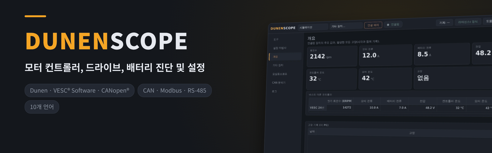
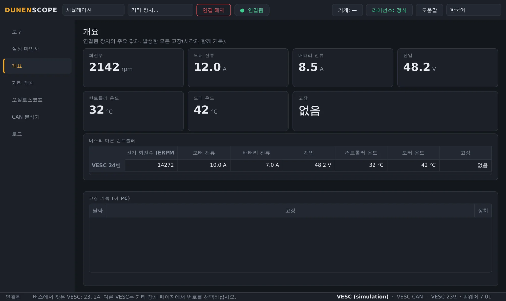
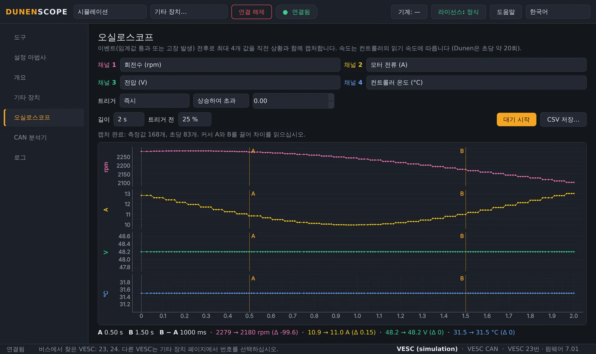
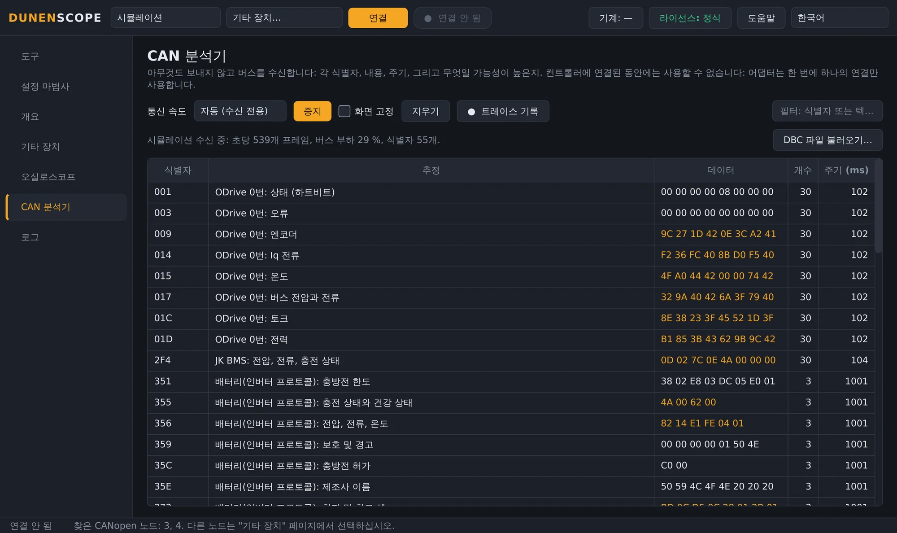
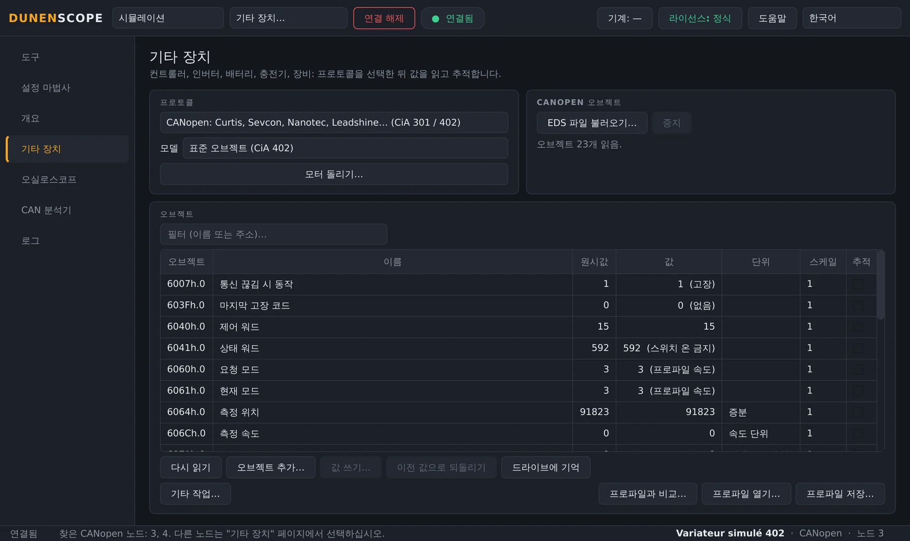
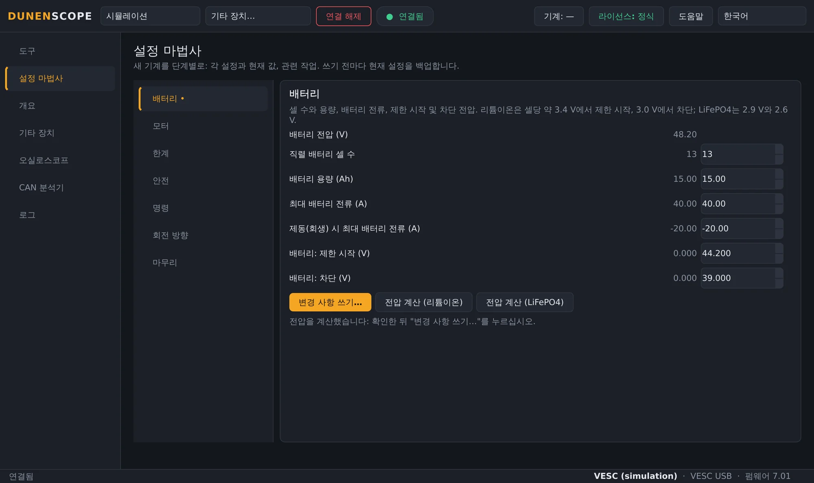
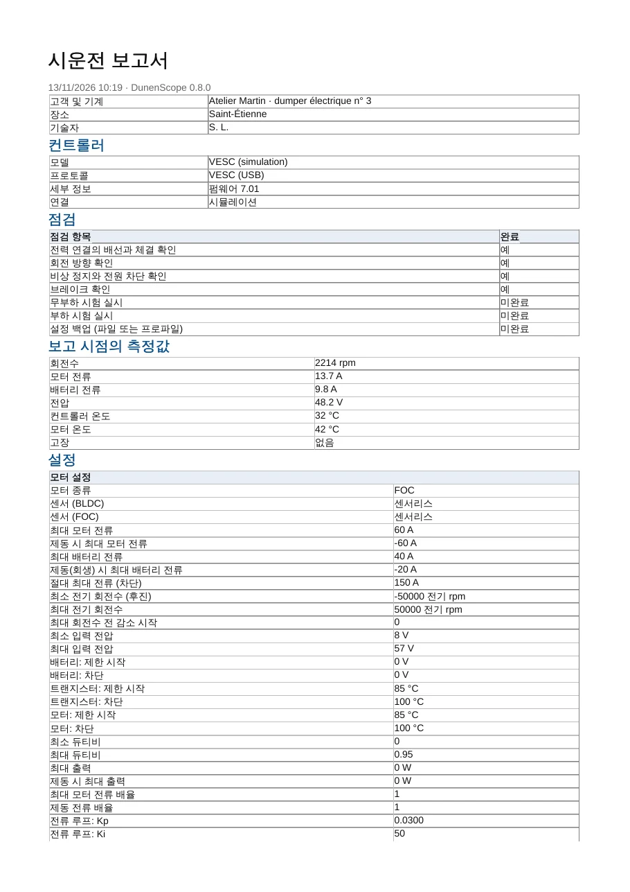
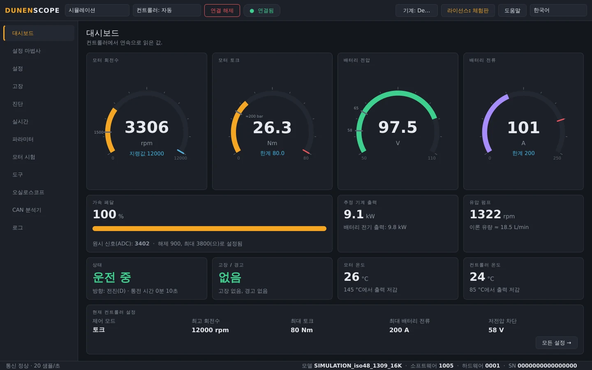
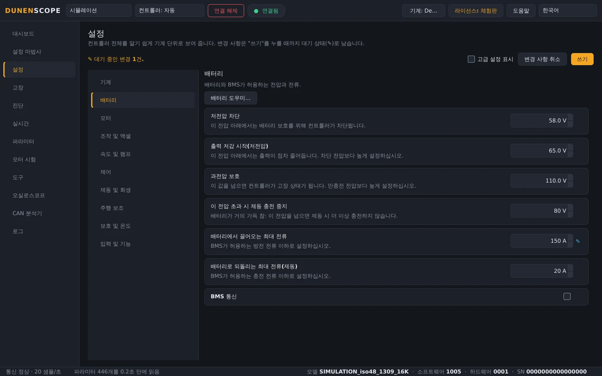

<a href="README.md">English</a> · <a href="README.fr.md">Français</a> · <a href="README.zh.md">中文</a> · <a href="README.es.md">Español</a> · <a href="README.de.md">Deutsch</a> · <a href="README.it.md">Italiano</a> · <a href="README.pt.md">Português (BR)</a> · <a href="README.ru.md">Русский</a> · <a href="README.ja.md">日本語</a> · <b>한국어</b>

Windows 10 / 11 · 64비트 · 읽기 무료

## 모터 컨트롤러, 드라이브, 배터리 진단 및 설정

DunenScope는 Windows PC와 CAN, USB 또는 RS-485 어댑터를 진단·설정 벤치로 바꿔 줍니다. Dunen 컨트롤러, VESC® Software 호환 컨트롤러, CANopen® 및 Modbus 드라이브, Kelly, Curtis, Sevcon, BMS, 충전기를 지원합니다. 모든 고장을 설명하고, 고장 직전의 상황을 기록하며, 기계를 단계별로 설정하고 시운전 보고서를 만들어 줍니다.

## 동영상(46초)

 <a href="https://github.com/simonlabrossedu71-tech/DunenScope/raw/main/docs/video/DunenScope_presentation_en.mp4">소리가 포함된 전체 동영상 다운로드(MP4, 16 MB)</a>

## 읽고 설정할 수 있는 장치

**기타 장치** 페이지에서 장치를 선택하세요(Dunen은 DunenScope가 자동으로 인식합니다):

**모터 컨트롤러**

- **Dunen / ELYX** — 446개 파라미터, 설정, 설정 마법사, 모터 시험, PI 튜닝
- **VESC® Software 호환** — USB 또는 CAN: 설정, 설정 마법사, 모터 감지
- **Kelly KLS-D, KAC, KBL / KHB** — CAN 또는 시리얼 통신: 측정값과 고장
- **Votol EM, Fardriver, Bafang(M 시리즈 모터), ODrive** — 측정값과 고장

**산업용 드라이브**

- **CANopen® CiA 402 드라이브** — Nanotec, Leadshine…: 프로파일 또는 EDS 파일의 오브젝트, 설정, 모터 시험
- **Curtis 1232E~1239E, Sevcon Gen4** — CANopen, 읽기 전용: 측정값과 고장
- **Modbus RTU 및 TCP** — Schneider ATV320, ASI BAC / Phaserunner, Sabvoton…: 레지스터, 코일, 입력

**배터리와 충전기**

- **JK, Daly, JBD / Xiaoxiang BMS, 인버터 프로토콜** — 셀, 온도, 전류, 충전 상태, 경보
- **Pylontech 배터리(RS-485), Elcon / TC 충전기** — 읽기 전용
- **Victron VE.Direct** — 태양광 충전 컨트롤러, 충전기, BMV, SmartShunt: 수신 전용

**건설·농기계 및 CAN 버스**

- **J1939 장비** — 엔진, 활성 고장
- **DBC 파일** — DBC 파일로 기술된 모든 CAN 버스(Orion BMS 2…)

사용하는 장치가 목록에 없나요? 통신 자료(프로토콜 설명서, EDS, 레지스터 목록, CAN 트레이스)를 [내 장치 추가](https://github.com/simonlabrossedu71-tech/DunenScope/issues/new?template=nouveau-controleur.yml) 양식으로 보내 주세요.

## DunenScope로 할 수 있는 일

- **설정 마법사** — 새 기계를 단계별로: 배터리, 모터, 제한값, 안전, 회전 방향. 각 설정마다 현재 값, 허용 범위, 알기 쉬운 환산값을 보여 줍니다.
- **설명해 주는 진단** — 모든 브랜드의 모든 고장에 대해 가능한 원인과 점검할 사항을 알려 줍니다. 블랙박스가 고장 직전 20초를 기록하고, 같은 버스의 여러 컨트롤러를 함께 감시합니다.
- **오실로스코프** — 4채널, 임계값 또는 고장 발생 시 트리거, 트리거 이전 구간 보존, 커서, CSV 내보내기.
- **CAN 분석기** — 아무것도 송신하지 않고 버스를 수신하여 각 프레임이 무엇인지(CANopen, VESC 호환, Kelly, Dunen, J1939) 알려 줍니다. 버스 부하, Excel용 트레이스 기록.
- **시운전 보고서** — 고객에게 전달할 PDF: 컨트롤러, 측정값, 전체 설정, 체크한 점검 항목, 서명란.
- **대시보드와 그래프** — 회전수, 토크, 전압, 전류, 온도, 상태, 고장을 실시간으로 표시. 실시간 그래프, CSV 기록.
- **백업과 안전한 쓰기** — 쓰기 전마다 자동 백업, 재판독 확인, 모터 정지 상태에서만 쓰기, 되돌리기. 기계를 프로파일과 한 줄씩 비교.
- **온라인 라이브러리** — 다른 사용자가 공유한 모델 프로파일(이름, 단위, 스케일)을 열거나 내 프로파일을 공유합니다. 값은 항상 제외됩니다.
- **Dunen 전용** — DunenConfiger 번호가 붙은 446개 파라미터 전체, 기계 단위로 알기 쉽게 표시되는 설정, 간편 설정, "왜 제한되나요?", 모터 시험과 PI 튜닝, 출하 검사.
- **시뮬레이션과 10개 언어** — 고장을 포함해 모든 기능을 하드웨어 없이 시험할 수 있습니다. 화면과 고장 설명은 10개 언어로 제공됩니다.

## 스크린샷

<table>
<tr><td width="50%" align="center"> 개요: 고장 설명, 버스의 여러 컨트롤러</td><td width="50%" align="center"> 오실로스코프: 이벤트 전후로 캡처한 4개 값</td></tr>
<tr><td width="50%" align="center"> CAN 분석기: 모든 프레임 식별</td><td width="50%" align="center"> 기타 장치: CANopen CiA 402 드라이브</td></tr>
<tr><td width="50%" align="center"> VESC 호환 컨트롤러의 설정 마법사</td><td width="50%" align="center"> PDF 시운전 보고서</td></tr>
<tr><td width="50%" align="center"> Dunen 대시보드</td><td width="50%" align="center"> Dunen 설정, 기계 단위로 표시</td></tr>
</table>

## 읽기는 무료, 설정은 정식 버전

| 기능 | 체험판(무료) | 정식 버전 |
| --- | :---: | :---: |
| 연결, 모든 설정 읽기, 대시보드, 그래프 | ✅ | ✅ |
| 진단, 고장 기록과 블랙박스, 오실로스코프, CAN 분석기 | ✅ | ✅ |
| 전체 시뮬레이션 모드, 업데이트 | ✅ | ✅ |
| 컨트롤러에 설정 쓰기, 설정 마법사 | — | ✅ |
| 모터 시험, PI 튜닝, 페달 보정 | — | ✅ |

**영구 라이선스 50 €** · **연간 구독 20 €** · **분기 구독 7 €**. 키 하나당 PC 한 대이며, **라이선스** 버튼에서 몇 초 만에 활성화됩니다. 활성화 후에는 인터넷 없이 작동합니다.

**온라인 구매:** [영구 — 50 €](https://buy.polar.sh/polar_cl_qO94LG8UMUEZitzRuoHexlgbRA5yJC3UlaF5C1Fv4O9) · [연간 — 20 €/년](https://buy.polar.sh/polar_cl_St8xQg80RzRuOiugr63Lz4lFQkZ8MM2BkT6Jx1tNVVB) · [분기 — 7 €/분기](https://buy.polar.sh/polar_cl_vjvXcXdimxbXQ3JzsfKf5UKQlYK8jFWHVp7yw0nHOmJ)

키는 이메일로 발송됩니다: DunenScope → **라이선스** → 키 붙여 넣기 → **활성화**. 구독은 45일마다 한 번 온라인으로 확인합니다.

## 시작하기

1. [Releases](https://github.com/simonlabrossedu71-tech/DunenScope/releases/latest)에서 **DunenScope_Setup**을 다운로드하여 실행합니다. Windows에 "Windows의 PC 보호"가 표시되면 *추가 정보* → *실행*을 클릭합니다.
2. 어댑터를 장치에 연결하고 전원을 켭니다.
3. Dunen은 자동으로 찾아집니다 → **연결**. 다른 브랜드: **기타 장치** 페이지에서 프로토콜 선택 → **연결**.
4. 아직 하드웨어가 없나요? **시뮬레이션**을 선택하세요. 아무것도 연결하지 않고 모든 기능을 볼 수 있습니다.

## 필요한 장비

- Windows 10 또는 11, 64비트.
- CAN 어댑터: PEAK PCAN-USB(권장), Kvaser, IXXAT, Vector, CANable 또는 candleLight.
- 장치에 따라: VESC 호환 컨트롤러의 USB 케이블, USB-RS485 어댑터(Modbus, BMS, Pylontech) 또는 VE.Direct-USB 케이블(Victron).

## 설명서

전체 설명서(PDF)이며, 소프트웨어와 함께 설치됩니다:

- [Français (PDF)](docs/manuals/DunenScope_Notice_FR.pdf) · [English (PDF)](docs/manuals/DunenScope_Manual_EN.pdf) · [中文 (PDF)](docs/manuals/DunenScope_Manual_ZH.pdf)

## 업데이트와 데이터

- 모든 설치 프로그램은 서명되어 있으며, DunenScope는 업데이트를 설치하기 전에 서명을 확인합니다.
- 새 버전은 시작할 때 무료로 안내되며, 설정·프로파일·백업은 유지됩니다.
- DunenScope는 라이선스 서비스, 업데이트 서버, 그리고 열었을 때의 온라인 라이브러리에만 연결합니다. 도움말 버튼의 메시지와 오류 보고서는 동의한 경우에만 전송됩니다.

## 라이선스와 안전

DunenScope를 설치하면 [최종 사용자 사용권 계약](docs/licence/EULA_KO.txt)에 동의하는 것으로 간주됩니다. DunenScope는 컨트롤러 설정을 변경하고 모터를 회전시킬 수 있습니다. 기계를 안전한 상태로 두고 자격을 갖춘 인원이 작업하십시오. 소프트웨어와 함께 제공되는 오픈 소스 구성 요소(Qt, PySide6, python-can, libusb…)는 각자의 라이선스를 따르며, 설치 폴더의 THIRD_PARTY_LICENSES.txt에 나열되어 있습니다.

DunenScope는 VESC 프로젝트와 제휴 관계가 없으며 그 승인을 받지도 않았습니다. CANopen®은 CAN in Automation의 등록 상표입니다. Dunen, ELYX, Kelly, Curtis, Sevcon, Victron, Pylontech 및 기타 언급된 브랜드는 각 소유자에게 귀속됩니다.

발행: ORDA Engineering SAS, 프랑스 생테티엔.
