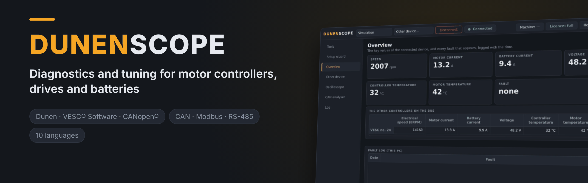
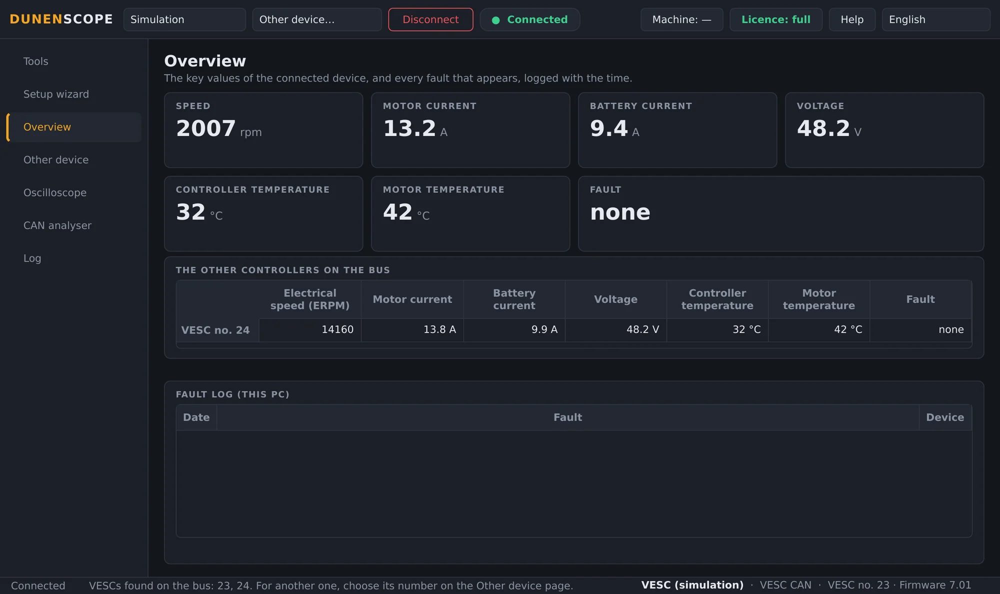
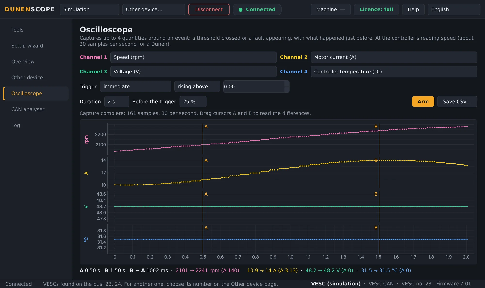
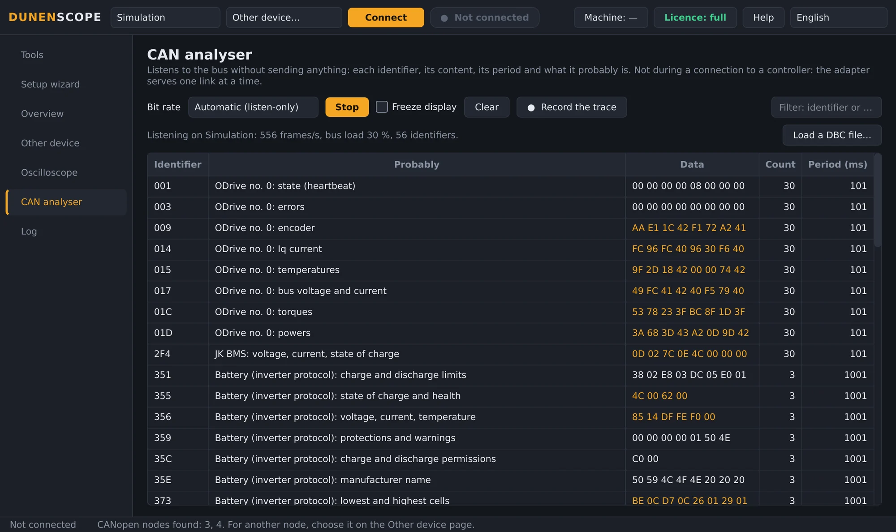
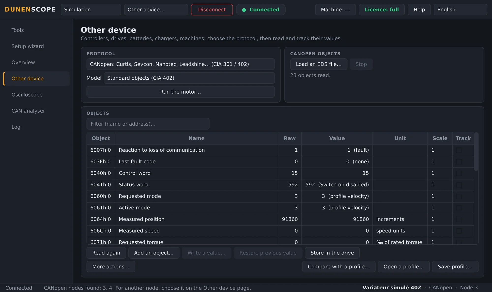
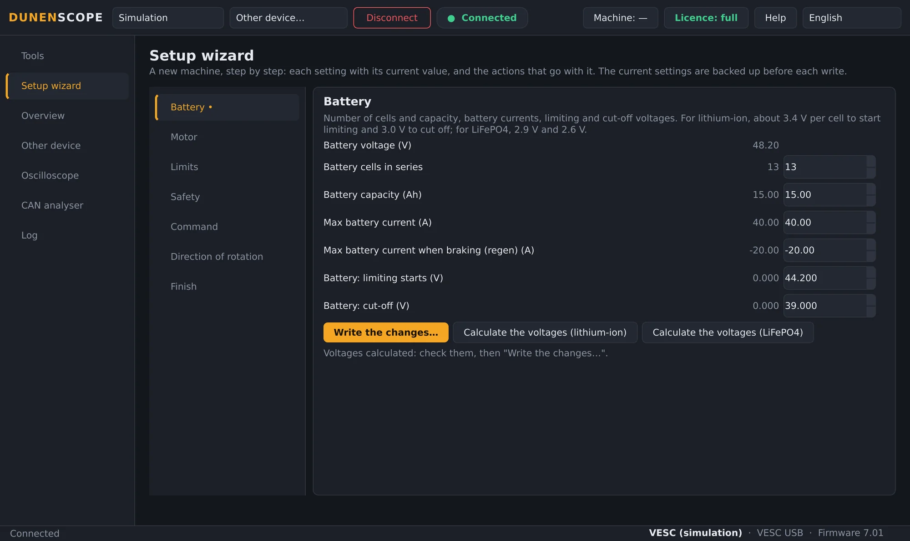
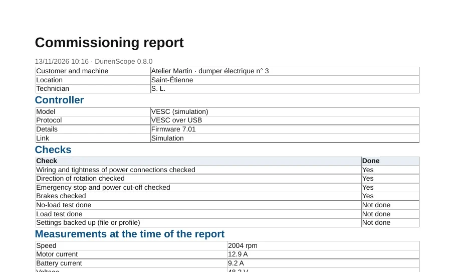
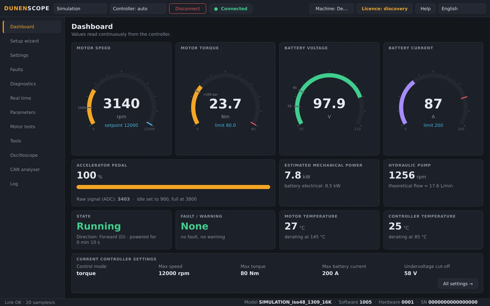
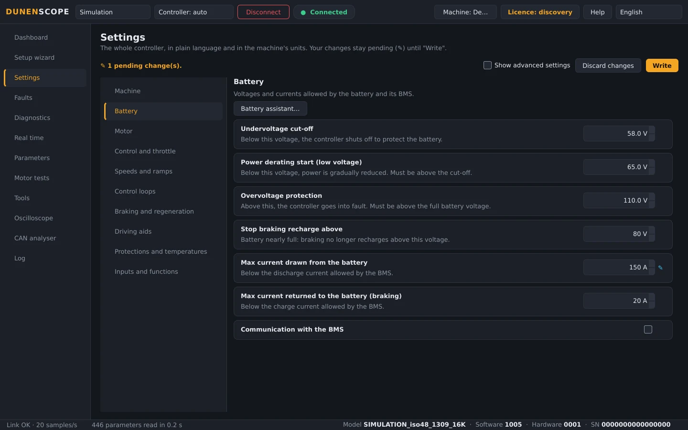

<b>English</b> · <a href="README.fr.md">Français</a> · <a href="README.zh.md">中文</a> · <a href="README.es.md">Español</a> · <a href="README.de.md">Deutsch</a> · <a href="README.it.md">Italiano</a> · <a href="README.pt.md">Português (BR)</a> · <a href="README.ru.md">Русский</a> · <a href="README.ja.md">日本語</a> · <a href="README.ko.md">한국어</a>

Windows 10 / 11 · 64-bit · free to read

## Diagnostics and tuning for motor controllers, drives and batteries

DunenScope turns a Windows PC and a CAN, USB or RS-485 adapter into a diagnostics and tuning bench: Dunen controllers, controllers compatible with VESC® Software, CANopen® and Modbus drives, Kelly, Curtis, Sevcon, BMS and chargers. It explains every fault, keeps what happened just before, sets the machine up step by step and produces the commissioning report.

## The video (46 s)

 <a href="docs/video/DunenScope_presentation_en.mp4">Watch the full video, with sound (MP4)</a>

## What it can read and tune

Choose the device on the **Other device** page (or let DunenScope recognise a Dunen):

**Motor controllers**

- **Dunen / ELYX** — 446 parameters, tuning, guided setup, motor tests, PI tuning
- **Compatible with VESC® Software** — over USB or CAN: tuning, guided setup, motor detection
- **Kelly KLS-D, KAC, KBL / KHB** — over CAN or serial link: measurements and faults
- **Votol EM, Fardriver, Bafang (M motors), ODrive** — measurements and faults

**Industrial drives**

- **CANopen® CiA 402 drives** — Nanotec, Leadshine…: profile or EDS file objects, tuning, motor test
- **Curtis 1232E to 1239E, Sevcon Gen4** — CANopen, read-only: measurements and faults
- **Modbus RTU and TCP** — Schneider ATV320, ASI BAC / Phaserunner, Sabvoton…: registers, coils and inputs

**Batteries and chargers**

- **JK, Daly, JBD / Xiaoxiang BMS, inverter protocol** — cells, temperatures, current, charge, alarms
- **Pylontech batteries (RS-485), Elcon / TC chargers** — read-only
- **Victron VE.Direct** — solar charge controllers, chargers, BMV and SmartShunt: listen-only

**Machinery and CAN bus**

- **J1939 machines** — engine, active faults
- **DBC file** — any CAN bus described by a DBC file (Orion BMS 2…)

Your device isn't listed? Send its communication files (protocol manual, EDS, register list, CAN trace) through the [Add my device](https://github.com/simonlabrossedu71-tech/DunenScope/issues/new?template=nouveau-controleur.yml) form.

## What DunenScope does

- **Guided setup** — a new machine, step by step: battery, motor, limits, safety, direction of rotation; each setting with its current value, its limits and its useful equivalent.
- **Diagnostics that explain** — every fault, from every brand, with its likely cause and what to check; the black box keeps the 20 seconds before each fault; several controllers on the same bus watched together.
- **Scope** — four channels, triggered on a threshold or when a fault appears, pre-trigger kept, cursors, CSV export.
- **CAN analyser** — it listens to the bus without sending anything and tells you what each frame is (CANopen, VESC-compatible, Kelly, Dunen, J1939); bus load, trace saved for Excel.
- **Commissioning report** — a PDF to hand to your customer: the controller, the measurements, all settings, the checks ticked and the signature boxes.
- **Dashboard and charts** — speed, torque, voltage, current, temperatures, state and faults live; real-time charts, CSV recording.
- **Backup and safe writing** — automatic backup before every write, value read back, motor stopped, undo; compare the machine with a profile, row by row.
- **Online library** — open a model profile shared by others (names, units, scales) or share yours, always without its values.
- **For Dunen controllers** — all 446 parameters with DunenConfiger's numbers, settings in plain words in the machine's units, easy setup, "why is it limited?", motor tests and PI tuning, end-of-line test.
- **Simulation and ten languages** — try everything without hardware, faults included; the interface and the fault explanations exist in 10 languages.

## Screenshots

<table>
<tr><td width="50%" align="center"> Overview: faults explained, several controllers on the bus</td><td width="50%" align="center"> Scope: four quantities captured around an event</td></tr>
<tr><td width="50%" align="center"> CAN analyser: every frame identified</td><td width="50%" align="center"> Other device: a CANopen CiA 402 drive</td></tr>
<tr><td width="50%" align="center"> Guided setup of a VESC-compatible controller</td><td width="50%" align="center"> PDF commissioning report</td></tr>
<tr><td width="50%" align="center"> Dashboard of a Dunen controller</td><td width="50%" align="center"> Dunen settings, in the machine's units</td></tr>
</table>

## Free to read, full version to tune

| Feature | Discovery (free) | Full version |
| --- | :---: | :---: |
| Connection, reading all settings, dashboard, charts | ✅ | ✅ |
| Diagnostics, fault log and black box, scope, CAN analyser | ✅ | ✅ |
| Full Simulation mode, updates | ✅ | ✅ |
| Writing settings to the controller, guided setup | — | ✅ |
| Motor tests, PI tuning, pedal calibration | — | ✅ |

**Lifetime licence €50** · **yearly subscription €20** · **quarterly subscription €7**. One key per PC, activated in seconds from the **Licence** button. Works offline once activated.

**Buy online:** [Lifetime — €50](https://buy.polar.sh/polar_cl_qO94LG8UMUEZitzRuoHexlgbRA5yJC3UlaF5C1Fv4O9) · [Yearly — €20/year](https://buy.polar.sh/polar_cl_St8xQg80RzRuOiugr63Lz4lFQkZ8MM2BkT6Jx1tNVVB) · [Quarterly — €7/quarter](https://buy.polar.sh/polar_cl_vjvXcXdimxbXQ3JzsfKf5UKQlYK8jFWHVp7yw0nHOmJ)

Your key arrives by e-mail: DunenScope → **Licence** → paste the key → **Activate**. Subscriptions go online once every 45 days.

## Getting started

1. Download **DunenScope_Setup** from [Releases](https://github.com/simonlabrossedu71-tech/DunenScope/releases/latest) and run it. If Windows shows "Windows protected your PC", click *More info* → *Run anyway*.
2. Plug the adapter into the device and power it up.
3. A Dunen is found automatically → **Connect**. For another brand: **Other device** page, choose the protocol → **Connect**.
4. No hardware yet? Choose **Simulation**: everything shows without plugging anything in.

## What you need

- Windows 10 or 11, 64-bit.
- A CAN adapter: PEAK PCAN-USB (recommended), Kvaser, IXXAT, Vector, CANable or candleLight.
- Depending on the device: the USB cable of a VESC-compatible controller, a USB-RS485 adapter (Modbus, BMS, Pylontech) or a VE.Direct-USB cable (Victron).

## Manuals

Full manuals (PDF), also installed with the software:

- [Français (PDF)](docs/manuals/DunenScope_Notice_FR.pdf) · [English (PDF)](docs/manuals/DunenScope_Manual_EN.pdf) · [中文 (PDF)](docs/manuals/DunenScope_Manual_ZH.pdf)

## Updates and data

- Every installer is signed; DunenScope checks the signature before installing an update.
- New versions are offered at start-up, free of charge; settings, profiles and backups are kept.
- DunenScope only contacts the licence service, the update server and, if you open it, the online library; messages from the Help button and error reports are sent only with your consent.

## Licence and safety

By installing DunenScope, you accept the [end-user licence agreement](docs/licence/EULA_EN.txt). DunenScope can change a controller's settings and run a motor: keep the machine safe and work with qualified staff. The free components shipped with the software (Qt, PySide6, python-can, libusb…) keep their own licences, listed in THIRD_PARTY_LICENSES.txt in the installation folder.

DunenScope is not affiliated with or endorsed by the VESC project. CANopen® is a registered trademark of CAN in Automation. Dunen, ELYX, Kelly, Curtis, Sevcon, Victron, Pylontech and the other brands mentioned belong to their owners.

Published by ORDA Engineering SAS, Saint-Étienne, France.
