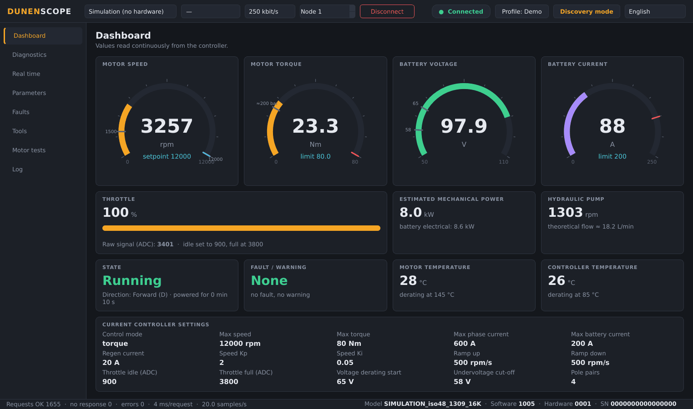
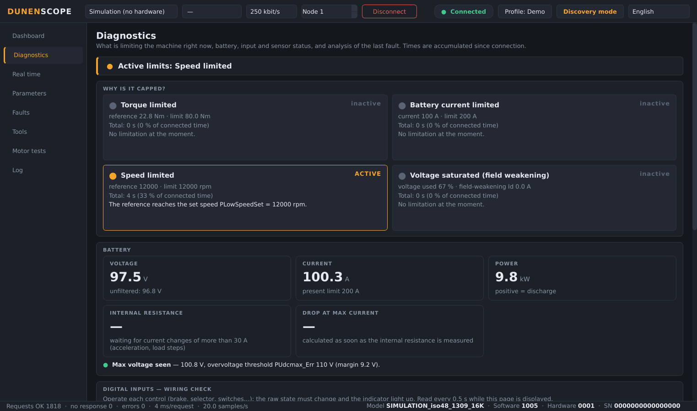
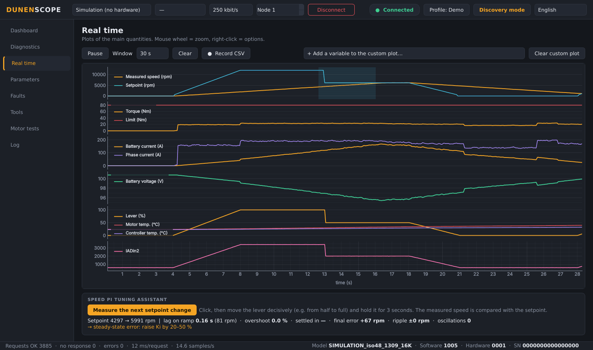
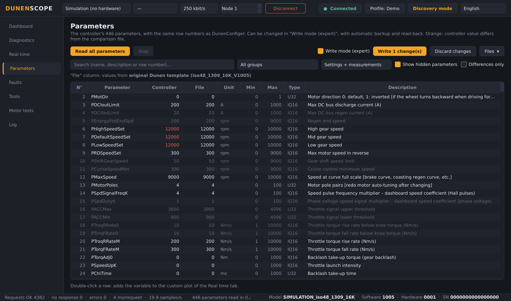
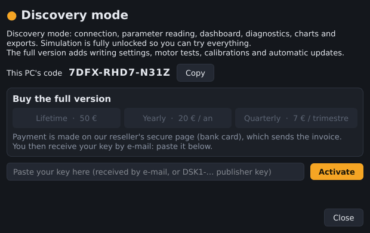

<b>English</b> · <a href="README.fr.md">Français</a> · <a href="README.zh.md">中文</a> · <a href="README.es.md">Español</a> · <a href="README.de.md">Deutsch</a> · <a href="README.it.md">Italiano</a> · <a href="README.pt.md">Português (BR)</a> · <a href="README.ru.md">Русский</a> · <a href="README.ja.md">日本語</a> · <a href="README.ko.md">한국어</a>

Windows 10 / 11 · 64-bit · free discovery mode

## Diagnostic and commissioning software for Dunen / ELYX motor controllers

DunenScope turns a Windows PC and a CAN adapter into a complete test bench for Dunen / ELYX controllers: see what the machine is doing, understand what limits it, tune it and prove it works — in minutes, in your language.

## What DunenScope does

- **Live dashboard** — speed, torque, battery voltage and current, throttle, power, temperatures, state and faults on one screen; pump flow or vehicle speed from your machine profile.
- **“Why is it capped?”** — shows which limit is acting right now (torque, battery current, speed, voltage) and for how long; battery internal resistance and margins; wiring check of every input; thermal time left; analysis of the last fault.
- **Real-time plots** — six synchronised plots plus a free plot of any 4 variables, CSV recording.
- **All 446 parameters** — same row numbers as DunenConfiger, search, comparison with a file, export to xlsx re-importable into DunenConfiger, CSV.
- **Safe writing** — automatic full backup before every write, read-back check, dangerous parameters locked, motor must be stopped, saved to permanent memory like DunenConfiger.
- **Speed PI tuning** — measurement on the machine, step-by-step manual tuning with advice, and automatic tuning.
- **Motor tests** — imposed speed or torque, encoder angle auto-learning, current loop; STOP / Esc and automatic stop.
- **Workshop tools** — one-click support package (.zip), throttle calibration assistant, end-of-line test with report and production log.
- **Made for the field** — 10 languages, PEAK PCAN-USB, Kvaser, IXXAT, Vector and SLCAN adapters, application profiles, and a simulation mode to try everything without hardware.

## Screenshots

<table>
<tr><td width="50%" align="center"> Diagnostics — what limits the machine</td><td width="50%" align="center"> Real-time plots and PI tuning assistant</td></tr>
<tr><td width="50%" align="center"> Parameters — compare, write, export</td><td width="50%" align="center"> Licence window</td></tr>
</table>

## Free discovery mode or full version

| Feature | Discovery (free) | Full version |
| --- | :---: | :---: |
| Connect, read all parameters, dashboard, real-time plots | ✅ | ✅ |
| Diagnostics, fault history, end-of-line test, exports, support package | ✅ | ✅ |
| Simulation mode with every feature unlocked | ✅ | ✅ |
| Write settings to a real controller | — | ✅ |
| Motor tests, PI tuning, throttle calibration | — | ✅ |
| Automatic updates | — | ✅ |

### Full version

**Lifetime licence 50 €** · **yearly subscription 20 €** · **quarterly subscription 7 €**. One key per PC, activated in seconds from the **Licence** button (top right). Works offline once activated. Online purchase is opening soon.

Subscriptions only need to go online once every 45 days.

## Get started

1. Download **DunenScope_Setup** from [Releases](https://github.com/simonlabrossedu71-tech/DunenScope/releases/latest) and run it. If Windows shows “Windows protected your PC”, click *More info* → *Run anyway*.
2. Choose your language. The installer offers the PEAK driver if it is missing.
3. Plug the CAN adapter into the controller and switch the key ON.
4. Select the adapter, 250 kbit/s, node 1 → **Connect**. No hardware yet? Choose **Simulation**.
5. Full version: **Licence** button → paste your key → **Activate**.

## Requirements

- Windows 10 or 11, 64-bit.
- A CAN adapter: PEAK PCAN-USB (recommended), Kvaser, IXXAT, Vector or SLCAN (CANable…).
- A Dunen / ELYX controller using the DunenConfiger protocol (Modbus over CAN, 250 kbit/s by default).

## Manuals

Full user manuals (PDF), also installed in the Start menu:

- [English (PDF)](docs/manuals/DunenScope_Manual_EN.pdf) · [Français (PDF)](docs/manuals/DunenScope_Notice_FR.pdf) · [中文 (PDF)](docs/manuals/DunenScope_Manual_ZH.pdf)

## Updates and security

- Every installer is signed; DunenScope checks the signature before installing an update.
- Full-version users are offered new versions at start-up; settings, profiles and backups are kept.
- DunenScope only contacts the licence service and the download server. No other data leaves your PC.

## Licence and safety

By installing DunenScope you accept the [end-user licence agreement](docs/licence/EULA_EN.txt). DunenScope can change controller settings and run a motor: work with the machine made safe and with qualified staff. Dunen and ELYX are trademarks of their respective owners.
