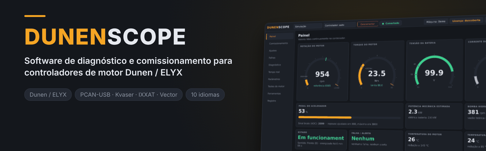
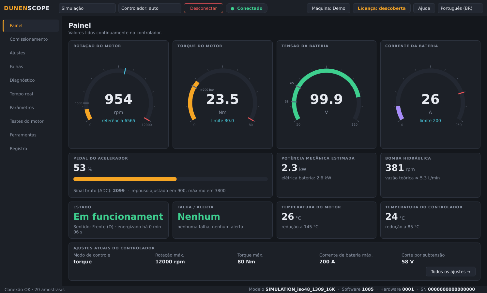
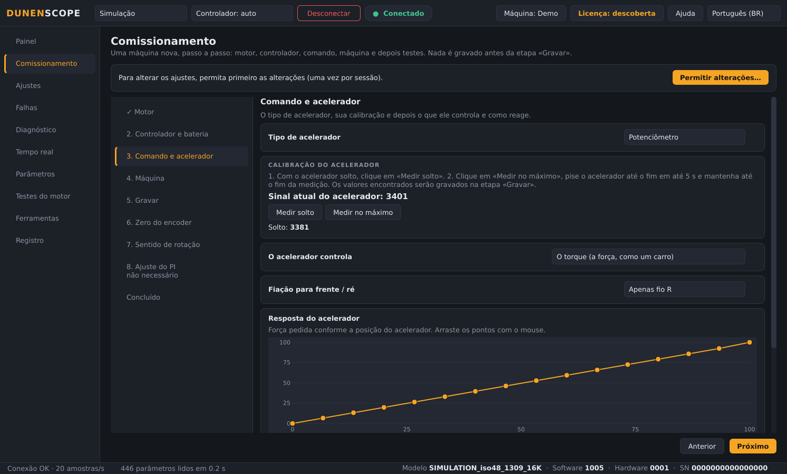
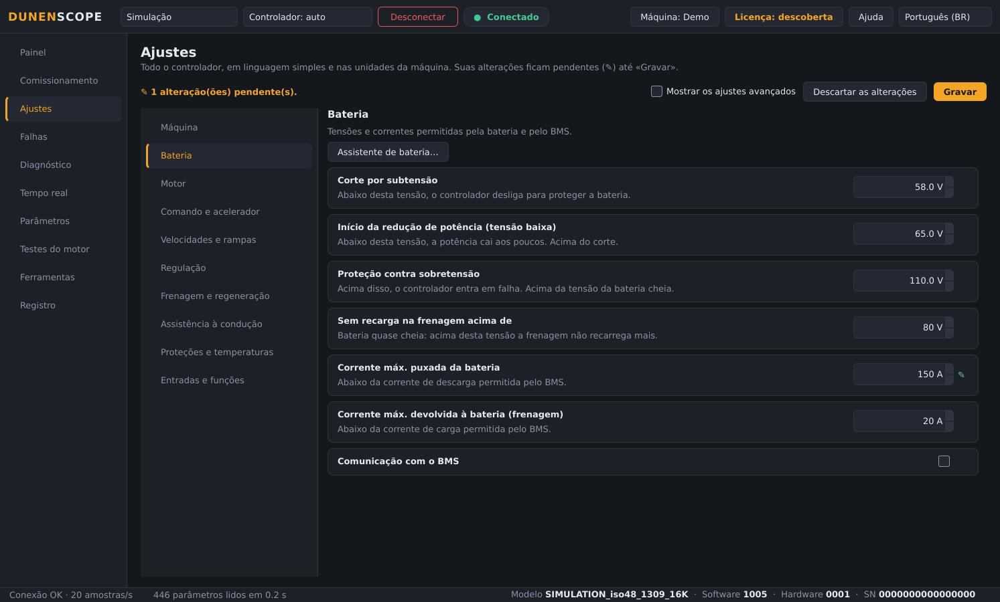
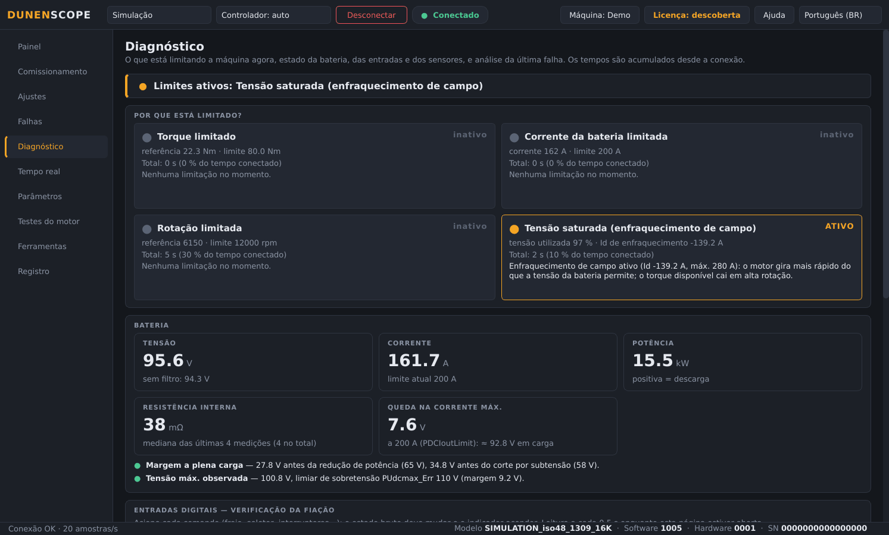
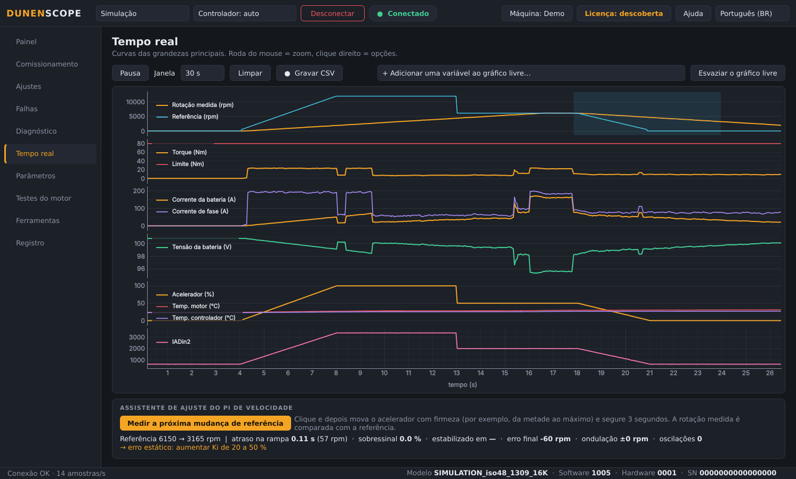
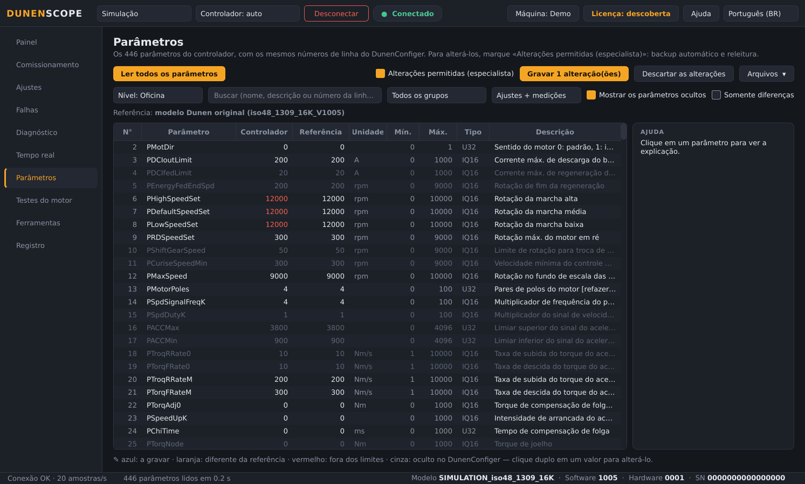
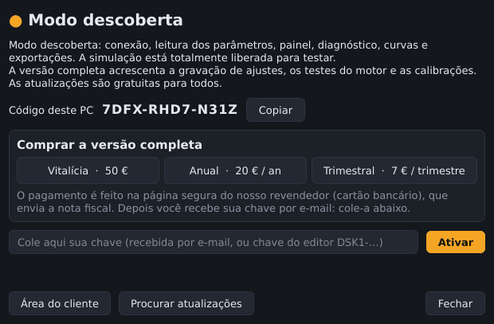

<a href="README.md">English</a> · <a href="README.fr.md">Français</a> · <a href="README.zh.md">中文</a> · <a href="README.es.md">Español</a> · <a href="README.de.md">Deutsch</a> · <a href="README.it.md">Italiano</a> · <b>Português (BR)</b> · <a href="README.ru.md">Русский</a> · <a href="README.ja.md">日本語</a> · <a href="README.ko.md">한국어</a>

Windows 10 / 11 · 64 bits · modo descoberta gratuito

## Software de diagnóstico e comissionamento para controladores de motor Dunen / ELYX

O DunenScope transforma um PC com Windows e um adaptador CAN em uma bancada de testes completa para controladores Dunen / ELYX: ver o que a máquina está fazendo, entender o que a limita, ajustá-la e provar que funciona — em minutos e no seu idioma.

## O que o DunenScope faz

- **Comissionamento** — uma máquina nova passo a passo, como no VESC: motor, controlador e bateria, calibração do pedal, máquina, gravação, zero do encoder, giro de teste de 5 s para o sentido, ajuste do PI.
- **Ajustes em linguagem clara** — todo o controlador por categorias, nas unidades da máquina (segundos, %, km/h, L/min, m/min), com curvas do pedal que se arrastam com o mouse.
- **Ligar e conectar** — o adaptador CAN, a taxa de bits e o endereço do controlador são encontrados sozinhos, e o modelo é reconhecido.
- **Ajuste fácil** — algumas perguntas (bateria, rotação, condução): os ajustes são calculados e preparados na lista, com ajuda em cada parâmetro e verificação de coerência antes de gravar.
- **Outros controladores** — para um modelo que o DunenScope ainda não conhece: escolher o protocolo, procurar os registradores que respondem, nomeá-los, acompanhá-los em gráfico e salvar uma ficha de modelo.
- **Fale conosco pelo aplicativo** — o botão Ajuda envia seu problema, ideia ou pergunta diretamente ao editor; relatórios de erro só são enviados com sua autorização.
- **Painel ao vivo** — rotação, torque, tensão e corrente da bateria, acelerador, potência, temperaturas, estado e falhas em uma só tela; vazão da bomba ou velocidade do veículo conforme o perfil da máquina.
- **«Por que está limitado?»** — mostra qual limite está atuando agora (torque, corrente da bateria, rotação, tensão) e há quanto tempo; resistência interna e margens da bateria; verificação da fiação de cada entrada; tempo restante até a redução térmica; análise da última falha.
- **Curvas em tempo real** — seis gráficos sincronizados e um gráfico livre com 4 variáveis à escolha, gravação em CSV.
- **Todos os 446 parâmetros** — mesmos números de linha do DunenConfiger, busca, comparação com um arquivo, exportação xlsx reimportável no DunenConfiger, CSV.
- **Gravação segura** — backup completo automático antes de cada gravação, releitura, parâmetros perigosos bloqueados, motor parado obrigatório, salvamento na memória permanente como no DunenConfiger.
- **Ajuste do PI de velocidade** — medição na máquina, ajuste manual por degraus com dicas e ajuste automático.
- **Testes do motor** — rotação ou torque impostos, autoaprendizagem do ângulo do encoder, malha de corrente; STOP / Esc e parada automática.
- **Ferramentas de oficina** — pacote de suporte em um clique (.zip), assistente de calibração do acelerador, teste de fim de linha com relatório e registro de produção.
- **Feito para o campo** — 10 idiomas, adaptadores PEAK PCAN-USB, Kvaser, IXXAT, Vector e SLCAN, perfis de aplicação e um modo simulação para testar tudo sem hardware.

## Capturas de tela

<table>
<tr><td width="50%" align="center"> Comissionamento: uma máquina nova passo a passo</td><td width="50%" align="center"> Ajustes em linguagem clara, nas unidades da máquina</td></tr>
<tr><td width="50%" align="center"> Diagnóstico — o que limita a máquina</td><td width="50%" align="center"> Curvas em tempo real e assistente de ajuste do PI</td></tr>
<tr><td width="50%" align="center"> Parâmetros — comparar, gravar, exportar</td><td width="50%" align="center"> Janela Licença</td></tr>
</table>

## Modo descoberta gratuito ou versão completa

| Função | Descoberta (grátis) | Versão completa |
| --- | :---: | :---: |
| Conexão, leitura de todos os parâmetros, painel, curvas | ✅ | ✅ |
| Diagnóstico, histórico de falhas, teste de fim de linha, exportações, pacote de suporte | ✅ | ✅ |
| Modo simulação com todas as funções liberadas | ✅ | ✅ |
| Atualizações automáticas | ✅ | ✅ |
| Gravação de ajustes em um controlador real | — | ✅ |
| Testes do motor, ajuste do PI, calibração do acelerador | — | ✅ |

### Versão completa

**Licença vitalícia 50 €** · **assinatura anual 20 €** · **assinatura trimestral 7 €**. Uma chave por PC, ativada em segundos pelo botão **Licença** (canto superior direito). Funciona sem internet depois de ativada.

**Comprar online:** [Vitalícia — 50 €](https://buy.polar.sh/polar_cl_qO94LG8UMUEZitzRuoHexlgbRA5yJC3UlaF5C1Fv4O9) · [Anual — 20 €/ano](https://buy.polar.sh/polar_cl_St8xQg80RzRuOiugr63Lz4lFQkZ8MM2BkT6Jx1tNVVB) · [Trimestral — 7 €/trimestre](https://buy.polar.sh/polar_cl_vjvXcXdimxbXQ3JzsfKf5UKQlYK8jFWHVp7yw0nHOmJ)

A chave chega por e-mail: cole-a no DunenScope → **Licença** → **Ativar**.

Assinaturas: basta conectar-se à internet uma vez a cada 45 dias.

## Primeiros passos

1. Baixe o **DunenScope_Setup** em [Releases](https://github.com/simonlabrossedu71-tech/DunenScope/releases/latest) e execute-o. Se o Windows mostrar «O Windows protegeu o computador», clique em *Mais informações* → *Executar assim mesmo*.
2. Escolha o idioma. O instalador oferece o driver PEAK se ele estiver faltando.
3. Conecte o adaptador CAN ao controlador e ligue a chave.
4. Clique em **Conectar**: o DunenScope encontra sozinho o adaptador, a taxa e o nó. Ainda sem hardware? Escolha **Simulação**.
5. Versão completa: botão **Licença** → cole sua chave → **Ativar**.

## Requisitos

- Windows 10 ou 11, 64 bits.
- Um adaptador CAN: PEAK PCAN-USB (recomendado), Kvaser, IXXAT, Vector ou SLCAN (CANable…).
- Um controlador Dunen / ELYX com o protocolo do DunenConfiger (Modbus sobre CAN, 250 kbit/s por padrão).

## Manuais

Manuais completos (PDF), também instalados no menu Iniciar:

- [English (PDF)](docs/manuals/DunenScope_Manual_EN.pdf) · [Français (PDF)](docs/manuals/DunenScope_Notice_FR.pdf) · [中文 (PDF)](docs/manuals/DunenScope_Manual_ZH.pdf)

## Atualizações e segurança

- Cada instalador é assinado; o DunenScope verifica a assinatura antes de instalar uma atualização.
- Novas versões são oferecidas ao iniciar para todos os usuários, gratuitamente; ajustes, perfis e backups são mantidos.
- O DunenScope só se comunica com o serviço de licenças e o servidor de downloads. Nenhum outro dado sai do seu PC.

## Licença e precauções

Ao instalar o DunenScope você aceita o [contrato de licença de usuário final](docs/licence/EULA_PT.txt). O DunenScope pode alterar os ajustes de um controlador e fazer um motor girar: trabalhe com a máquina em segurança e com pessoal qualificado. Dunen e ELYX são marcas de seus respectivos proprietários.
