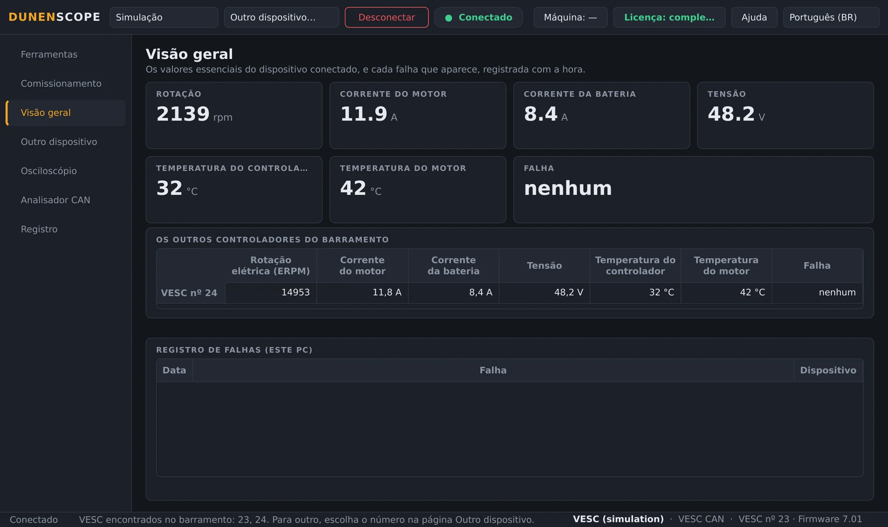
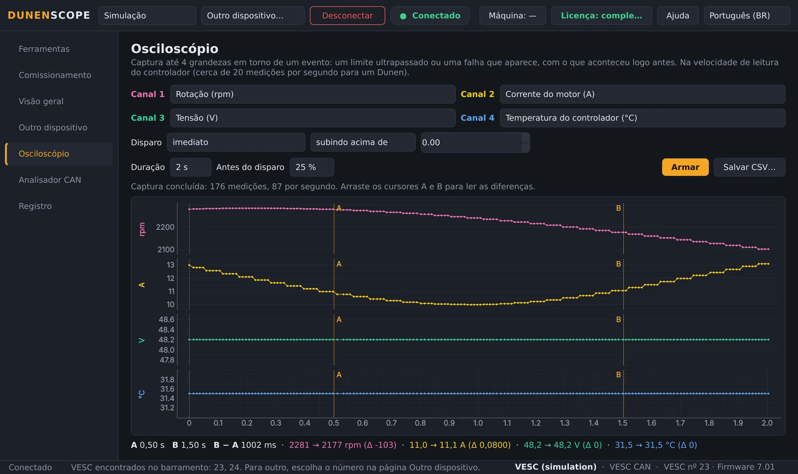
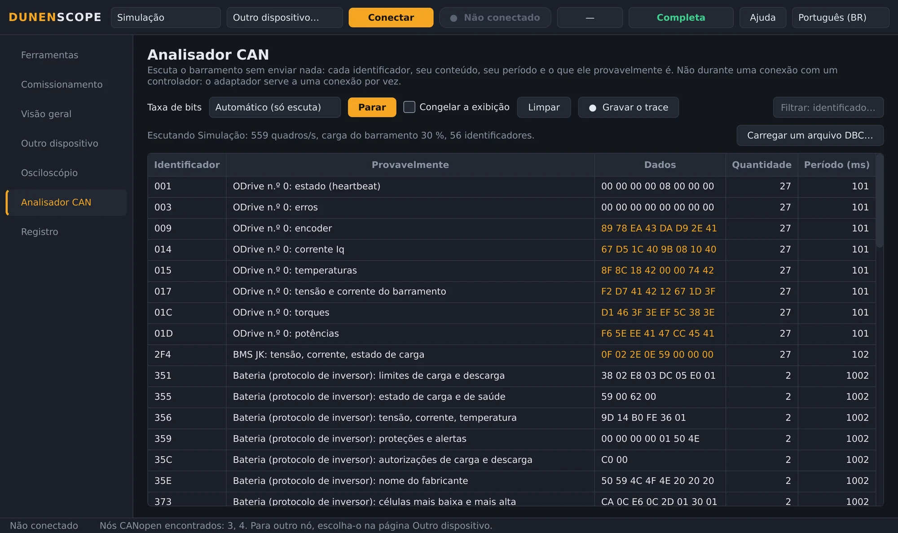
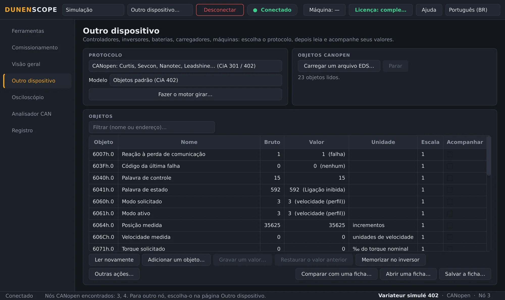
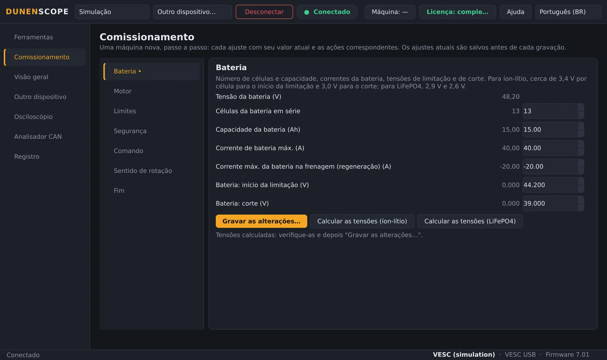
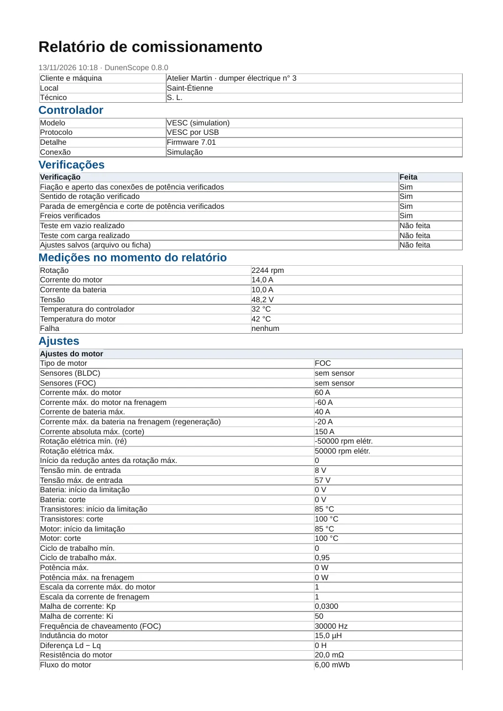
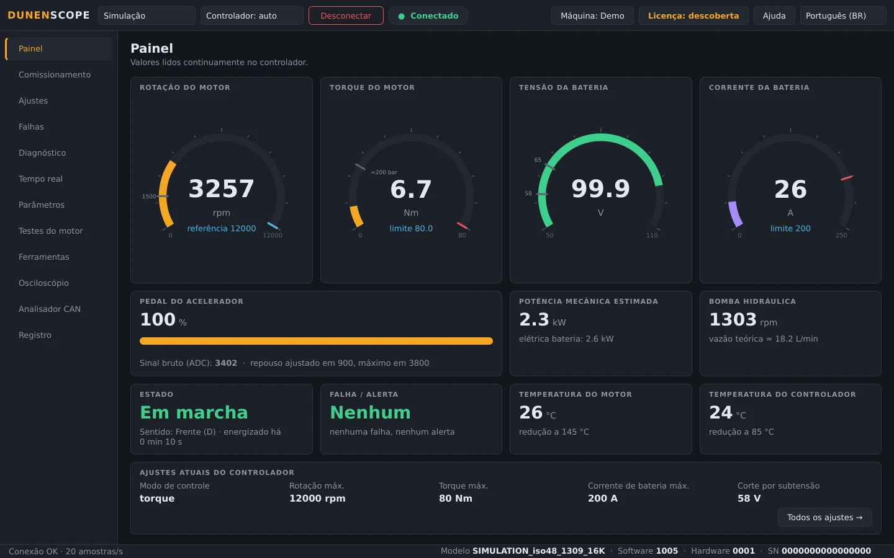
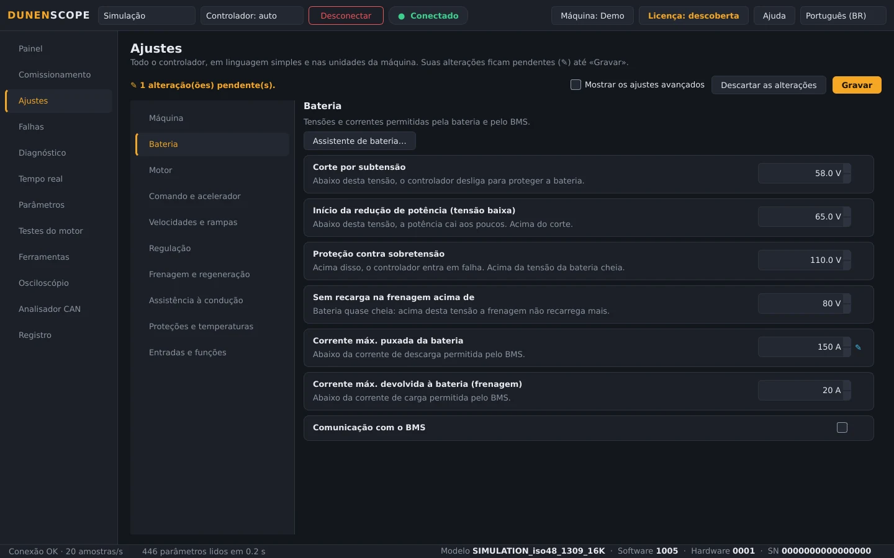

<a href="README.md">English</a> · <a href="README.fr.md">Français</a> · <a href="README.zh.md">中文</a> · <a href="README.es.md">Español</a> · <a href="README.de.md">Deutsch</a> · <a href="README.it.md">Italiano</a> · <b>Português (BR)</b> · <a href="README.ru.md">Русский</a> · <a href="README.ja.md">日本語</a> · <a href="README.ko.md">한국어</a>

Windows 10 / 11 · 64 bits · leitura gratuita

## Diagnóstico e ajuste de controladores de motor, inversores e baterias

O DunenScope transforma um PC com Windows e um adaptador CAN, USB ou RS-485 em uma bancada de diagnóstico e ajuste: controladores Dunen, controladores compatíveis com VESC® Software, inversores CANopen® e Modbus, Kelly, Curtis, Sevcon, BMS e carregadores. Ele explica cada falha, guarda o que aconteceu logo antes, ajusta a máquina passo a passo e gera o relatório de comissionamento.

## O vídeo (46 s)

 <a href="https://github.com/simonlabrossedu71-tech/DunenScope/raw/main/docs/video/DunenScope_presentation_en.mp4">Baixe o vídeo completo, com som (MP4, 16 MB)</a>

## O que ele lê e ajusta

Escolha o equipamento na página **Outro dispositivo** (ou deixe o DunenScope reconhecer um Dunen):

**Controladores de motor**

- **Dunen / ELYX** — 446 parâmetros, ajuste, comissionamento guiado, testes do motor, ajuste do PI
- **Compatíveis com VESC® Software** — por USB ou CAN: ajuste, comissionamento guiado, detecção do motor
- **Kelly KLS-D, KAC, KBL / KHB** — por CAN ou serial: medições e falhas
- **Votol EM, Fardriver, Bafang (motores M), ODrive** — medições e falhas

**Inversores industriais**

- **Inversores CANopen® CiA 402** — Nanotec, Leadshine…: objetos do perfil ou do arquivo EDS, ajuste, teste do motor
- **Curtis 1232E a 1239E, Sevcon Gen4** — CANopen, somente leitura: medições e falhas
- **Modbus RTU e TCP** — Schneider ATV320, ASI BAC / Phaserunner, Sabvoton…: registradores, bobinas e entradas

**Baterias e carregadores**

- **BMS JK, Daly, JBD / Xiaoxiang, protocolo de inversor** — células, temperaturas, corrente, carga, alarmes
- **Baterias Pylontech (RS-485), carregadores Elcon / TC** — somente leitura
- **Victron VE.Direct** — controladores de carga solar, carregadores, BMV e SmartShunt: somente escuta

**Máquinas e barramento CAN**

- **Máquinas J1939** — motor a combustão, falhas ativas
- **Arquivo DBC** — qualquer barramento CAN descrito por um arquivo DBC (Orion BMS 2…)

Seu equipamento não está na lista? Envie os arquivos de comunicação dele (manual do protocolo, EDS, lista de registradores, trace CAN) pelo formulário [Adicionar meu dispositivo](https://github.com/simonlabrossedu71-tech/DunenScope/issues/new?template=nouveau-controleur.yml).

## O que o DunenScope faz

- **Comissionamento guiado** — uma máquina nova, passo a passo: bateria, motor, limites, segurança, sentido de rotação; cada ajuste com seu valor atual, seus limites e seu equivalente prático.
- **Um diagnóstico que explica** — cada falha, de cada marca, com a causa provável e o que verificar; a caixa-preta guarda os 20 segundos antes de cada falha; vários controladores do mesmo barramento monitorados juntos.
- **Osciloscópio** — quatro canais, disparo por limiar ou quando surge uma falha, pré-disparo mantido, cursores, exportação CSV.
- **Analisador CAN** — escuta o barramento sem transmitir nada e diz o que é cada quadro (CANopen, compatível VESC, Kelly, Dunen, J1939); carga do barramento, trace gravado para Excel.
- **Relatório de comissionamento** — um PDF para entregar ao cliente: o controlador, as medições, todos os ajustes, as verificações marcadas e os campos de assinatura.
- **Painel e curvas** — rotação, torque, tensão, corrente, temperaturas, estado e falhas ao vivo; curvas em tempo real, gravação CSV.
- **Backup e gravação segura** — backup automático antes de cada gravação, valor relido, motor parado, desfazer; compare a máquina com uma ficha, linha por linha.
- **Biblioteca online** — abra a ficha de um modelo compartilhada por outros (nomes, unidades, escalas) ou compartilhe a sua, sempre sem os valores.
- **Para os Dunen** — os 446 parâmetros com os números do DunenConfiger, ajustes claros nas unidades da máquina, ajuste fácil, «Por que está limitado?», testes do motor e ajuste do PI, teste de fim de linha.
- **Simulação e dez idiomas** — tudo pode ser testado sem hardware, inclusive as falhas; a interface e as explicações das falhas existem em 10 idiomas.

## Capturas de tela

<table>
<tr><td width="50%" align="center"> Visão geral: falhas explicadas, vários controladores do barramento</td><td width="50%" align="center"> Osciloscópio: quatro grandezas capturadas em torno de um evento</td></tr>
<tr><td width="50%" align="center"> Analisador CAN: cada quadro identificado</td><td width="50%" align="center"> Outro dispositivo: um inversor CANopen CiA 402</td></tr>
<tr><td width="50%" align="center"> Comissionamento guiado de um controlador compatível VESC</td><td width="50%" align="center"> Relatório de comissionamento em PDF</td></tr>
<tr><td width="50%" align="center"> Painel de um Dunen</td><td width="50%" align="center"> Ajustes de um Dunen, nas unidades da máquina</td></tr>
</table>

## Leitura gratuita, versão completa para ajustar

| Função | Descoberta (grátis) | Versão completa |
| --- | :---: | :---: |
| Conexão, leitura de todos os ajustes, painel, curvas | ✅ | ✅ |
| Diagnóstico, registro e caixa-preta de falhas, osciloscópio, analisador CAN | ✅ | ✅ |
| Modo Simulação completo, atualizações | ✅ | ✅ |
| Gravação dos ajustes no controlador, comissionamento guiado | — | ✅ |
| Testes do motor, ajuste do PI, calibração do pedal | — | ✅ |

**Licença vitalícia 50 €** · **assinatura anual 20 €** · **assinatura trimestral 7 €**. Uma chave por PC, ativada em segundos pelo botão **Licença**. Funciona sem internet depois de ativada.

**Comprar online:** [Vitalícia — 50 €](https://buy.polar.sh/polar_cl_qO94LG8UMUEZitzRuoHexlgbRA5yJC3UlaF5C1Fv4O9) · [Anual — 20 €/ano](https://buy.polar.sh/polar_cl_St8xQg80RzRuOiugr63Lz4lFQkZ8MM2BkT6Jx1tNVVB) · [Trimestral — 7 €/trimestre](https://buy.polar.sh/polar_cl_vjvXcXdimxbXQ3JzsfKf5UKQlYK8jFWHVp7yw0nHOmJ)

A chave chega por e-mail: DunenScope → **Licença** → cole a chave → **Ativar**. As assinaturas se conectam uma vez a cada 45 dias.

## Primeiros passos

1. Baixe o **DunenScope_Setup** em [Releases](https://github.com/simonlabrossedu71-tech/DunenScope/releases/latest) e execute-o. Se o Windows mostrar «O Windows protegeu o computador», clique em *Mais informações* → *Executar assim mesmo*.
2. Conecte o adaptador ao equipamento e ligue-o.
3. Um Dunen é encontrado automaticamente → **Conectar**. Para outra marca: página **Outro dispositivo**, escolha o protocolo → **Conectar**.
4. Ainda sem hardware? Escolha **Simulação**: tudo é mostrado sem conectar nada.

## Equipamento necessário

- Windows 10 ou 11, 64 bits.
- Um adaptador CAN: PEAK PCAN-USB (recomendado), Kvaser, IXXAT, Vector, CANable ou candleLight.
- Conforme o equipamento: o cabo USB de um controlador compatível VESC, um adaptador USB-RS485 (Modbus, BMS, Pylontech) ou um cabo VE.Direct-USB (Victron).

## Manuais

Manuais completos (PDF), também instalados com o software:

- [Français (PDF)](docs/manuals/DunenScope_Notice_FR.pdf) · [English (PDF)](docs/manuals/DunenScope_Manual_EN.pdf) · [中文 (PDF)](docs/manuals/DunenScope_Manual_ZH.pdf)

## Atualizações e dados

- Cada instalador é assinado; o DunenScope verifica a assinatura antes de instalar uma atualização.
- Novas versões são oferecidas ao iniciar, gratuitamente; ajustes, fichas e backups são mantidos.
- O DunenScope só se comunica com o serviço de licenças, o servidor de atualizações e, se você abri-la, a biblioteca online; as mensagens do botão Ajuda e os relatórios de erro só são enviados com o seu consentimento.

## Licença e segurança

Ao instalar o DunenScope, você aceita o [contrato de licença de usuário final](docs/licence/EULA_PT.txt). O DunenScope pode alterar os ajustes de um controlador e fazer um motor girar: trabalhe com a máquina em segurança e com pessoal qualificado. Os componentes livres fornecidos com o software (Qt, PySide6, python-can, libusb…) mantêm suas próprias licenças, listadas em THIRD_PARTY_LICENSES.txt na pasta de instalação.

O DunenScope não é afiliado ao projeto VESC nem aprovado por ele. CANopen® é uma marca registrada da CAN in Automation. Dunen, ELYX, Kelly, Curtis, Sevcon, Victron, Pylontech e as demais marcas citadas pertencem aos seus proprietários.

Publicado por ORDA Engineering SAS, Saint-Étienne, França.
