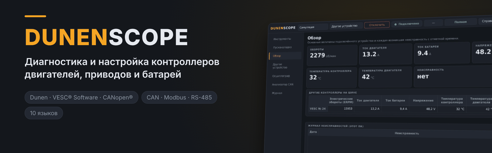
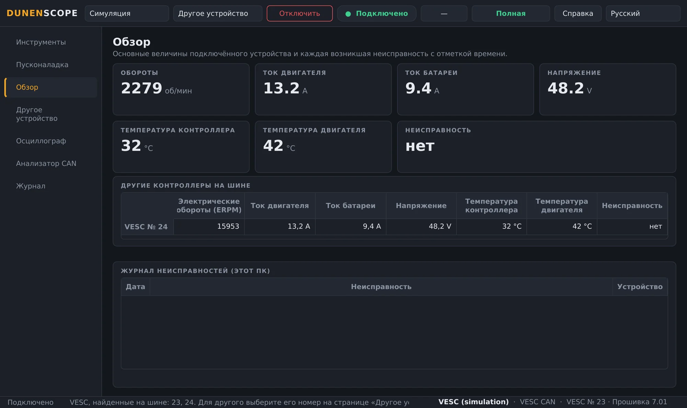
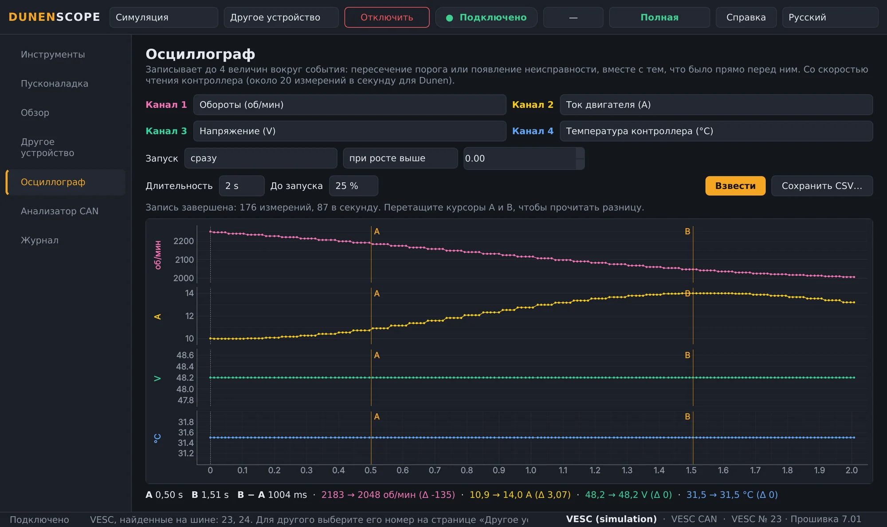
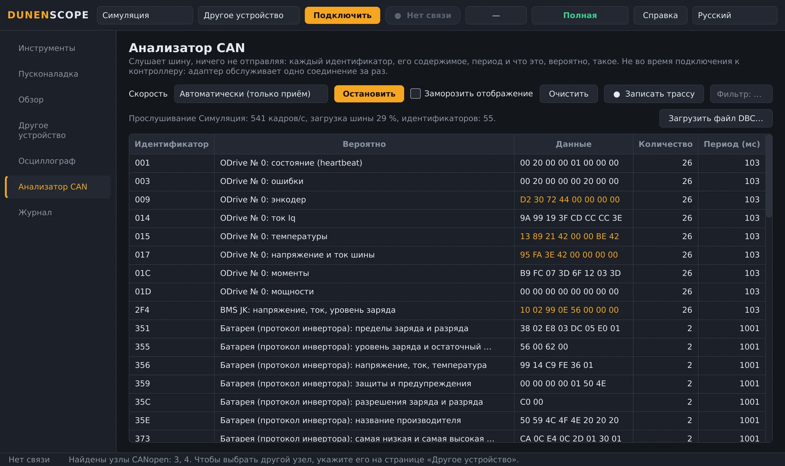
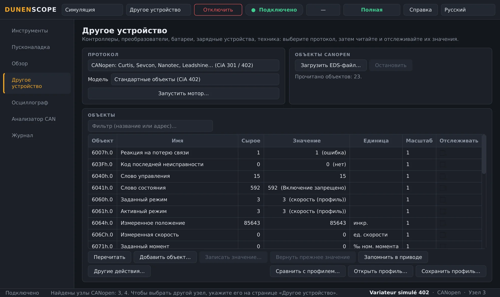
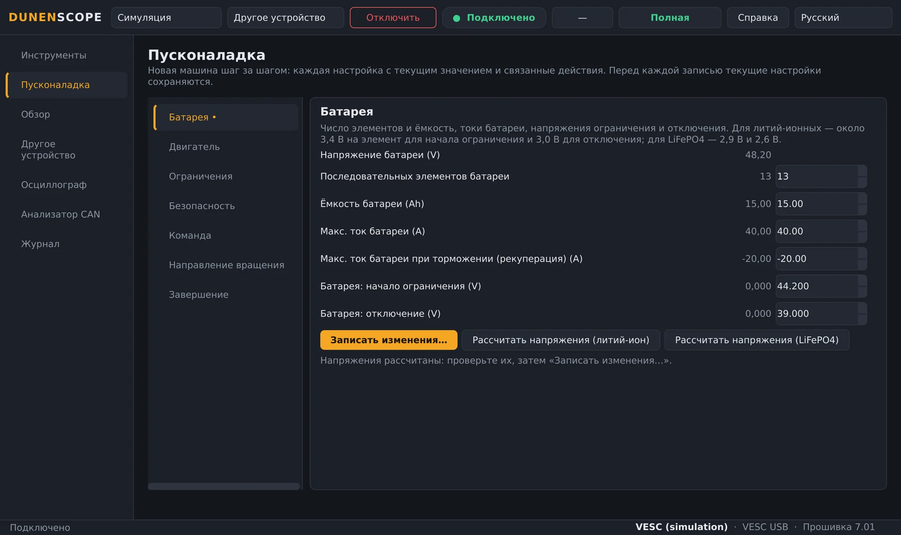
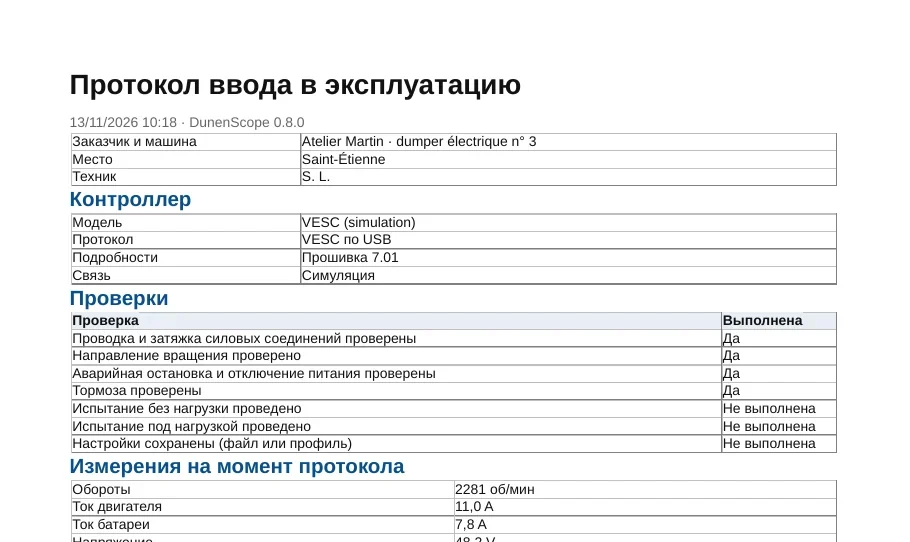
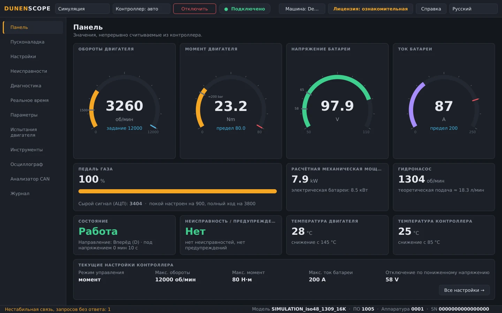
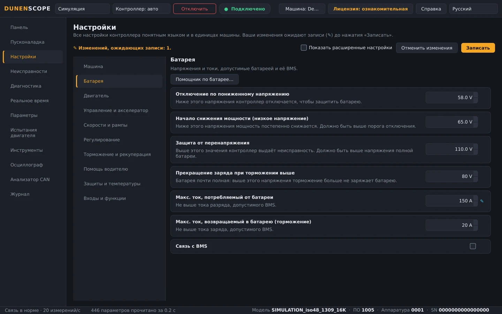

<a href="README.md">English</a> · <a href="README.fr.md">Français</a> · <a href="README.zh.md">中文</a> · <a href="README.es.md">Español</a> · <a href="README.de.md">Deutsch</a> · <a href="README.it.md">Italiano</a> · <a href="README.pt.md">Português (BR)</a> · <b>Русский</b> · <a href="README.ja.md">日本語</a> · <a href="README.ko.md">한국어</a>

Windows 10 / 11 · 64 бита · чтение бесплатно

## Диагностика и настройка контроллеров двигателей, приводов и батарей

DunenScope превращает ПК с Windows и адаптер CAN, USB или RS-485 в стенд диагностики и настройки: контроллеры Dunen, контроллеры, совместимые с VESC® Software, приводы CANopen® и Modbus, Kelly, Curtis, Sevcon, BMS и зарядные устройства. Он объясняет каждую неисправность, сохраняет то, что происходило непосредственно перед ней, пошагово настраивает машину и формирует протокол ввода в эксплуатацию.

## Видео (46 с)

 <a href="https://github.com/simonlabrossedu71-tech/DunenScope/raw/main/docs/video/DunenScope_presentation_en.mp4">Скачать полное видео со звуком (MP4, 16 МБ)</a>

## Что он умеет читать и настраивать

Выберите устройство на странице **Другое устройство** (или дайте DunenScope самому распознать Dunen):

**Контроллеры двигателей**

- **Dunen / ELYX** — 446 параметров, настройка, пошаговая пусконаладка, испытания двигателя, настройка ПИ-регулятора
- **Совместимые с VESC® Software** — по USB или CAN: настройка, пошаговая пусконаладка, определение двигателя
- **Kelly KLS-D, KAC, KBL / KHB** — по CAN или последовательному каналу: измерения и неисправности
- **Votol EM, Fardriver, Bafang (двигатели M), ODrive** — измерения и неисправности

**Промышленные приводы**

- **Приводы CANopen® CiA 402** — Nanotec, Leadshine…: объекты профиля или EDS-файла, настройка, испытание двигателя
- **Curtis 1232E–1239E, Sevcon Gen4** — CANopen, только чтение: измерения и неисправности
- **Modbus RTU и TCP** — Schneider ATV320, ASI BAC / Phaserunner, Sabvoton…: регистры, катушки и входы

**Батареи и зарядные устройства**

- **BMS JK, Daly, JBD / Xiaoxiang, протокол инвертора** — ячейки, температуры, ток, заряд, аварийные сигналы
- **Батареи Pylontech (RS-485), зарядные устройства Elcon / TC** — только чтение
- **Victron VE.Direct** — солнечные контроллеры, зарядные устройства, BMV и SmartShunt: только прослушивание

**Техника и шина CAN**

- **Техника J1939** — двигатель внутреннего сгорания, активные неисправности
- **Файл DBC** — любая шина CAN, описанная файлом DBC (Orion BMS 2…)

Вашего устройства нет в списке? Отправьте документацию по его обмену данными (описание протокола, EDS, карта регистров, запись трафика CAN) через форму [Добавить моё устройство](https://github.com/simonlabrossedu71-tech/DunenScope/issues/new?template=nouveau-controleur.yml).

## Что умеет DunenScope

- **Пошаговая пусконаладка** — новая машина шаг за шагом: батарея, двигатель, ограничения, безопасность, направление вращения; у каждой настройки — текущее значение, допустимые пределы и понятный эквивалент.
- **Диагностика, которая объясняет** — каждая неисправность любой марки — с вероятной причиной и тем, что проверить; чёрный ящик хранит 20 секунд перед каждой неисправностью; несколько контроллеров на одной шине отслеживаются одновременно.
- **Осциллограф** — четыре канала, запуск по порогу или при появлении неисправности, предыстория до запуска, курсоры, экспорт в CSV.
- **Анализатор CAN** — слушает шину, ничего не передавая, и показывает, что представляет собой каждый кадр (CANopen, совместимый с VESC, Kelly, Dunen, J1939); загрузка шины, запись трафика для Excel.
- **Протокол ввода в эксплуатацию** — PDF для передачи заказчику: контроллер, измерения, все настройки, отмеченные проверки и поля для подписей.
- **Панель и графики** — обороты, момент, напряжение, ток, температуры, состояние и неисправности в реальном времени; графики в реальном времени, запись в CSV.
- **Резервная копия и безопасная запись** — автоматическая резервная копия перед каждой записью, обратное чтение значения, двигатель остановлен, отмена; построчное сравнение машины с профилем.
- **Онлайн-библиотека** — откройте профиль модели, которым поделились другие (имена, единицы, масштабы), или поделитесь своим — всегда без значений.
- **Для Dunen** — все 446 параметров с номерами из DunenConfiger, понятные настройки в единицах машины, быстрая настройка, «Почему ограничено?», испытания двигателя и настройка ПИ-регулятора, выходной контроль.
- **Симуляция и десять языков** — всё можно попробовать без оборудования, включая неисправности; интерфейс и пояснения к неисправностям доступны на 10 языках.

## Снимки экрана

<table>
<tr><td width="50%" align="center"> Обзор: неисправности с пояснениями, несколько контроллеров на шине</td><td width="50%" align="center"> Осциллограф: четыре величины, записанные вокруг события</td></tr>
<tr><td width="50%" align="center"> Анализатор CAN: каждый кадр распознан</td><td width="50%" align="center"> Другое устройство: привод CANopen CiA 402</td></tr>
<tr><td width="50%" align="center"> Пошаговая пусконаладка контроллера, совместимого с VESC</td><td width="50%" align="center"> Протокол ввода в эксплуатацию в PDF</td></tr>
<tr><td width="50%" align="center"> Панель контроллера Dunen</td><td width="50%" align="center"> Настройки Dunen в единицах машины</td></tr>
</table>

## Чтение бесплатно, полная версия для настройки

| Функция | Ознакомительная (бесплатно) | Полная версия |
| --- | :---: | :---: |
| Подключение, чтение всех настроек, панель, графики | ✅ | ✅ |
| Диагностика, журнал и чёрный ящик неисправностей, осциллограф, анализатор CAN | ✅ | ✅ |
| Полный режим симуляции, обновления | ✅ | ✅ |
| Запись настроек в контроллер, пошаговая пусконаладка | — | ✅ |
| Испытания двигателя, настройка ПИ-регулятора, калибровка педали | — | ✅ |

**Бессрочная лицензия 50 €** · **годовая подписка 20 €** · **квартальная подписка 7 €**. Один ключ на ПК, активируется за несколько секунд кнопкой **Лицензия**. После активации работает без интернета.

**Купить онлайн:** [Бессрочно — 50 €](https://buy.polar.sh/polar_cl_qO94LG8UMUEZitzRuoHexlgbRA5yJC3UlaF5C1Fv4O9) · [На год — 20 €/год](https://buy.polar.sh/polar_cl_St8xQg80RzRuOiugr63Lz4lFQkZ8MM2BkT6Jx1tNVVB) · [На квартал — 7 €/квартал](https://buy.polar.sh/polar_cl_vjvXcXdimxbXQ3JzsfKf5UKQlYK8jFWHVp7yw0nHOmJ)

Ключ приходит по e-mail: DunenScope → **Лицензия** → вставьте ключ → **Включить**. Подписки выходят в интернет раз в 45 дней.

## Начало работы

1. Скачайте **DunenScope_Setup** в разделе [Releases](https://github.com/simonlabrossedu71-tech/DunenScope/releases/latest) и запустите его. Если Windows покажет «Система Windows защитила ваш компьютер», нажмите *Подробнее* → *Выполнить в любом случае*.
2. Подключите адаптер к устройству и подайте питание.
3. Dunen находится автоматически → **Подключить**. Для другой марки: страница **Другое устройство**, выберите протокол → **Подключить**.
4. Оборудования пока нет? Выберите **Симуляция**: всё показывается без подключения.

## Что нужно

- Windows 10 или 11, 64 бита.
- CAN-адаптер: PEAK PCAN-USB (рекомендуется), Kvaser, IXXAT, Vector, CANable или candleLight.
- В зависимости от устройства: USB-кабель контроллера, совместимого с VESC, адаптер USB-RS485 (Modbus, BMS, Pylontech) или кабель VE.Direct-USB (Victron).

## Руководства

Полные руководства (PDF), также устанавливаются вместе с программой:

- [Français (PDF)](docs/manuals/DunenScope_Notice_FR.pdf) · [English (PDF)](docs/manuals/DunenScope_Manual_EN.pdf) · [中文 (PDF)](docs/manuals/DunenScope_Manual_ZH.pdf)

## Обновления и данные

- Каждый установщик подписан; DunenScope проверяет подпись перед установкой обновления.
- Новые версии предлагаются при запуске бесплатно; настройки, профили и резервные копии сохраняются.
- DunenScope обращается только к службе лицензий, серверу обновлений и, если вы её открываете, к онлайн-библиотеке; сообщения через кнопку «Справка» и отчёты об ошибках отправляются только с вашего согласия.

## Лицензия и безопасность

Устанавливая DunenScope, вы принимаете [лицензионное соглашение с конечным пользователем](docs/licence/EULA_RU.txt). DunenScope может изменять настройки контроллера и запускать двигатель: работайте только с машиной в безопасном состоянии и с квалифицированным персоналом. Свободные компоненты, поставляемые с программой (Qt, PySide6, python-can, libusb…), сохраняют свои лицензии; их список — в файле THIRD_PARTY_LICENSES.txt в папке установки.

DunenScope не связан с проектом VESC и не одобрен им. CANopen® — зарегистрированный товарный знак CAN in Automation. Dunen, ELYX, Kelly, Curtis, Sevcon, Victron, Pylontech и другие упомянутые марки принадлежат их владельцам.

Издатель: ORDA Engineering SAS, Сент-Этьен, Франция.
