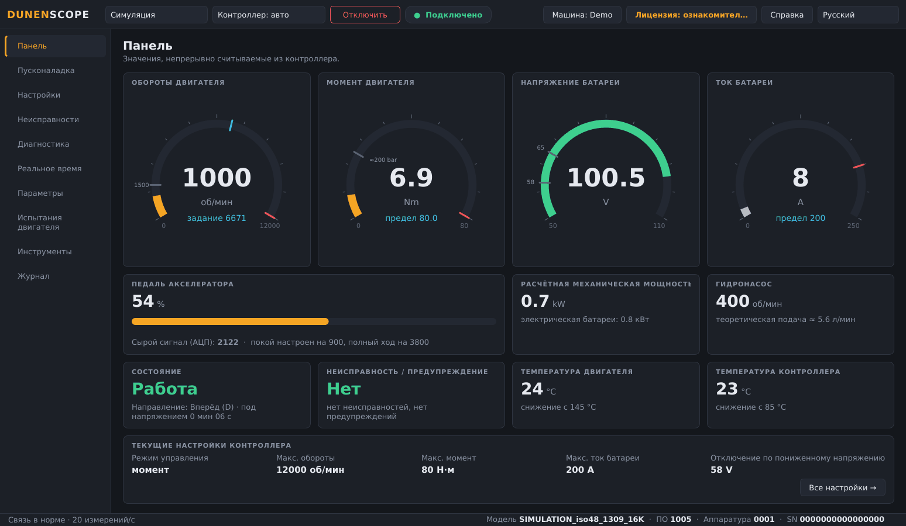
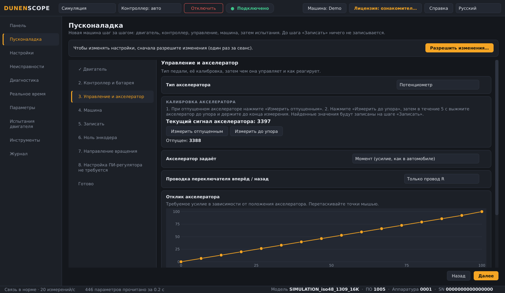
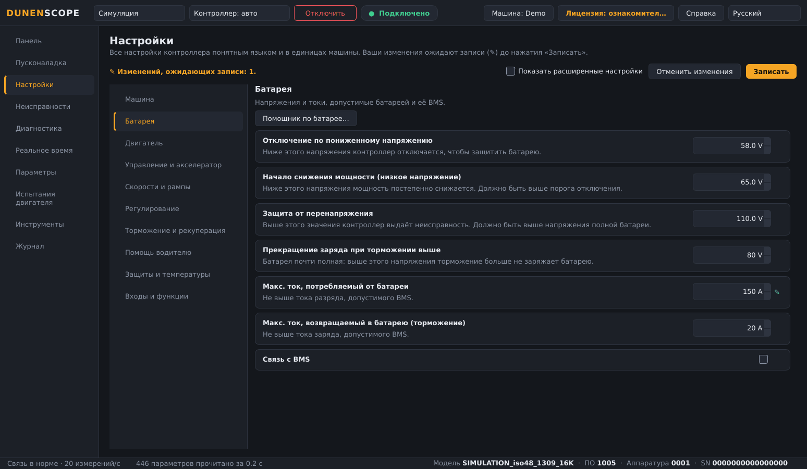
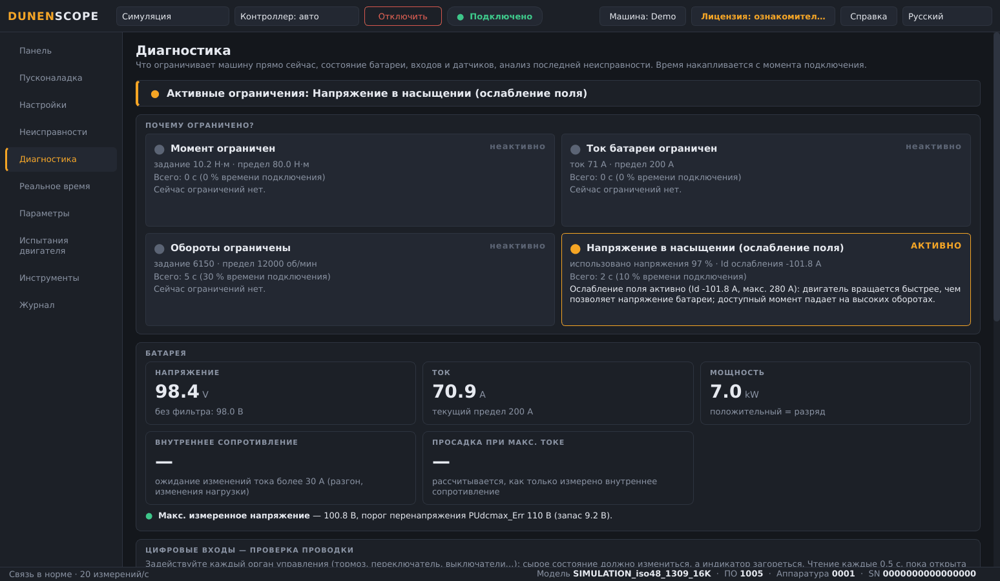
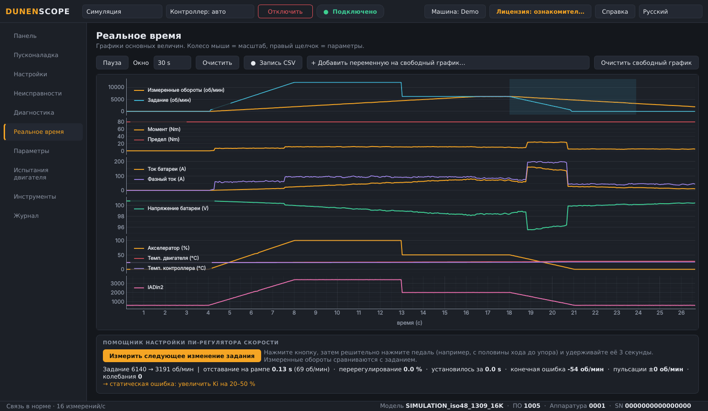
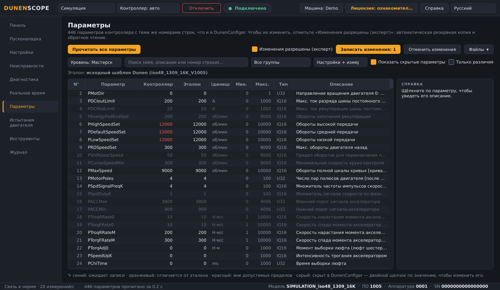
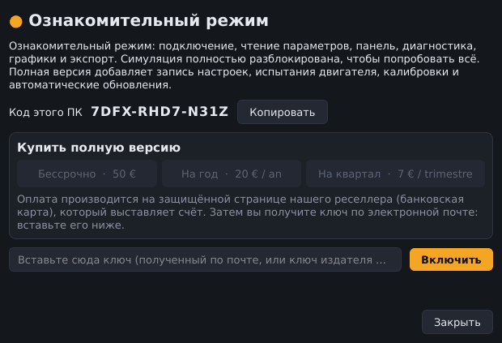

<a href="README.md">English</a> · <a href="README.fr.md">Français</a> · <a href="README.zh.md">中文</a> · <a href="README.es.md">Español</a> · <a href="README.de.md">Deutsch</a> · <a href="README.it.md">Italiano</a> · <a href="README.pt.md">Português (BR)</a> · <b>Русский</b> · <a href="README.ja.md">日本語</a> · <a href="README.ko.md">한국어</a>

Windows 10 / 11 · 64 бита · бесплатный ознакомительный режим

## Программа диагностики и пусконаладки контроллеров двигателей Dunen / ELYX

DunenScope превращает ПК с Windows и CAN-адаптер в полноценный испытательный стенд для контроллеров Dunen / ELYX: видеть, что делает машина, понимать, что её ограничивает, настраивать её и подтверждать результат — за несколько минут и на вашем языке.

## Что умеет DunenScope

- **Пусконаладка** — новая машина шаг за шагом, как в VESC: двигатель, контроллер и батарея, калибровка педали, машина, запись, ноль энкодера, пробное вращение 5 с для проверки направления, настройка ПИ.
- **Понятные настройки** — весь контроллер по категориям, в единицах машины (секунды, %, км/ч, л/мин, м/мин), кривые педали меняются мышью.
- **Подключил и работаешь** — адаптер CAN, скорость шины и адрес контроллера находятся автоматически, модель распознаётся.
- **Быстрая настройка** — несколько вопросов (батарея, обороты, характер езды): настройки рассчитываются и готовятся в списке, со справкой по каждому параметру и проверкой согласованности перед записью.
- **Другие контроллеры** — для модели, которую DunenScope ещё не знает: выбрать протокол, найти отвечающие регистры, дать им имена, смотреть графики и сохранить профиль модели.
- **Пишите нам прямо из программы** — кнопка «Справка» отправляет вашу проблему, идею или вопрос напрямую разработчику; отчёты об ошибках — только с вашего согласия.
- **Панель в реальном времени** — обороты, момент, напряжение и ток батареи, акселератор, мощность, температуры, состояние и неисправности на одном экране; подача насоса или скорость машины по профилю.
- **«Почему ограничено?»** — показывает, какое ограничение действует прямо сейчас (момент, ток батареи, обороты, напряжение) и как долго; внутреннее сопротивление и запасы батареи; проверка проводки каждого входа; время до теплового снижения мощности; анализ последней неисправности.
- **Графики в реальном времени** — шесть синхронных графиков и свободный график из 4 любых переменных, запись CSV.
- **Все 446 параметров** — те же номера строк, что в DunenConfiger, поиск, сравнение с файлом, экспорт в xlsx с повторным импортом в DunenConfiger, CSV.
- **Безопасная запись** — автоматическая полная резервная копия перед каждой записью, повторное чтение, блокировка опасных параметров, обязательная остановка двигателя, сохранение в энергонезависимую память как в DunenConfiger.
- **Настройка ПИ-регулятора скорости** — измерение на машине, пошаговая ручная настройка с подсказками и автонастройка.
- **Испытания двигателя** — заданные обороты или момент, автоопределение угла энкодера, контур тока; СТОП / Esc и автоматическая остановка.
- **Инструменты мастерской** — пакет поддержки одним щелчком (.zip), помощник калибровки акселератора, выходной контроль с отчётом и производственным журналом.
- **Создан для работы на объекте** — 10 языков, адаптеры PEAK PCAN-USB, Kvaser, IXXAT, Vector и SLCAN, профили применения и режим симуляции, чтобы попробовать всё без оборудования.

## Снимки экрана

<table>
<tr><td width="50%" align="center"> Пусконаладка: новая машина шаг за шагом</td><td width="50%" align="center"> Понятные настройки в единицах машины</td></tr>
<tr><td width="50%" align="center"> Диагностика — что ограничивает машину</td><td width="50%" align="center"> Графики в реальном времени и помощник настройки ПИ</td></tr>
<tr><td width="50%" align="center"> Параметры — сравнение, запись, экспорт</td><td width="50%" align="center"> Окно «Лицензия»</td></tr>
</table>

## Бесплатный ознакомительный режим или полная версия

| Функция | Ознакомительный (бесплатно) | Полная версия |
| --- | :---: | :---: |
| Подключение, чтение всех параметров, панель, графики | ✅ | ✅ |
| Диагностика, история неисправностей, выходной контроль, экспорт, пакет поддержки | ✅ | ✅ |
| Режим симуляции со всеми функциями | ✅ | ✅ |
| Автоматические обновления | ✅ | ✅ |
| Запись настроек в реальный контроллер | — | ✅ |
| Испытания двигателя, настройка ПИ, калибровка акселератора | — | ✅ |

### Полная версия

**Бессрочная лицензия 50 €** · **годовая подписка 20 €** · **квартальная подписка 7 €**. Один ключ на ПК, активация за несколько секунд кнопкой **Лицензия** (вверху справа). После активации работает без интернета.

**Купить онлайн:** [Бессрочно — 50 €](https://buy.polar.sh/polar_cl_qO94LG8UMUEZitzRuoHexlgbRA5yJC3UlaF5C1Fv4O9) · [На год — 20 €/год](https://buy.polar.sh/polar_cl_St8xQg80RzRuOiugr63Lz4lFQkZ8MM2BkT6Jx1tNVVB) · [На квартал — 7 €/квартал](https://buy.polar.sh/polar_cl_vjvXcXdimxbXQ3JzsfKf5UKQlYK8jFWHVp7yw0nHOmJ)

Ключ приходит по e-mail: вставьте его в DunenScope → **Лицензия** → **Включить**.

Для подписки достаточно выходить в интернет раз в 45 дней.

## Начало работы

1. Скачайте **DunenScope_Setup** в разделе [Releases](https://github.com/simonlabrossedu71-tech/DunenScope/releases/latest) и запустите его. Если Windows покажет «Система Windows защитила ваш компьютер», нажмите *Подробнее* → *Выполнить в любом случае*.
2. Выберите язык. Установщик предложит драйвер PEAK, если его нет.
3. Подключите CAN-адаптер к контроллеру и включите ключ.
4. Нажмите **Подключить**: DunenScope сам найдёт адаптер, скорость и узел. Оборудования пока нет? Выберите **Симуляция**.
5. Полная версия: кнопка **Лицензия** → вставьте ключ → **Активировать**.

## Требования

- Windows 10 или 11, 64 бита.
- CAN-адаптер: PEAK PCAN-USB (рекомендуется), Kvaser, IXXAT, Vector или SLCAN (CANable…).
- Контроллер Dunen / ELYX с протоколом DunenConfiger (Modbus по CAN, по умолчанию 250 кбит/с).

## Руководства

Полные руководства (PDF), также устанавливаются в меню «Пуск»:

- [English (PDF)](docs/manuals/DunenScope_Manual_EN.pdf) · [Français (PDF)](docs/manuals/DunenScope_Notice_FR.pdf) · [中文 (PDF)](docs/manuals/DunenScope_Manual_ZH.pdf)

## Обновления и безопасность

- Каждый установщик подписан; DunenScope проверяет подпись перед установкой обновления.
- Новые версии бесплатно предлагаются всем пользователям при запуске; настройки, профили и резервные копии сохраняются.
- DunenScope обращается только к службе лицензий и серверу загрузок. Никакие другие данные не покидают ваш ПК.

## Лицензия и меры предосторожности

Устанавливая DunenScope, вы принимаете [лицензионное соглашение](docs/licence/EULA_RU.txt). DunenScope может изменять настройки контроллера и запускать двигатель: работайте только с машиной в безопасном состоянии и с квалифицированным персоналом. Dunen и ELYX являются товарными знаками их владельцев.
