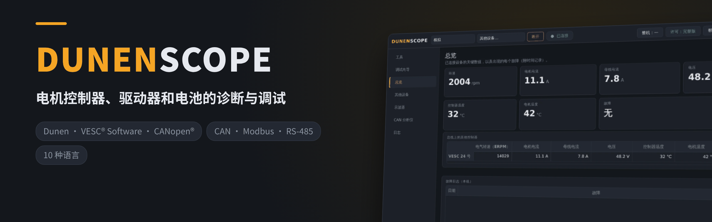
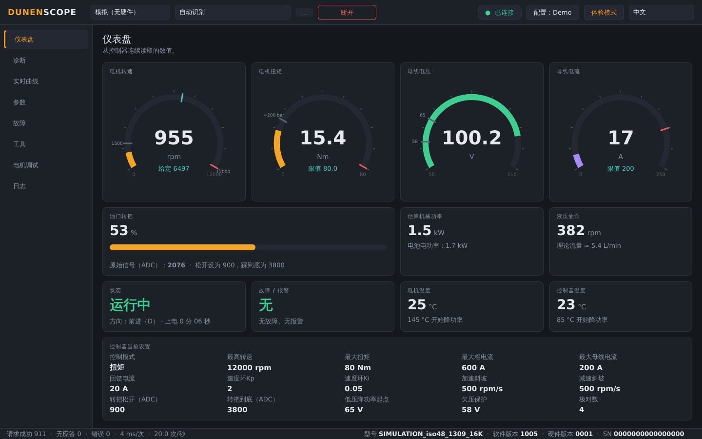
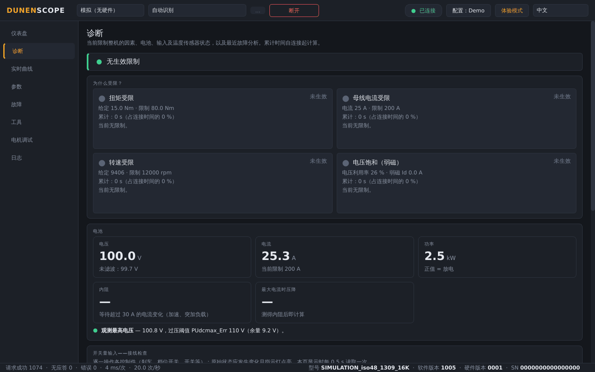
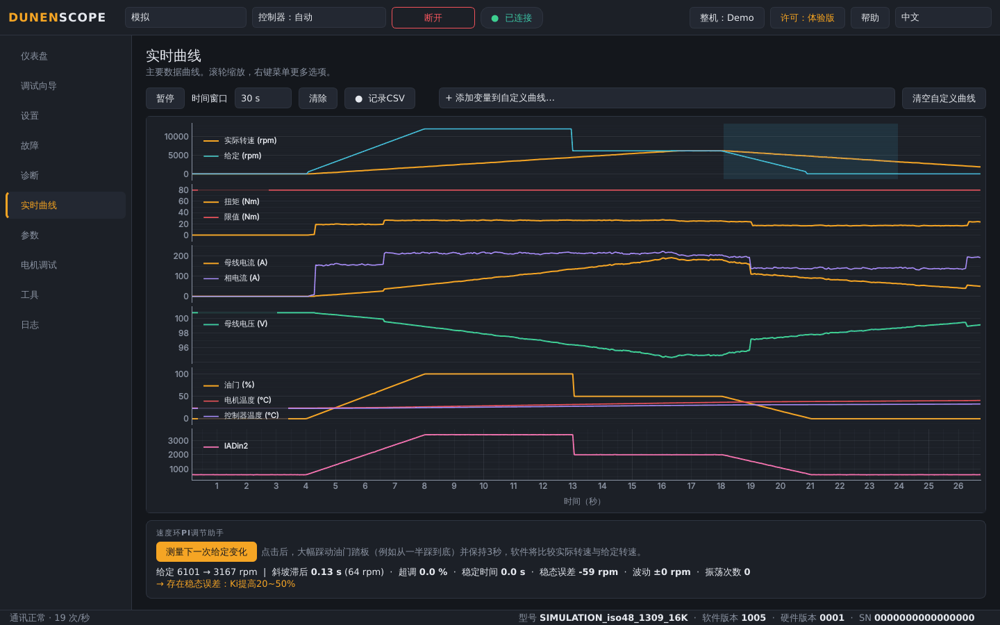
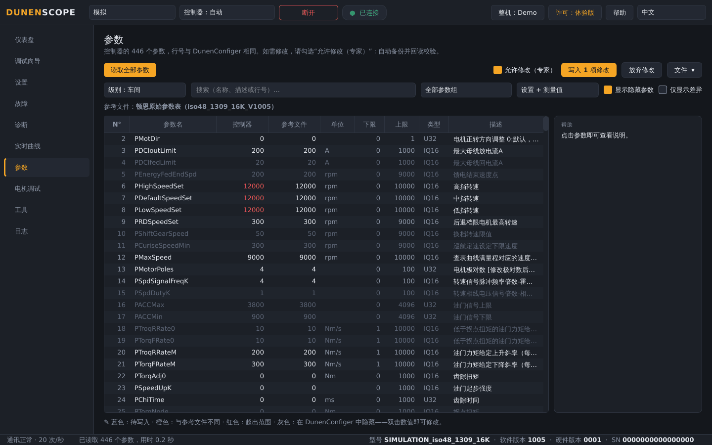
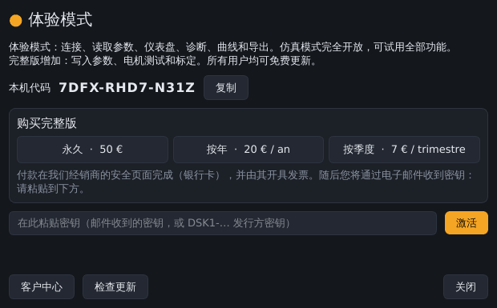

<a href="README.md">English</a> · <a href="README.fr.md">Français</a> · <b>中文</b> · <a href="README.es.md">Español</a> · <a href="README.de.md">Deutsch</a> · <a href="README.it.md">Italiano</a> · <a href="README.pt.md">Português (BR)</a> · <a href="README.ru.md">Русский</a> · <a href="README.ja.md">日本語</a> · <a href="README.ko.md">한국어</a>

Windows 10 / 11 · 64 位 · 免费体验模式

## Dunen / ELYX 电机控制器诊断与调试软件

DunenScope 让一台 Windows 电脑和一个 CAN 适配器成为 Dunen / ELYX 控制器的完整测试台：查看设备运行状态、了解限制因素、完成调校并验证效果——几分钟即可完成，并且支持您的语言。

## DunenScope 的功能

- **实时仪表盘** — 转速、扭矩、电池电压和电流、油门、功率、温度、状态和故障集中在一个界面；可按整机配置显示油泵流量或车速。
- **“为什么受限？”** — 显示当前起作用的限制（扭矩、电池电流、转速、电压）及持续时间；电池内阻和余量；逐个检查输入接线；热降额剩余时间；分析最近一次故障。
- **实时曲线** — 六个同步曲线，外加任选 4 个变量的自由曲线，支持 CSV 记录。
- **全部 446 个参数** — 行号与 DunenConfiger 一致，可搜索、与文件对比、导出可重新导入 DunenConfiger 的 xlsx 以及 CSV。
- **安全写入** — 每次写入前自动完整备份、回读校验、危险参数锁定、必须停机，并像 DunenConfiger 一样保存到永久存储。
- **速度环 PI 整定** — 整机实测、带建议的手动阶跃整定，以及自动整定。
- **电机调试** — 指定转速或扭矩、编码器角度自学习、电流环；STOP / Esc 及自动停止。
- **车间工具** — 一键生成支持包（.zip）、油门标定助手、带报告和生产记录的下线检测。
- **面向现场** — 10 种语言，支持 PEAK PCAN-USB、Kvaser、IXXAT、Vector 和 SLCAN 适配器，应用配置，以及无需硬件即可试用全部功能的仿真模式。

## 界面截图

<table>
<tr><td width="50%" align="center"> 诊断——限制设备的原因</td><td width="50%" align="center"> 实时曲线与 PI 整定助手</td></tr>
<tr><td width="50%" align="center"> 参数——对比、写入、导出</td><td width="50%" align="center"> “许可”窗口</td></tr>
</table>

## 免费体验模式或完整版

| 功能 | 体验版（免费） | 完整版 |
| --- | :---: | :---: |
| 连接、读取全部参数、仪表盘、实时曲线 | ✅ | ✅ |
| 诊断、故障记录、下线检测、导出、支持包 | ✅ | ✅ |
| 仿真模式，全部功能开放 | ✅ | ✅ |
| 自动更新 | ✅ | ✅ |
| 向真实控制器写入参数 | — | ✅ |
| 电机调试、PI 整定、油门标定 | — | ✅ |

### 完整版

**永久授权 50 €** · **年度订阅 20 €** · **季度订阅 7 €**。每个密钥对应一台电脑，点击右上角 **许可** 按钮几秒即可激活。激活后无需联网即可使用。

**在线购买：** [永久 — 50 €](https://buy.polar.sh/polar_cl_qO94LG8UMUEZitzRuoHexlgbRA5yJC3UlaF5C1Fv4O9) · [按年 — 20 €/年](https://buy.polar.sh/polar_cl_St8xQg80RzRuOiugr63Lz4lFQkZ8MM2BkT6Jx1tNVVB) · [按季度 — 7 €/季度](https://buy.polar.sh/polar_cl_vjvXcXdimxbXQ3JzsfKf5UKQlYK8jFWHVp7yw0nHOmJ)

密钥通过电子邮件发送：在 DunenScope 中点击 **许可** → **激活** 粘贴即可。

订阅版每 45 天联网验证一次即可。

## 快速开始

1. 在 [Releases](https://github.com/simonlabrossedu71-tech/DunenScope/releases/latest) 下载 **DunenScope_Setup** 并运行。如果 Windows 提示“Windows 已保护你的电脑”，请点击 *更多信息* → *仍要运行*。
2. 选择语言。如缺少 PEAK 驱动，安装程序会提示安装。
3. 将 CAN 适配器连接到控制器，并打开钥匙开关。
4. 选择适配器、250 kbit/s、节点 1 → **连接**。暂时没有硬件？请选择 **仿真**。
5. 完整版：点击 **许可** 按钮 → 粘贴密钥 → **激活**。

## 系统要求

- Windows 10 或 11，64 位。
- CAN 适配器：PEAK PCAN-USB（推荐）、Kvaser、IXXAT、Vector 或 SLCAN（CANable…）。
- 使用 DunenConfiger 协议的 Dunen / ELYX 控制器（CAN 上的 Modbus，默认 250 kbit/s）。

## 使用说明

完整使用说明（PDF），安装后也可在开始菜单中找到：

- [English (PDF)](docs/manuals/DunenScope_Manual_EN.pdf) · [Français (PDF)](docs/manuals/DunenScope_Notice_FR.pdf) · [中文 (PDF)](docs/manuals/DunenScope_Manual_ZH.pdf)

## 更新与安全

- 每个安装程序都经过签名；DunenScope 在安装更新前会验证签名。
- 所有用户在启动时都会免费收到新版本提示；设置、配置和备份都会保留。
- DunenScope 只连接许可服务和下载服务器，不会有其他数据离开您的电脑。

## 许可与安全须知

安装 DunenScope 即表示您接受[最终用户许可协议](docs/licence/EULA_ZH.txt)。DunenScope 可以修改控制器参数并驱动电机运转：请确保设备处于安全状态，并由合格人员操作。Dunen 和 ELYX 为其各自所有者的商标。
