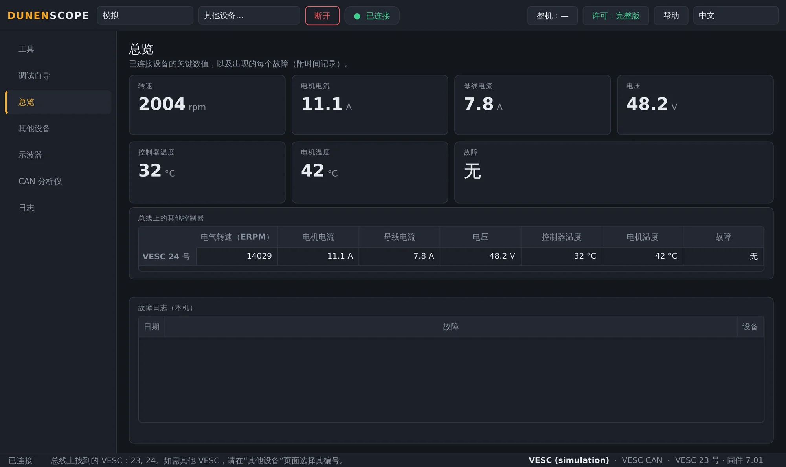
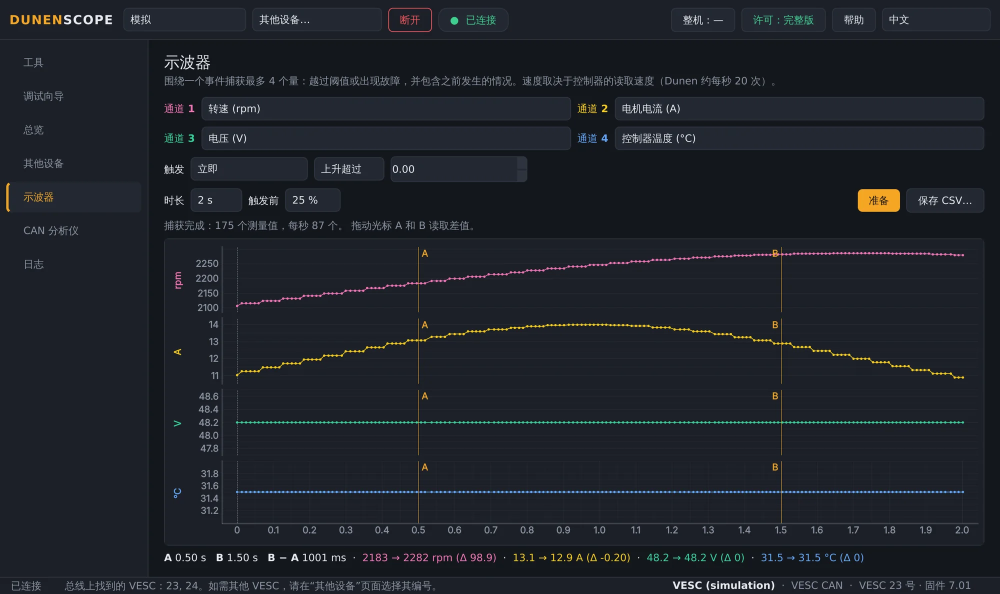
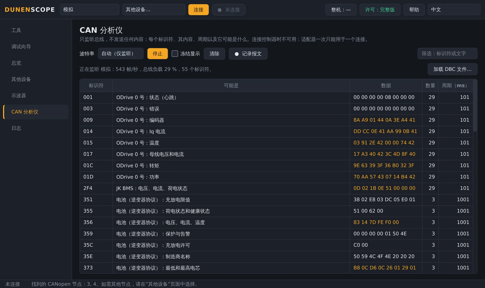
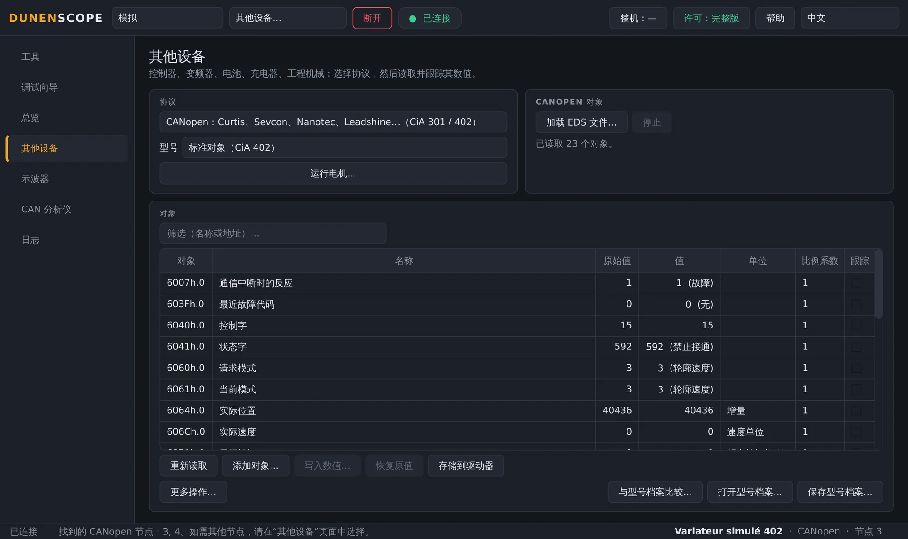
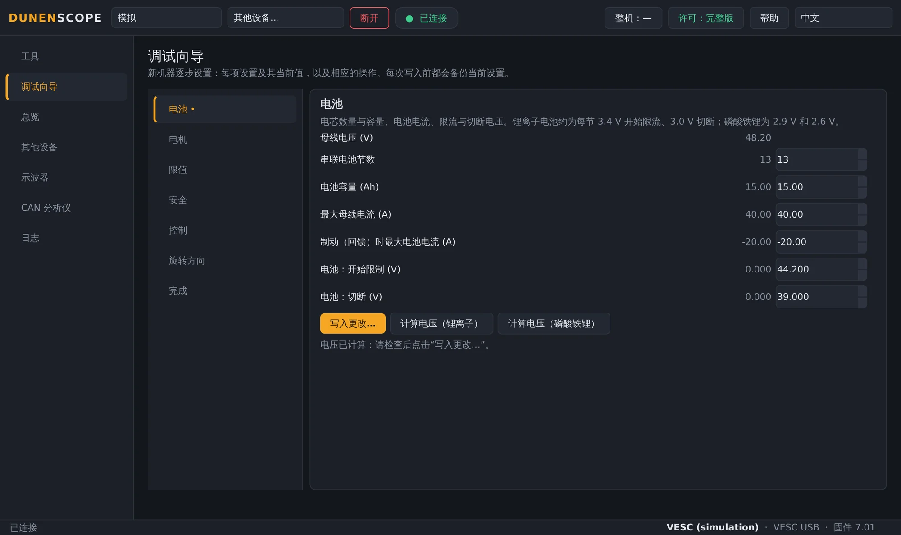
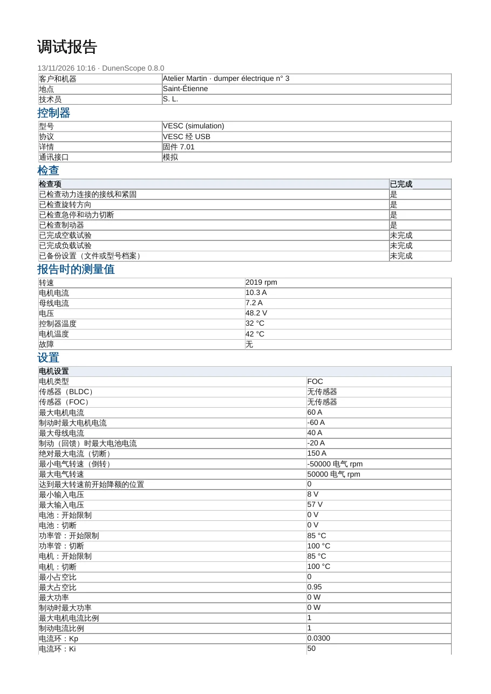
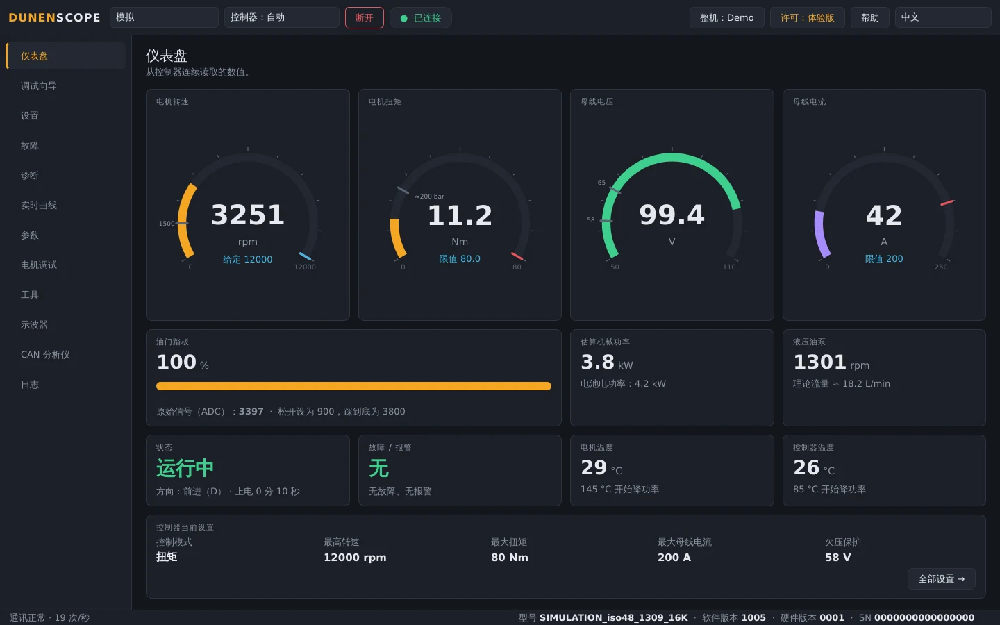
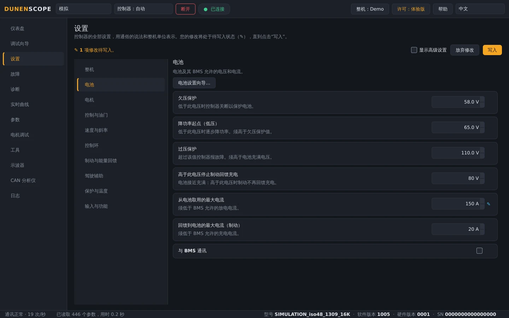

<a href="README.md">English</a> · <a href="README.fr.md">Français</a> · <b>中文</b> · <a href="README.es.md">Español</a> · <a href="README.de.md">Deutsch</a> · <a href="README.it.md">Italiano</a> · <a href="README.pt.md">Português (BR)</a> · <a href="README.ru.md">Русский</a> · <a href="README.ja.md">日本語</a> · <a href="README.ko.md">한국어</a>

Windows 10 / 11 · 64 位 · 免费读取

## 电机控制器、驱动器和电池的诊断与调试

DunenScope 将一台 Windows 电脑和一个 CAN、USB 或 RS-485 适配器变成诊断与调试台：Dunen 控制器、兼容 VESC® Software 的控制器、CANopen® 和 Modbus 驱动器、Kelly、Curtis、Sevcon、BMS 和充电器。它解释每一个故障，保留故障发生前的情况，逐步完成整机设置，并生成调试报告。

> [!TIP]
> **发现错误？缺少设备？** 请在这里提交您的文件：每个请求都会在当天被自动读取和处理——在请求下给出回复，缺少信息时会提问，随后在后续更新中提供修复或加入该设备。
>
> **[报告错误](https://github.com/simonlabrossedu71-tech/DunenScope/issues/new?template=signaler-bug.yml)** · **[添加我的设备](https://github.com/simonlabrossedu71-tech/DunenScope/issues/new?template=nouveau-controleur.yml)**

## 视频（46 秒）

 <a href="https://github.com/simonlabrossedu71-tech/DunenScope/raw/main/docs/video/DunenScope_presentation_en.mp4">下载带声音的完整视频（MP4，16 MB）</a>

## 可读取和调试的设备

在 **其他设备** 页面选择设备（或让 DunenScope 自动识别 Dunen）：

**电机控制器**

- **Dunen / ELYX** — 446 个参数、参数设置、调试向导、电机调试、PI 整定
- **兼容 VESC® Software 的控制器** — 通过 USB 或 CAN：参数设置、调试向导、电机检测
- **Kelly KLS-D、KAC、KBL / KHB** — 通过 CAN 或串口：测量值和故障
- **Votol EM、Fardriver、Bafang（M 系列电机）、ODrive** — 测量值和故障

**工业驱动器**

- **CANopen® CiA 402 驱动器** — Nanotec、Leadshine…：规范或 EDS 文件中的对象、参数设置、电机调试
- **Curtis 1232E 至 1239E、Sevcon Gen4** — CANopen，只读：测量值和故障
- **Modbus RTU 和 TCP** — Schneider ATV320、ASI BAC / Phaserunner、Sabvoton…：寄存器、线圈和输入

**电池和充电器**

- **JK、Daly、JBD / Xiaoxiang BMS，逆变器协议** — 电芯、温度、电流、电量、报警
- **Pylontech 电池（RS-485）、Elcon / TC 充电器** — 只读
- **Victron VE.Direct** — 太阳能控制器、充电器、BMV 和 SmartShunt：仅监听

**工程机械与 CAN 总线**

- **J1939 机械** — 发动机、当前故障
- **DBC 文件** — 任何由 DBC 文件描述的 CAN 总线（Orion BMS 2…）

您的设备不在列表中？请通过 [添加我的设备](https://github.com/simonlabrossedu71-tech/DunenScope/issues/new?template=nouveau-controleur.yml) 表单发送其通信资料（协议手册、EDS、寄存器列表、CAN 记录）。

## DunenScope 的功能

- **自动连接** — 点击一次“连接”：Dunen 立即连接；否则 DunenScope 只监听 CAN 总线（不发送任何数据）和串口，然后连接找到的设备或显示设备列表。
- **调试向导** — 逐步设置一台新整机：电池、电机、限值、安全、旋转方向；每项设置都显示当前值、上下限及其实际对应值。
- **会解释的诊断** — 各品牌的每个故障都附有可能原因和检查要点；黑匣子保存每次故障前 20 秒的数据；可同时监控同一总线上的多个控制器。
- **示波器** — 四通道，可按阈值或在故障出现时触发，保留触发前数据，带光标，可导出 CSV。
- **CAN 分析仪** — 只监听总线、不发送任何数据，并识别每一帧（CANopen、兼容 VESC、Kelly、Dunen、J1939）；显示总线负载，记录可用 Excel 打开。
- **调试报告** — 可交给客户的 PDF：控制器、测量值、全部设置、已勾选的检查项和签名栏。
- **仪表盘与曲线** — 实时显示转速、扭矩、电压、电流、温度、状态和故障；实时曲线，CSV 记录。
- **备份与安全写入** — 每次写入前自动备份、回读校验、电机必须停止、可撤销；可将整机与型号档案逐行比较。
- **在线资料库** — 打开他人分享的型号档案（名称、单位、比例），或分享您自己的档案，始终不含参数值。
- **针对 Dunen** — 全部 446 个参数，编号与 DunenConfiger 一致；以整机单位显示的通俗设置；快速设置；“为什么受限？”；电机调试和 PI 整定；下线检测。
- **模拟与十种语言** — 无需硬件即可试用全部功能，包括故障；界面和故障说明提供 10 种语言。

## 界面截图

<table>
<tr><td width="50%" align="center"> 总览：故障说明，总线上的多个控制器</td><td width="50%" align="center"> 示波器：围绕一个事件捕获的四个量</td></tr>
<tr><td width="50%" align="center"> CAN 分析仪：识别每一帧</td><td width="50%" align="center"> 其他设备：一台 CANopen CiA 402 驱动器</td></tr>
<tr><td width="50%" align="center"> 兼容 VESC 的控制器的调试向导</td><td width="50%" align="center"> PDF 调试报告</td></tr>
<tr><td width="50%" align="center"> Dunen 控制器的仪表盘</td><td width="50%" align="center"> Dunen 的设置，使用整机单位</td></tr>
</table>

## 免费读取，完整版用于调试

| 功能 | 体验版（免费） | 完整版 |
| --- | :---: | :---: |
| 连接、读取全部设置、仪表盘、曲线 | ✅ | ✅ |
| 诊断、故障日志和黑匣子、示波器、CAN 分析仪 | ✅ | ✅ |
| 完整的模拟模式、更新 | ✅ | ✅ |
| 将设置写入控制器、调试向导 | — | ✅ |
| 电机调试、PI 整定、踏板标定 | — | ✅ |

**永久许可 50 €** · **年度订阅 20 €** · **季度订阅 7 €**。每台电脑一个密钥，通过 **许可** 按钮几秒即可激活。激活后无需联网即可使用。

**在线购买：** [永久 — 50 €](https://buy.polar.sh/polar_cl_qO94LG8UMUEZitzRuoHexlgbRA5yJC3UlaF5C1Fv4O9) · [按年 — 20 €/年](https://buy.polar.sh/polar_cl_St8xQg80RzRuOiugr63Lz4lFQkZ8MM2BkT6Jx1tNVVB) · [按季度 — 7 €/季度](https://buy.polar.sh/polar_cl_vjvXcXdimxbXQ3JzsfKf5UKQlYK8jFWHVp7yw0nHOmJ)

密钥通过电子邮件发送：DunenScope → **许可** → 粘贴密钥 → **激活**。订阅版每 45 天联网一次。

## 快速开始

1. 在 [Releases](https://github.com/simonlabrossedu71-tech/DunenScope/releases/latest) 下载 **DunenScope_Setup** 并运行。如果 Windows 提示“Windows 已保护你的电脑”，请点击 *更多信息* → *仍要运行*。
2. 将适配器连接到设备并通电。
3. 保持 **控制器：自动**，点击 **连接**：DunenScope 会找到已连接的设备并与之连接。也可以在 **其他设备** 页面选择协议。
4. 暂时没有硬件？选择 **模拟**：无需连接任何设备即可展示全部功能。

## 所需硬件

- Windows 10 或 11，64 位。
- CAN 适配器：PEAK PCAN-USB（推荐）、Kvaser、IXXAT、Vector、CANable 或 candleLight。
- 视设备而定：兼容 VESC 的控制器的 USB 线、USB-RS485 适配器（Modbus、BMS、Pylontech）或 VE.Direct-USB 线（Victron）。

## 使用说明

完整使用说明（PDF），也随软件一起安装：

- [Français (PDF)](docs/manuals/DunenScope_Notice_FR.pdf) · [English (PDF)](docs/manuals/DunenScope_Manual_EN.pdf) · [中文 (PDF)](docs/manuals/DunenScope_Manual_ZH.pdf)

## 更新与数据

- 每个安装程序都经过签名；DunenScope 在安装更新前会验证签名。
- 启动时免费提示新版本；设置、型号档案和备份都会保留。
- DunenScope 只连接许可服务、更新服务器，以及在您打开时连接在线资料库；“帮助”按钮发出的消息和错误报告仅在您同意后发送。

## 许可与安全

安装 DunenScope 即表示您接受[最终用户许可协议](docs/licence/EULA_ZH.txt)。DunenScope 可以修改控制器设置并使电机运转：请确保设备处于安全状态，并由合格人员操作。随软件提供的开源组件（Qt、PySide6、python-can、libusb…）保留各自的许可证，列于安装文件夹中的 THIRD_PARTY_LICENSES.txt。

DunenScope 与 VESC 项目无关联，也未获其认可。CANopen® 是 CAN in Automation 的注册商标。Dunen、ELYX、Kelly、Curtis、Sevcon、Victron、Pylontech 及文中提及的其他品牌归其各自所有者所有。

发行方：ORDA Engineering SAS，法国圣艾蒂安（Saint-Étienne）。
